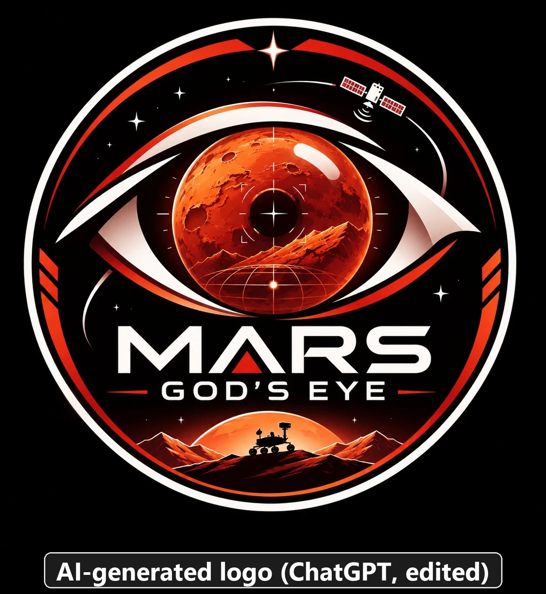
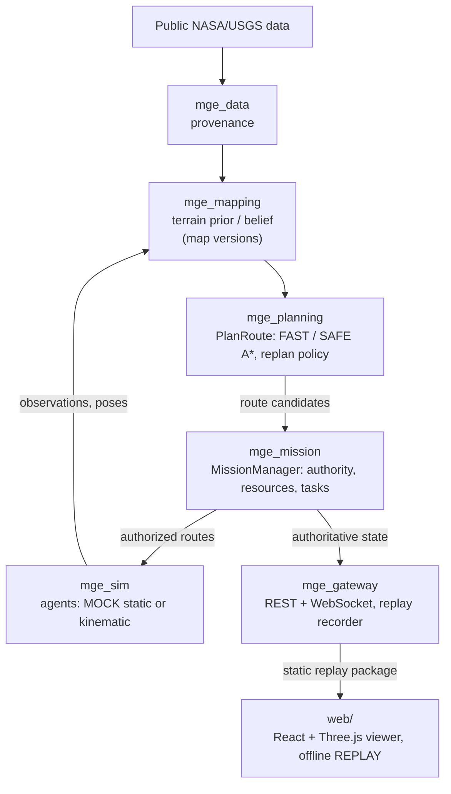
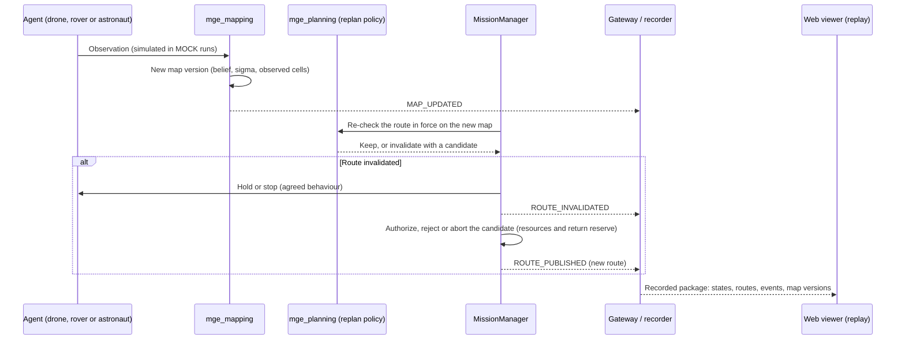
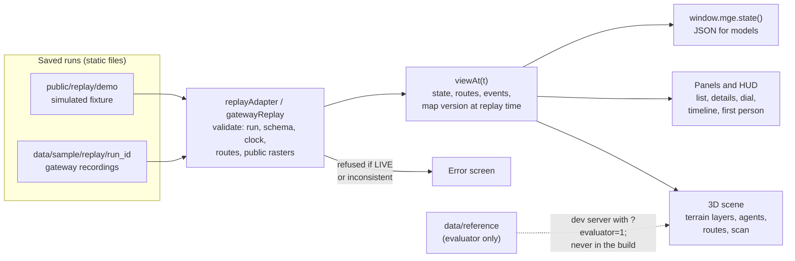
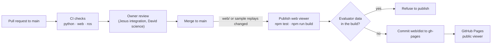

<p align="center">
  
</p>

# MARS GODS EYE

NASA Space Apps 2026 / Interplanetary Survival Guide: Martian Map.
Team: **Houston, We Have a Bug!**

## For judges: the project in one minute

**The problem.** Mars maps from orbit are built for regions, not for a walk.
MOLA altimetry has 463 m pixels; even the CTX stereo terrain model at Jezero has
one height every 20 m. A crew going out on foot with a rover and a drone needs
to know which ground is only *estimated* from orbit, what a route costs in time,
energy and oxygen, and what to do when the ground turns out to differ from the
map.

**What we built.** A prototype planner and 3D replay viewer for a small crew
(astronaut, rover and drone) at Jezero crater:

1. Load public NASA orbital terrain as an estimated map, keeping its uncertainty
   and its source.
2. Propose routes (FAST or SAFE) that check time, energy and oxygen for the way
   out, the work at the stop and the way back, with a reserve.
3. When an observation contradicts the orbital estimate, stop the affected
   crew member, cancel the route and plan a new one from where they actually are,
   with the resources they have left.
4. Record every decision and replay it in a web browser, with no server.

**See it.** [Watch the same-run software recovery (21 s)](https://jorgefajardom-coder.github.io/NASA-GODS-EYE-/media/height-recovery-002.mp4)
([English subtitles](web/public/media/height-recovery-002.en.srt)).
[Explore the six illustrative zones](https://jorgefajardom-coder.github.io/NASA-GODS-EYE-/),
or [open the corrected recorded recovery](https://jorgefajardom-coder.github.io/NASA-GODS-EYE-/?run=recorded-recovery-002).
The latter is a separately identified ROS software recording: one kinematic MOCK
astronaut stops, replans and returns after a SIMULATED terrain contradiction;
rover and parked drone remain idle. It ends READY, not scientific COMPLETE.
The 3D scene consumes saved files. An optional read-only gateway panel can show a running stack; it sends no goals and does not drive the scene.
[Source locks, validation and limitations](evidence/height-reconciliation-20261115/README.md)
accompany this exact package. The historical recording remains unchanged.
[Scientific foundations and analytical pilot results](https://github.com/jorgefajardom-coder/NASA-GODS-EYE-/wiki).
How each challenge requirement is addressed: [project page draft](docs/project_page.md).

**NASA data in the project.**

| Resource | What it does here |
| --- | --- |
| MRO/CTX stereo terrain model, Mars 2020 TRN mosaic (USGS) | Terrain the planner routes over; elevation, slope and contours in the viewer |
| MGS/MOLA global elevation model (NASA PDS) | Regional context: places the study area and checks the vertical alignment of the CTX tile |
| MRO/CTX orthomosaic via [JPL Mars Trek](https://trek.nasa.gov/mars/) | Surface image draped over the terrain (display) |
| USGS SIM 3464 geologic map of Jezero | Geologic units in the viewer (display; boundaries approximate to 100–200 m) |
| Perseverance MEDA, Curiosity REMS, MSL RAD | Weather and radiation context in the viewer (display; RAD measured the dose at Gale crater, the other zones, Jezero included, use RAD's dose-pressure relation) |
| MRO/HiRISE terrain model (USGS) | Held back as a reference for evaluating results; never given to the planner or the viewer |
| Perseverance and Ingenuity 3D models (NASA/JPL-Caltech) | Rover and drone models in the viewer |
| Zone terrain models via JPL Mars Trek: MSL Gale DEM mosaic, Columbia Hills and InSight HiRISE/CTX/HRSC mosaics, Endeavour crater HiRISE DEM, CTX stereo DEM of Melas Chasma | Terrain of the five other zone scenes (display; mission stories there are simulated) |
| Viking MDIM 2.1 colour mosaic via JPL Mars Trek | The Mars globe of the zone selector |
| Mars 2020 and MSL traverse waypoints (MMGIS); PDS Geosciences Node corrected Spirit and Opportunity traverses | Real rover stops drawn on the map and driven in the photo tour |
| Perseverance and Curiosity raw images (NASA/JPL-Caltech public feed) | Real photos at each rover stop and the latest Perseverance images; loaded only on request |
| Mars Odyssey GRS water map; MSL RAD surface dose | Water and radiation context for every zone (display; radiation measured at Gale, estimated elsewhere) |

Sources, versions and file hashes are in [data sources](docs/data_sources.md)
and [NASA traceability](docs/nasa_traceability.md).

**Limits, stated plainly.**

- This is a prototype that replays recorded runs. It is not a live mission or a
  safety system, and it does not certify that any route is safe to walk.
- In the featured recording only the astronaut moves; the rover and drone stay
  idle and the mission ends in READY. A full three-member science mission is not
  yet demonstrated.
- The contradicting observation is simulated, not a real measurement. Time,
  energy and oxygen costs are model estimates pending scientific review.
- Orbital data cannot show rocks or hazards smaller than its 20 m spacing;
  the 4 m planning grid adds no detail.
- The wider 2 km scene and the other five zones are scripted illustrations on
  real terrain: their mission stories are simulated. Their points of interest C
  and D are real NASA science sites (or labelled fictitious where none exists).
- Radiation is a surface average without shielding; solar storms (NASA DONKI
  space weather) are not included.
- AI-generated media carry a visible `AI-generated` mark; all AI use is declared
  in [docs/AI_USAGE.md](docs/AI_USAGE.md).

Evidence for the featured recording: [source, test and browser record](evidence/audit-reconciliation-20261115/runtime-v1/README.md).

## Project status for the team

Mars Gods Eye plans and replays crewed surface missions (astronaut, rover and
drone) over real Mars terrain at Jezero crater: orbital terrain priors, a
resource-aware route planner, a mission authority, a ROS 2 simulation vertical
with a gateway and replay recorder, and a 3D web viewer that plays saved runs
offline.

**Status (2026-11-15): mission authority, planner, data/mapping, gateway and web
viewer are implemented and on `main`, and the public site shows the six Mars zones (PR #36);
PRs #37 (viewer and submission texts) and #38 (auxiliary data layers) are open for review;
integrated mission acceptance is pending.** Nothing in
this repository is a validated LIVE mission. MOCK providers, synthetic
observations, replays and successful builds are labelled as such and are not
mission evidence. Final English video/project-page links and acceptance remain
tracked in the [delivery closure plan](docs/delivery_closure_plan.md) and
[submission checklist](docs/competition.md).

- **Web viewer (public preview):** <https://jorgefajardom-coder.github.io/NASA-GODS-EYE-/>
  — static build of `main`, published automatically on the `gh-pages` branch by
  `.github/workflows/pages.yml` on every push to `main` that touches the viewer (each publish
  commit names its source revision).
  It plays saved runs in REPLAY mode only; it is not connected to a gateway. A text description
  for language models and readers without WebGL is at
  [`llms.txt`](https://jorgefajardom-coder.github.io/NASA-GODS-EYE-/llms.txt) and
  [`about.html`](https://jorgefajardom-coder.github.io/NASA-GODS-EYE-/about.html).
- **Intended submission:** 2026-11-15 20:00 America/Bogota (UTC-05:00), per
  [D-DEL-03](docs/decisions/2026-11-14-delivery-freeze.md); 23:59 is the team
  backstop only. An earlier local cutoff or longer organizer review takes precedence.
- **Delivery gate pending:** local organizer notification and explicit
  endorsement (JES-07 / AC-10 in [the mission checklist](docs/mission_checklist.md))
  are not yet recorded. Reserve at least four hours before final submission;
  silence is not approval. See [AGENTS.md](AGENTS.md), section 15.

## Start here

- [Team branches and ownership](docs/team.md) and
  [continuation plan, 14 November 2026](docs/team_continuation_plan.md) (on `main`)
- [Probable roadmap and owner checklists](docs/mission_checklist.md)
- [Science extension tree: verifiable gates, dependencies and leads](docs/science_extension_tree.md) — freeze remains active; unlisted ideas may be assessed locally for discussion on 15 November 2026 (America/Bogota).
- [Accepted estimated-terrain scope, D-EST-01](docs/decisions/2026-11-14-estimated-terrain-planning.md)
- [NASA resource-to-result traceability](docs/nasa_traceability.md)
- [Proposed shared interface contract](docs/ICD.md) (pending team confirmation),
  [contract baseline](docs/CONTRACT_BASELINE.md) and [replay contract](docs/REPLAY_CONTRACT.md)
- [Launch profiles](docs/LAUNCH_PROFILES.md)
- [Requirements and acceptance](docs/requirements.md),
  [scientific decisions](docs/science_decisions.md) and [competition checklist](docs/competition.md)
- [Integration status](docs/integration_log.md), [integration matrix](docs/INTEGRATION_MATRIX.md)
  and [verification](docs/verification.md)
- Per-owner handoffs: [Jesus](docs/handoffs/jesus.md), [Jorge](docs/handoffs/jorge.md),
  [Diego](docs/handoffs/diego.md), [Daniel](docs/handoffs/daniel.md), [David](docs/handoffs/david.md)
- [Planner handoff](docs/planner_handoff.md) and [temporary data provenance](docs/planner_provenance.md)
- [Required AI declaration](docs/AI_USAGE.md) and [metadata](docs/ai_usage.json)

## System overview



MissionManager alone owns mission state, task eligibility and active-route
policy. The planner returns candidates, the gateway serializes authoritative
state and the web viewer only displays it; it never plans routes. Missing
producers use deterministic, visibly labelled MOCK providers, and exactly one
provider may own each canonical ROS service in a launch profile.

### Map change and replanning

When an observation contradicts the terrain estimate, the route in force is
re-checked on the new map version and the mission authority decides
([D-EST-01](docs/decisions/2026-11-14-estimated-terrain-planning.md),
[replan policy](docs/replan_policy.md)). The policy only recommends; it never
authorizes a route or commands a stop. Integrated execution of this loop on one
run (step 4) is still open.



## Branches and pull requests

Snapshot of the remote on 2026-11-15 (`origin/main` = `9013beb`). See
[docs/team.md](docs/team.md) for the authoritative ownership record. Open pull
requests are pending review: their features are not on `main` or the public site
until they are merged.

| Branch | Owner | State |
| --- | --- | --- |
| `main` | Everyone, via reviewed PRs | Integrated contract and code: PRs #1–#5 and #7–#36 merged |
| `feat/ux` | Jorge | Web viewer. Merged: #5, #19, #23, #27 (route guide, interface entrance, text access), #29 (first-person rework, drone camera, helmet and artificial light, Mars sky, route sufficiency alerts, render tiers) and #36 (Mars globe zone selector, six Mars zones, real NASA science sites, astronaut sites, rover cameras and photo tour, terrain-fitted arrival, MIT License, no-WebGL selector and image provenance fixes) |
| `feat/challenge-gaps` | Jorge | **PR #37 open:** water and radiation for every zone, exhaled CO₂ and per-zone dose in the astronaut HUD, smoother rover camera in the photo tour, the project page in the official form order, the astronaut resources proposal and README updates |
| `feat/integration` | Jesus | ROS interfaces, ICD, gateway, recorder, bringup, sim and CI. Merged: #18, #32 (one-minute summary for judges) and #35 (private-browser replay record for AC-08) |
| `feat/planner` | Diego | Planning engine, snapshot adapter and PlanRoute service. Merged: #2, #12 and #33 (resource safety and scientific cost validation) |
| `feat/data` | Daniel | Public terrain data, mapping, provenance and control points. Merged: #8 and #24. **PR #38 open:** auxiliary Jezero layers (CTX orthoimage and geology) in the data package, published by the data node, with HTTP range caching |
| `feat/mission` | David | Mission authority, resource profiles and acceptance. Merged: #10, #14, #25 (activity cost evidence) and #31 (patch-specific agent campaign proposal) |
| `codex/audit-contract-reconciliation`, `codex/docs-delivery-reconciliation`, `codex/docs-science-extension-tree` | Jesus / David | Merged: #28 (estimated terrain and replay contract reconciliation), #30 (delivery conclusions and scope freeze) and #34 (science extension tree) |
| `codex/mission-replay-recovery` | Jesus (with Jorge's history) | Continuous-pose replan recovery after a stop and strict web replay validation; merged in PR #21 |
| `fix/recorder-shutdown` | Jesus | Recorder shutdown and replanning on new maps; merged in PR #26 |
| `gh-pages` | Jorge + Jesus | Static viewer build from `main`, published by the Pages workflow (last publish: `main` `9013beb`, PR #36) |
| `feature/web-replay-viewer` | Jorge | Historical viewer branch, ancestor of `feat/ux`; PR #6 closed, preserved |
| `docs/agents-policy`, `codex/*` (other) | Owner / Jesus | Merged documentation and reconciliation branches, kept for traceability |

## Layout and owners

| Path | Owner | Purpose |
| --- | --- | --- |
| `src/mge_interfaces` | Jesus + consumers | ROS messages and services |
| `src/mge_data`, `src/mge_mapping`, `data` | Daniel | Provenance, terrain and belief updates |
| `src/mge_planning` | Diego | Pure planning core and ROS service adapter |
| `src/mge_mission`, `config` | David; integration by Jesus | Mission authority, resources and tasks |
| `src/mge_sim`, `src/mge_gateway`, `src/mge_bringup` | Jesus | Simulation adapter, API and launch |
| `web` | Jorge | React / TypeScript / Three.js viewer with offline replay |
| `scripts` | Per script owner | Terrain preparation, benchmarks, conformance and repository checks |
| `tests`, `evidence`, `docs` | Everyone | Verification, immutable runs and contracts |

The evaluator reference is isolated in `data/reference` and must never be
distributed to the planner, mission manager or public mission viewer.

## Web viewer

React 19, TypeScript, Three.js (`@react-three/fiber`, `drei`) and Vite, with
fonts bundled and no CDN or network dependency. Details, architecture and
acceptance status are in [web/README.md](web/README.md).



### Runs and data handling

- REPLAY mode only. The status block shows `REPLAY · <source_mode>` (`MOCK`,
  `SIMULATION` or `UNKNOWN`); a package that claims `LIVE` is refused.
- Default entry: the simulated `demo` on the Jezero CTX crop. The selector offers it and the
  five other zone scenes (`OFFERED_RUNS`: `demo` and every `*-demo`), all simulated stories
  on real terrain; no MOCK runs are offered. `recorded-recovery-001` stays loadable with `?run=`: an unchanged recorder package
  on Daniel's 128 m Jezero crop (32×32 computational cells at 4 m; CTX source
  spacing 20 m). Real data/mapping/planner providers are paired with MOCK mission
  and kinematic execution. The human stops, replans, resumes and returns; rover
  and drone remain idle. Its final `READY` state is not scientific `COMPLETE`.
- `mock-vertical-001`, the historical recorded flat-MOCK sample, also stays loadable
  with `?run=`; both MOCK packages remain in the repository for the team's contract and
  consumer tests. A folder entry can differ from the immutable `run_id` inside its files.
  Never combine metrics or layers between these scenes. Browser/backend-off acceptance
  of this cut remains to be recorded.
- Reads gateway replay packages (ICD §7) and their public raster attachment
  `files.public_rasters` (`mge-public-rasters-1.0.0`), checked against the package;
  mismatches fail with `PUBLIC_RASTERS_INVALID`, and non-MOCK packages without it
  fail with `PUBLIC_RASTERS_REQUIRED`.
- Recorded packages are checked before rendering: record counts, run, schema,
  clock and map identity, immutable routes and recorded raster versions.
- The evaluator reference is shown only in the dev server with `?evaluator=1`;
  the production build never contains it (`tests/referenceIsolation.test.ts`).

### Interface

- Intro screen for the illustrative demo: skippable AI-generated video with one burned-in
  `AI-GENERATED · KLING` mark (`?nointro=1` or reduced motion skips it). The interface then enters: the panels
  slide in, the timeline rises and the agent dial spins into place.
- Zone selector (`Z` in the map view; opens after the intro): a Mars globe built from the Viking
  MDIM 2.1 colour mosaic (JPL Mars Trek) with one point per scene at the centre of its crop.
  The selected zone turns to face the camera and the globe zooms in; a card fitted radially
  against the planet shows the zone's orbital image, a short synopsis and its coordinates.
  Six Mars scenes: Jezero (Perseverance), Gale (Curiosity), Gusev (Spirit), Elysium Planitia
  (InSight), Meridiani Planum (Opportunity) and Valles Marineris (Melas Chasma).
  *Travel* zooms the card image to fill the screen edge to edge (cover, no black bands); on
  arrival the same image lays itself down on the terrain it is draped on, a perspective warp
  onto the projected footprint that follows the camera, then fades into the 3D map. Display
  only; reduced motion skips the warp and simply fades. The photo stays on screen across the
  page change (no loading screen in between). Each card also shows the zone's water and daily
  radiation dose. Without WebGL, or on the 2D tier, the selector runs flat: the same card,
  arrows, dots, keys and *Travel*, without the globe.
- Sites from real NASA science: points C and D are the rover's real science sites where the
  mission has them (Perseverance samples Salette and Swift Run at Jezero; Curiosity drill holes
  Buckskin and Big Sky at Gale; Spirit and Opportunity contact-science rocks at Gusev and
  Meridiani). Astronaut sites: the Three Forks sample depot (Jezero), a science stop the
  astronaut can walk to, and a habitat area chosen by the slope criterion of NASA's human
  Exploration Zone rubric. Each site shows its source (NASA, chosen on NASA terrain or
  fictitious). Reasoning in the [science POI dossier](docs/science_poi_dossier.md).
- Real rover stops and photo tour (*Photo tour*): the simulated rover drives through every real
  stop of the map in NASA's order; at each one the view turns to where each real photo was taken
  and shows it. Perseverance images match the exact stop; Curiosity's feed only gives the sol;
  Spirit and Opportunity have no images in the feed, and the viewer says so.
- Rover cameras and arm (`1`–`5` while following the rover): Navcam, Mastcam-Z with its zoom,
  front and rear Hazcam and WATSON, drawn from the camera nodes of the 3D model with published
  fields of view; an arm close-up. Camera changes ease over about a third of a second instead of jumping, the
  view is stabilised relative to the rover, and the photo tour plays at 5× (10× can be chosen).
- Real images (*Mars now*, `M` in first person, and the Atmos tab): Perseverance and Curiosity
  raw images from NASA's public feed, loaded only on request. Images keep their mission and stop:
  a rover's tour photos are never shown as another rover's latest images.
- Terrain formation: the layer appears flat and its relief rises to the true shape in 1.4 s,
  valleys first and ridges last, with rising ground lit. Switching layers or a new map version
  morphs the heights in 1.8 s instead of jumping. Display only.
- Modes: Exploration, Ground layers, Atmos and Mission replay.
- Terrain layers: Orbital map, Updated map (per map version), Slope (Horn 3x3),
  Uncertainty (sigma) and, for the evaluator only, Reference.
- Real CTX orthomosaic drape, contour lines every 10 m, optional 20 km surroundings,
  close-up procedural ground grain (cosmetic, sampled on rotated grids so no regular
  lines appear) and a solid terrain block.
- Sky at the real present time at the site, the same instant as the Jezero clock: the
  Sun placed with NASA GISS Mars24, a dusty butterscotch day sky with a blue glow around
  the Sun, and at night the 2887 naked-eye stars of the Yale Bright Star Catalogue placed
  with the IAU 2009 rotation model of Mars. `?skytime=<ISO date>` shows another instant.
- Lighting: **artificial light on by default** (terrain lit as by day whatever the hour);
  the *Real light* button (`I`) shows the terrain with the real light of that hour, the
  key light and the astronaut's shadow following the Sun, with a dim night fill.
- Render tiers for any computer: full 3D with a GPU, a lite 3D tier for software
  rasterisers or slow GPUs, and a 2D top-down map without WebGL or when the 3D view
  fails to start; `?render=full|lite|2d` forces one.
- Ground layers: USGS SIM 3464 geologic map with unit list and a schematic
  cut-away block of strata.
- Atmos: water and radiation at every zone (Mars Odyssey GRS water-equivalent hydrogen; MSL
  RAD surface dose, measured at Gale and estimated elsewhere, flagged where it extrapolates;
  an example dose for a 4 h Marswalk, without shielding or solar storms). At Jezero also
  Perseverance MEDA weather, the Curiosity REMS annual cycle at Gale (reference) and the latest
  Perseverance raw images.
- Management list of agents, tasks and routes, contextual details panel, event
  inspector and replan alerts built only from received objects.
- Agent HUD: heading-up minimap plus six gauges (oxygen, energy, time, route,
  atmosphere, dose), amber when a route leaves under 15 % of the starting budget. A second
  press on the oxygen button shows the CO₂ the astronaut has exhaled, as a red tank like the
  oxygen one (oxygen used × an assumed respiratory quotient of 0.85; the suit's CO₂ removal
  capacity is not modelled); a third press goes back to the map. The dose gauge uses each
  zone's own surface rate (measured at Gale, estimated elsewhere) and puts the dose in
  proportion to NASA's 600 mSv career limit (NASA-STD-3001).
- Live Earth and Mars clocks (NASA GISS Mars24: MTC, LMST at Jezero, sol, Ls),
  independent of the replay time.
- Cameras: Map, Astronaut, Rover, Drone and Base; grab-to-drag map and 45° view rotation.
- First person (`V`) from the followed astronaut, rover or drone: drag to look, wheel to zoom
  (18°–110°), supersampled rendering. It opens from black and powers on like a display (shutters,
  short boot log, then each instrument). Its HUD has a compass tape with site bearings, the
  same agent dial as in third person (menu with resources and the heading-up map), the route
  in force draped on the ground with the next waypoint and its distance, and one bottom dock
  with the drone camera and every key control. The 20 km surroundings are always drawn and contours hidden, so the
  ground reaches the horizon. Optional camera sway (`B`).
- Drone camera (`C`, first person): a window showing the scene from the drone, looking ahead
  and 35° down, from the replayed pose (not a video feed).
  A *Map* tab shows the terrain the drone has surveyed so far (observed cells of the map in force
  as a point cloud, the rest as orbital estimate, flight trail); the observations are simulated
  in the replay, not a LiDAR measurement.
- Astronaut helmet lights (`L`): one cool-white spot light at helmet height aimed ahead,
  as EVA suits carry; a display choice, not a suit specification.
- Route sufficiency alerts (first person): each resource is compared with what finishing
  the route in force needs (return included) and what walking back now along the travelled
  path needs, keeping the 20 % JZ-P06 reserve. Amber *Route uses the reserve* (with the
  turn-back point), red *Turn back* and red *Return to base now*. Rationale and NASA sources
  in [docs/route_resource_sufficiency.md](docs/route_resource_sufficiency.md); assumptions
  pending David's review; display only, no live safety check or guaranteed return.
- Terrain scan (`Q` in first person): a 50 m visual pulse from the astronaut that follows the
  relief, draws temporary contours and edges, shows the run's orbital slope classes and NoData
  as small surface-aligned symbols, and lights footprints and the route; 3 s recharge. Display
  only, not a sensor or observation. Inspired by the Odradek scanner of *Death Stranding*;
  no game assets used.
- The astronaut faces the direction it walks (display), also in recorded packages whose human
  orientation is constant.
- Live ROS gateway panel (opt-in, `?gateway=http://127.0.0.1:8010`): a read-only panel that
  connects to a running `mge_gateway` (health, manifest, snapshot and the `/api/events`
  WebSocket, with snapshot polling as fallback) and shows the provenance label from the
  gateway's `source_mode` (a MOCK stack shows MOCK, never LIVE), run, dataset, mission state,
  agents and the newest events. It sends no goals and does not drive the 3D scene, which
  still plays saved runs; the gateway serves no terrain rasters yet. The gateway accepts the
  `http://localhost:5173` origin by default. See "Run the viewer against ROS" below.
- Text access for language models: `llms.txt`, `about.html`, page metadata with JSON-LD, a
  static summary for readers without JavaScript, and `window.mge.state()`, which returns the
  displayed replay state as JSON (always labelled REPLAY).
- Timeline at 1×, 5× and 10×, starting 4 s before the first agent moves.
- Display-only motion: monotone cubic (PCHIP) pose interpolation, astronaut with
  planted feet and shadow, rover steering and suspension, drone rotor spin-up,
  terrain clearance and downwash dust. None of it changes a position in the data.

Keys: `F` follow camera, `V` first person, `Q` terrain scan (first person; rotates the view otherwise), `C` drone camera
(first person), `M` Mars now (first person), `1`–`5` rover cameras, `L` helmet lights, `I` artificial / real light, `B` camera sway (first person),
`G` grab map, `Q` / `E` rotate view, `Z` zone selector (map view; `←` `→`, `Enter` travel, `Esc` back), `Space` play/pause, `←` `→` ±5 s, `Home` restart.

### What is real in the viewer

Everything not listed as real is labelled in the interface as simulated,
illustrative, synthetic or AI-generated.

The recorded recovery uses Daniel's public 128 m dataset and recorded planner
output with explicitly simulated observations and MOCK execution. Its four files
are `manifest.json`, `timeline.jsonl`, `snapshot.json` and `public_rasters.json`.
The source table below describes the separate 2 km illustrative demo where noted;
its geology, imagery and environmental layers are not silently attached to the
recorded scene. Optional layers must match their declared frame and datum.

| Layer or element | Source | Status |
| --- | --- | --- |
| Elevation (Orbital map) | MRO/CTX DTM, Mars 2020 TRN mosaic, USGS Astrogeology ([DOI 10.5066/P906QQT8](https://doi.org/10.5066/P906QQT8)), 2 km crop at 20 m | Real, provisional crop |
| Contour lines | Derived from that elevation every 10 m | Derived from real data |
| Demo slope | Horn 3×3 on that prior, 20 m grid / 60 m computational window | Derived orbital estimate; unresolved local hazards, not a hazard measurement |
| Surroundings (optional) | Same CTX DTM over 20 km, box-averaged to 100 m, and the CTX orthomosaic at 40 m | Real, context only; not part of the mission map |
| Block walls | Display of the crop as a solid block | Plain rock tone, no subsurface claim |
| Surface image | MRO/CTX orthomosaic `JEZ_ctx_B_soc_008`, via [JPL Mars Trek](https://trek.nasa.gov/mars/), 6 m resampled to 5 m | Real, contrast-stretched for display |
| Ground layers (geology) | USGS SIM 3464, Sun and Stack (2020), [doi:10.3133/sim3464](https://doi.org/10.3133/sim3464) | Real map; boundaries 100-200 m approximate |
| Cut-away strata | Unit order from the SIM 3464 interpretations | Schematic: thicknesses and tones not measured |
| Atmos: Jezero weather | Perseverance MEDA daily summaries, NASA Mars weather feed | Real; outreach summary, not the PDS archive |
| Atmos: annual cycle | Curiosity REMS daily summaries at Gale crater | Real, another site; reference only |
| Atmos: radiation | MSL RAD surface averages, Hassler et al. (2014), [doi:10.1126/science.1244797](https://doi.org/10.1126/science.1244797) | Published values; Gale, unshielded estimate |
| HUD: crew dose | The zone's surface dose rate (MSL RAD at Gale; RAD's dose-pressure relation elsewhere) times the replay time, shown against NASA's 600 mSv career limit (NASA-STD-3001) | **Estimate**, not a dosimeter reading; no shielding or solar storms |
| HUD: pressure map | Latest MEDA pressure scaled with height over the area (barometric law, 11.1 km scale height) | **Estimate**, not a measured field |
| HUD: exhaled CO₂ | Oxygen used × an assumed respiratory quotient of 0.85 | **Estimate** pending review; no CO₂ data or suit scrubber capacity |
| HUD: resource use | Drop between the two received samples around the replay time; route cost and reserve as published | Derived from the simulated run |
| Earth and Mars clocks | Device clock; NASA GISS Mars24 algorithm (Allison and McEwen 2000) | Real present time, not the run's time |
| Uncertainty (sigma) | Set by the demo fixture (1 m, 3 m on the surveyed crossing, 0.2 m once observed); the data package uses a constant 2.5 m | **Assumed, not measured** |
| Updated map (v2) | CTX prior plus a simulated drone observation over a scarp added to the hidden reference | **Synthetic** adverse case |
| Mission, agents, routes, budgets, events | `web/scripts/make-demo-fixture.mjs` | **Simulated** story; POIs C and D are real NASA science sites (Salette and Swift Run samples) visited in that story; rover 1 m/s with pivot turns, drone 4 m/s at 40 m with spin-up, vertical climb and descent |
| Shadows, footprints, dust, rotor blur, wheel and steering motion | Derived in the viewer from the drawn poses | **Cosmetic display** only |
| Zone selector globe | Viking MDIM 2.1 colour mosaic, NASA/USGS via [JPL Mars Trek](https://trek.nasa.gov/mars/) (32 level-2 tiles); each zone card shows the orbital image draped on that scene | Real NASA imagery; horizon band from the Melas DEM is decorative, not to scale; synopses are AI-assisted text |
| Zone scenes (Gale, Gusev, Elysium, Meridiani, Melas) | NASA terrain models and orbital mosaics via JPL Mars Trek; real rover stops from MMGIS and the PDS Geosciences Node | Real terrain, imagery and stops; mission stories **simulated** |
| Zone water and radiation | Mars Odyssey GRS (Boynton et al. 2007); MSL RAD (Hassler et al. 2014) and RAD's dose-pressure relation (Guo et al. 2018) | Real orbital and surface-average context; **estimate** outside Gale, flagged outside RAD's measured range; no shielding or solar storms |
| Rover photos at stops and *Mars now* | Perseverance and Curiosity raw images, NASA/JPL-Caltech public feed, loaded on request | Real images, kept with their mission and stop; not terrain data |
| Zone arrival transition | The zone's orbital image warped from full screen onto the projected footprint of its terrain | **Cosmetic display**; no data changes |
| Terrain formation, height morph, interface entrance, camera sway | Viewer animations on the drawn surface and camera | **Cosmetic display**; no height or pose in the data changes |
| Terrain scan | Prior-derived slope classes and NoData around the astronaut, using the current run's grid | **Display only**: not an observation, sensor or route update; display bands are unvalidated |
| First-person route | Route in force as recorded, draped on the ground, with the next waypoint and its distance | Drawn from the received route |
| Route sufficiency alert | Route cost spread per metre, remaining amounts, 20 % reserve (JZ-P06) | **Estimate** for display; experimental reserve, not a NASA standard; pending science review |
| Sun position and sky | NASA GISS Mars24 at the real present time and site latitude/longitude | Real computed position; sky colours are a display rendering |
| Stars | Yale Bright Star Catalogue (Hoffleit & Warren 1991), V ≤ 5.5, IAU 2009 Mars rotation model | Real catalogue positions; no planets, moons, refraction or proper motion |
| Artificial light (default), night fill, helmet lights | Viewer lighting choices | **Display only**, not sunlight or suit specifications |
| Drone camera window | The scene drawn again from the replayed drone pose | **Display only**, not a camera feed |
| Drone survey map (Map tab) | Cells marked observed in the map version in force, belief heights | **Simulated** observations in the replay; not a LiDAR measurement |
| 2D map / lite 3D tiers | Same replay drawn with Canvas 2D or reduced 3D settings | Same data, reduced display |
| Rover and drone models | NASA/JPL-Caltech Perseverance and Ingenuity 3D models | Real models, agency branding removed |
| Astronaut model | Sketchfab, LasquetiSpice, CC BY 4.0 | Third-party asset |
| Astronaut portrait (details panel) | Generated with ChatGPT (OpenAI), `web/public/assets/portraits/human_1.webp` | **AI-generated** image, visible `AI-generated` watermark |
| Surface base | `base-marciana-v2`, generated with OpenAI Codex, prepared by `web/scripts/blender/prepare_base.py` | **AI-generated** 3D model |
| Intro screen | Generated with Kling, `web/public/assets/intro/mars-gods-eye-intro.webm` | **AI-generated** video, one `AI-GENERATED · KLING` mark burned into every frame; audio track declared, played muted |
| Team logo (README, about page) | Generated with ChatGPT (OpenAI) and edited by the team, `web/public/assets/brand/mars-gods-eye-logo.webp` | **AI-generated** image, visible `AI-generated` watermark in every version |
| Link preview | NASA/JPL/USGS Viking global color mosaic ([PIA00407](https://science.nasa.gov/photojournal/global-color-views-of-mars/)), centred on black without text, `web/public/assets/brand/og-image.jpg` | Real NASA image, not AI-generated; no NASA logos or mission marks |
| Browser tab icon | Illustration of Mars made by the team, `web/public/favicon.ico` and PNG sizes (32, 48, 180, 512 px) | Team-made image, not AI-generated; background removed and resized |
| Evaluator reference | MRO/HiRISE DTM ([DOI 10.5066/P9REJ9JN](https://doi.org/10.5066/P9REJ9JN)) | Real; isolated, never in the public build |

Credits and licences are in [THIRD_PARTY_NOTICES.md](THIRD_PARTY_NOTICES.md),
AI use in [docs/AI_USAGE.md](docs/AI_USAGE.md), and the viewer details in
[web/README.md](web/README.md).

Known gaps: the 3D scene does not play a live gateway (only the read-only panel does); the recorded recovery
package has public rasters but no draped imagery, so it shows a plain-coloured
128 m block, and `mock-vertical-001` remains a flat MOCK grid; AC-08 has an automated private-browser replay record with every backend off
([evidence](evidence/web-private-replay-20261115/README.md)) but is not accepted: no person-operated or
public-site check exists and the recorded package is MOCK; J-06
render acceptance and a screen-reader audit are not done.

## Checks without ROS

Use Python 3.12. Activate a virtual environment, then from the repository root:

```sh
python -m pip install -r requirements-dev.txt
python -m pytest
python scripts/check_repository.py
```

Use Node as pinned in `web/.nvmrc` (24.18.0; `package.json` engines `>=24 <25`):

```sh
cd web
npm ci
npm test            # vitest run
npm run typecheck   # tsc -b --noEmit
npm run build       # tsc -b && vite build into dist/
npm run preview     # serve the production build
npm run dev         # development server
npm run fixture     # regenerate the demo replay fixture
```

A static build does not imply a loaded replay or a connected ROS system. Do not
expose ROS DDS to the browser.

CI (`.github/workflows/ci.yml`, "CI checks") runs three jobs: `python`
(repository check and pytest), `web` (`npm test` and `npm run build`) and `ros`
(Jazzy build, interface inspection and the MOCK vertical end to end). The dedicated ROS job
compiles ROS; Python checks on Windows cannot replace it.

`.github/workflows/pages.yml` ("Publish web viewer") runs on pushes to `main` that touch
`web/` or the sample replays: it tests and builds the viewer, refuses a build containing
evaluator reference data, and commits `web/dist` to `gh-pages` (no force push).



## ROS target: Ubuntu 24.04 / ROS 2 Jazzy

Gazebo Harmonic is the intended simulator, installed separately. Native Windows
is not the declared ROS integration target; use prepared Linux/WSL (Ubuntu 24.04
on WSL 2 works with ROS 2 Jazzy desktop and Gazebo Harmonic 8). If `apt-get update`
fails because `packages.ros.org` no longer has a Release file, the machine still
uses the retired ROS apt source; install the current `ros2-apt-source` package as
described in the ROS 2 Jazzy installation guide before updating.

The integration tests also need `python3-fastapi`, `python3-uvicorn`,
`python3-websockets` and `python3-httpx` (apt); without them they are skipped,
not passed. Last local run on 2026-11-14 (WSL 2, Ubuntu 24.04, ROS 2 Jazzy):
8 packages built, `tests/contract tests/unit tests/contracts/test_gateway.py`
284 passed, `tests/integration` 34 passed, none skipped. This checks the MOCK
and real-terrain verticals and the replay recorder; it is not a validated mission.

```sh
source /opt/ros/jazzy/setup.bash
rosdep install --from-paths src --ignore-src -r -y
colcon build --symlink-install
source install/setup.bash
ros2 interface show mge_interfaces/msg/TerrainMeta
ros2 interface show mge_interfaces/srv/PlanRoute
ros2 launch mge_bringup demo.launch.py
```

`demo.launch.py` starts package entrypoints with incomplete default mission
configuration, not an accepted E2E mission. Read the package READMEs.

| Launch file | Purpose |
| --- | --- |
| `vertical_mock.launch.py` | Gateway plus selectable MOCK or real terrain, planner, mission and agents (below) |
| `profile.launch.py` | Exclusive provider profiles `mock`, `integration`, `simulation`, `live` with an approval receipt; see [LAUNCH_PROFILES](docs/LAUNCH_PROFILES.md) |
| `smoke.launch.py` | Static MOCK agent publisher only |
| `demo.launch.py` | Scaffold processes of every package; the gateway reports `NOT_READY` |

None of these launches establishes E2E acceptance.

## Docker alternative for ROS

`scripts/dev.sh` runs any command in a ROS 2 Jazzy container with the
repository mounted. Build the image once; `--build-arg BASE=<image>` selects
another Jazzy base image.

```sh
docker build -t mge-dev docker/
scripts/dev.sh colcon build --symlink-install
scripts/dev.sh python3 -m pytest tests/contract tests/unit tests/integration
```

## Mock integration vertical

After building and sourcing the workspace (or through `scripts/dev.sh`):

```sh
ros2 launch mge_bringup vertical_mock.launch.py run_id:=demo-001
```

This starts the gateway with MOCK agents, terrain, planner and mission from
`mge_sim`. In a second terminal:

```sh
curl http://127.0.0.1:8000/api/manifest
curl -X POST http://127.0.0.1:8000/api/mission/goal \
  -H 'Content-Type: application/json' \
  -d '{"request_id": "req-1", "primary_agent_id": "human_1",
       "base": {"x": 2.5, "y": 2.5}, "goal": {"x": 152.5, "y": 202.5},
       "time_budget_s": 14400, "energy_budget_wh": 1000, "oxygen_budget_l": 1000}'
curl http://127.0.0.1:8000/api/run/demo-001/snapshot
```

Launch arguments of `vertical_mock.launch.py`:

| Argument | Default | Effect |
| --- | --- | --- |
| `run_id` | `mock-run` | Run identifier used by the gateway and recorder |
| `terrain` | `mock` | `real` uses `mge_data` + `mge_mapping` on the public Jezero package (requires `planner:=real`) |
| `planner` | `mock` | `real` routes through `mge_planning`; set `profiles_file` |
| `mission` | `mock` | `real` substitutes the real mission authority; needs explicit configuration and a clock |
| `agents` | `static` | `kinematic` runs the MOCK kinematic executor |
| `agents_file` | per terrain | Agent positions and budgets (illustrative) |
| `record`, `record_dir` | `false`, `evidence` | Write a replay package to `<record_dir>/<run_id>` |
| `host`, `port`, `use_sim_time` | `127.0.0.1`, `8000`, `false` | Gateway binding and clock |

Mission-provider arguments (`mission_profiles_path`, `mission_path`,
`base_enu_m`, `allow_illustrative`, `model_agreement_confirmed`,
`approved_model_id`) are described in the
[real mission provider handoff](docs/mission_integration_handoff.md). Never run
both mission providers.

With the default MOCK planner, routes are straight lines that ignore terrain.
Agent positions and budgets come from `src/mge_bringup/config/agents.yaml` and
are explicitly illustrative. Nothing here is a moving mission or a NASA measurement.

- `planner:=real profiles_file:=$PWD/config/planner_profiles.illustrative.json`
  routes through `mge_planning`. Terrain and mission stay MOCK, positions must be
  cell centres of the 5 m grid (for example `2.5, 2.5`), and the profiles are illustrative.
- `terrain:=real` (with `planner:=real`) loads the public Jezero package: a
  32 x 32 grid of 4 m cells centred on the map origin, so cell centres are
  `-62 + 4 k`. Agents default to `src/mge_bringup/config/agents_jezero.yaml`.
  Under the accepted scope [D-EST-01](docs/decisions/2026-11-14-estimated-terrain-planning.md)
  valid orbital-prior cells start as estimates; until it is implemented, the
  integrated code may still answer a first request with `UNKNOWN`, and a
  SIMULATED observation creates the next map version that triggers a replan.
  Mission and agents stay MOCK and the run is declared MOCK.
- `agents:=kinematic` makes the primary agent follow the authorized active path
  at the speed the route's estimates imply and halt in place, reporting `HALTED`
  with zero velocity, when the route is invalidated. Continuous ground starts
  for replanning from a halted pose exist behind an explicit opt-in (disabled by
  default); PR #21 added the acknowledged-stop recovery that resumes from the
  exact stopped pose (see [the recovery handoff](docs/mission_replay_recovery.md)).

### Run the viewer against ROS

Checked on 2026-11-15 on Windows with WSL 2 (Ubuntu 24.04, ROS 2 Jazzy):
`colcon build` of the 8 packages, `tests/integration/test_vertical_execution.py` and
`test_vertical_mock.py` (12 passed), then this live session. If port 8000 is taken (for
example by Docker), use another one:

```sh
ros2 launch mge_bringup vertical_mock.launch.py run_id:=ros-live-001 port:=8010   terrain:=real planner:=real profiles_file:=$PWD/config/planner_profiles.illustrative.json   agents:=kinematic allow_continuous_starts:=true record:=true record_dir:=$PWD/evidence/live
```

WSL forwards `127.0.0.1:8010` to Windows. Start the viewer's dev server on port 5173
(`npm run dev` in `web/`) and open `http://localhost:5173/?gateway=http://127.0.0.1:8010`:
the panel connects, and a goal sent to `/api/mission/goal` appears in it within a second.
Without a simulated observation the integrated planner still answers `UNKNOWN` and the
mission goes to `BLOCKED` (a legitimate result under D-EST-01). Stopping the launch with
Ctrl+C makes the recorder close `evidence/live/ros-live-001/`, which the viewer opens as
`REPLAY · MOCK` when copied to `web/public/replay/` (not committed).

### Gateway API

Interactive documentation is at `http://127.0.0.1:8000/docs`; the web contract
is in [docs/ICD.md](docs/ICD.md), section 6.

| Method | Path | Purpose |
| --- | --- | --- |
| GET | `/api/health` | ROS connection and terrain metadata flags |
| GET | `/api/manifest` | Run, `source_mode`, terrain metadata, agents and endpoints |
| GET | `/api/run/{run_id}/snapshot` | Mission state, terrain metadata and events |
| GET | `/api/run/{run_id}/events?after_seq=` | Polling fallback for events |
| POST | `/api/mission/goal` | Mission goal request; Bearer token when `MGE_CONTROL_TOKEN` is set |
| WS | `/api/events` | Event and state stream |

Without an active run the endpoints answer `503` with `NO_ACTIVE_RUN`.

## Planner

The planner retains FAST/SAFE joint outbound/service/return A*, validated
continuous human/rover starts behind an explicit opt-in (disabled by default in
the ROS service), D-07 after 20 m and the ROS-independent F03.4 policy with
bounded search retries and outbound/service contingency-return proposals. Its
shared connector extension remains pending owner review; ReplanPolicy is not
wired into MissionManager or the physical supervisor and never authorizes
motion. Existing scientific model-agreement gates remain enforced by the
integrated manager. See [the planning package](src/mge_planning) and
[the replan policy](docs/replan_policy.md).

## Replay package

Add `record:=true` to write a replay package to `evidence/<run_id>` (or to
`record_dir:=<dir>`). A package is a set of static files that can be read
without ROS or the gateway; see [docs/ICD.md](docs/ICD.md), section 7, and
[docs/REPLAY_CONTRACT.md](docs/REPLAY_CONTRACT.md) for the public raster attachment.

```sh
ros2 launch mge_bringup vertical_mock.launch.py run_id:=demo-002 record:=true
ros2 run mge_gateway check_replay evidence/demo-002
```

`data/sample/replay/mock-vertical-001` is a sample recorded from the mock
vertical with `scripts/record_sample_replay.py`. It holds MOCK data only. The
web viewer bundles it as the `mock-vertical-001` run.

## Mission module checks

The proposed profiles are available for formula inspection and sensitivity
checks. They are not silently promoted to operational approval. The ROS node
requires explicit configuration, simulation time and model agreement; see
[the mission package](src/mge_mission/README.md) for startup and boundaries.

To record standalone, synthetic formula estimates in a new evidence directory:

```sh
python scripts/check_mission_models.py --run-id my-model-check --output-dir evidence/my-model-check
```

Existing evidence files are not overwritten. MODEL_CHECK outputs do not establish
actual agent traversal, completed tasks, mission success or an A/B/C result.

See [real mission provider handoff](docs/mission_integration_handoff.md) for exclusive
launch selection, clock/configuration requirements and unchanged scientific gates.

## Open milestones

- Step 4: integrated execution with three agent roles, stop and authorized
  replan on the same run (C3/C4 in the [continuation plan](docs/team_continuation_plan.md)).
- Step 5: offline replay and web video of that same run, validated without
  backends (C5, AC-08).
- D-EST-01 implementation, scientific model agreement and Gazebo acceptance.
- Local organizer notification and endorsement before submission (JES-07 / AC-10).

Varied scenes, larger maps and H-DAN-01 are optional extensions, not substitutes
for these milestones.

## Collaboration and licensing

Read [AGENTS.md](AGENTS.md). Work on your assigned branch; open small PRs to
`main`. Jesus reviews integration, David scientific assumptions. Update the ICD,
producers, consumers and contract tests together when fields/frames/units change.
Use English Conventional Commits and English PR descriptions.

The project's own code and documentation are released under the
[MIT License](LICENSE); every ROS package and the web viewer declare MIT.
The `team@example.invalid` maintainer address in new packages is still a
placeholder to replace before distribution. The MIT License does not cover
third-party material: NASA/USGS data and imagery, fonts, 3D models and other
assets keep their own terms and credits.
Third-party credits and licences are in [THIRD_PARTY_NOTICES.md](THIRD_PARTY_NOTICES.md).

## AI use

AI tools were used in this project as required to be declared by NASA Space Apps.
Where and how is recorded in [docs/AI_USAGE.md](docs/AI_USAGE.md) and
[docs/ai_usage.json](docs/ai_usage.json); AI-generated images and video carry a
visible `AI-generated` watermark, and no AI-generated content is presented as
NASA observational data.
