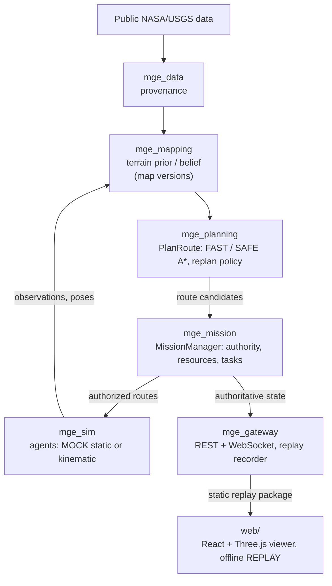
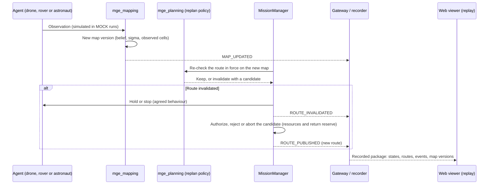
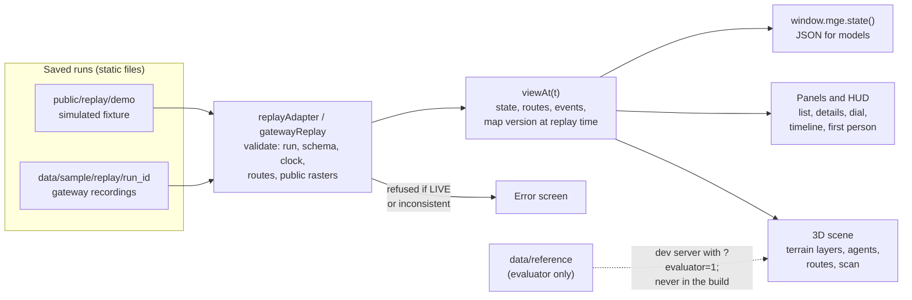
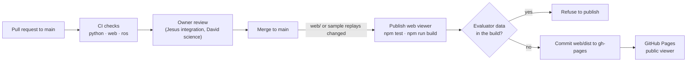

<p align="center">
  
</p>

# MARS GODS EYE

NASA Space Apps 2026 / Interplanetary Survival Guide: Martian Map.
Team: **Houston, We Have a Bug!**

Mars Gods Eye plans and replays crewed surface missions (astronaut, rover and
drone) over real Mars terrain at Jezero crater: orbital terrain priors, a
resource-aware route planner, a mission authority, a ROS 2 simulation vertical
with a gateway and replay recorder, and a 3D web viewer that plays saved runs
offline.

**Status (2026-11-14): mission authority, planner, data/mapping, gateway and web
viewer are implemented and on `main`; integrated mission acceptance is pending.** Nothing in
this repository is a validated LIVE mission. MOCK providers, synthetic
observations, replays and successful builds are labelled as such and are not
mission evidence.

**For judges:** this prototype connects orbital terrain estimates with route
proposals and recorded decision changes when simulated observations contradict
them. The featured `Recorded recovery · MOCK` uses public Jezero terrain and the
real planner: a human stops, receives a revised route and returns. Its closing
state is READY; it does not demonstrate a scientifically accepted three-role
mission or certified safety. The broader scripted demo is a separate illustration.
See [recorded source and browser evidence](evidence/audit-reconciliation-20261115/runtime-v1/README.md).
Final English video/project-page links and acceptance remain tracked in the
[delivery closure plan](docs/delivery_closure_plan.md) and
[submission checklist](docs/competition.md).

- **Web viewer (public preview):** <https://jorgefajardom-coder.github.io/NASA-GODS-EYE-/>
  — static build of `main`, published automatically on the `gh-pages` branch by
  `.github/workflows/pages.yml` on every push to `main` that touches the viewer (each publish
  commit names its source revision).
  It plays saved runs in REPLAY mode only; it is not connected to a gateway. A text description
  for language models and readers without WebGL is at
  [`llms.txt`](https://jorgefajardom-coder.github.io/NASA-GODS-EYE-/llms.txt) and
  [`about.html`](https://jorgefajardom-coder.github.io/NASA-GODS-EYE-/about.html).
- **Team deadline:** 2026-11-15 23:59 America/Bogota (UTC-05:00). Confirm any
  earlier local judging cutoff separately.
- **Delivery gate pending:** local organizer notification and explicit
  endorsement (JES-07 / AC-10 in [the mission checklist](docs/mission_checklist.md))
  are not yet recorded. Reserve at least four hours before final submission;
  silence is not approval. See [AGENTS.md](AGENTS.md), section 15.

## Start here

- [Team branches and ownership](docs/team.md) and
  [continuation plan, 14 November 2026](docs/team_continuation_plan.md) (on `main`)
- [Probable roadmap and owner checklists](docs/mission_checklist.md)
- [Accepted estimated-terrain scope, D-EST-01](docs/decisions/2026-11-14-estimated-terrain-planning.md)
- [NASA resource-to-result traceability](docs/nasa_traceability.md)
- [Proposed shared interface contract](docs/ICD.md) (pending team confirmation),
  [contract baseline](docs/CONTRACT_BASELINE.md) and [replay contract](docs/REPLAY_CONTRACT.md)
- [Launch profiles](docs/LAUNCH_PROFILES.md)
- [Requirements and acceptance](docs/requirements.md),
  [scientific decisions](docs/science_decisions.md) and [competition checklist](docs/competition.md)
- [Integration status](docs/integration_log.md), [integration matrix](docs/INTEGRATION_MATRIX.md)
  and [verification](docs/verification.md)
- Per-owner handoffs: [Jesus](docs/handoffs/jesus.md), [Jorge](docs/handoffs/jorge.md),
  [Diego](docs/handoffs/diego.md), [Daniel](docs/handoffs/daniel.md), [David](docs/handoffs/david.md)
- [Planner handoff](docs/planner_handoff.md) and [temporary data provenance](docs/planner_provenance.md)
- [Required AI declaration](docs/AI_USAGE.md) and [metadata](docs/ai_usage.json)

## System overview



MissionManager alone owns mission state, task eligibility and active-route
policy. The planner returns candidates, the gateway serializes authoritative
state and the web viewer only displays it; it never plans routes. Missing
producers use deterministic, visibly labelled MOCK providers, and exactly one
provider may own each canonical ROS service in a launch profile.

### Map change and replanning

When an observation contradicts the terrain estimate, the route in force is
re-checked on the new map version and the mission authority decides
([D-EST-01](docs/decisions/2026-11-14-estimated-terrain-planning.md),
[replan policy](docs/replan_policy.md)). The policy only recommends; it never
authorizes a route or commands a stop. Integrated execution of this loop on one
run (step 4) is still open.



## Branches and pull requests

Snapshot of the remote on 2026-11-14 (`origin/main` = `b5dc681`). See
[docs/team.md](docs/team.md) for the authoritative ownership record.

| Branch | Owner | State |
| --- | --- | --- |
| `main` | Everyone, via reviewed PRs | Integrated contract and code: PRs #1–#5 and #7–#26 merged |
| `feat/ux` | Jorge | Web viewer; PRs #5, #19, #23 and #27 are merged in main (offline viewer, public raster input, intro, first person, orbital preview, route guide and text access). PR #27 publication baseline: `6bcf208` |
| `feat/integration` | Jesus | ROS interfaces, ICD, gateway, recorder, bringup, sim and CI; last merged in PR #18 |
| `feat/planner` | Diego | Planning engine, snapshot adapter and PlanRoute service; merged in PRs #2 and #12 |
| `feat/data` | Daniel | Public terrain data, mapping, provenance and control points; merged in PRs #8 and #24 (configurable terrain region) |
| `feat/mission` | David | Mission authority, resource profiles and acceptance; merged in PRs #10, #14 and #25 (activity cost evidence) |
| `codex/mission-replay-recovery` | Jesus (with Jorge's history) | Continuous-pose replan recovery after a stop and strict web replay validation; merged in PR #21 |
| `fix/recorder-shutdown` | Jesus | Recorder shutdown and replanning on new maps; merged in PR #26 |
| `gh-pages` | Jorge + Jesus | Static viewer build from `main`, published by the Pages workflow |
| `feature/web-replay-viewer` | Jorge | Historical viewer branch, ancestor of `feat/ux`; PR #6 closed, preserved |
| `docs/agents-policy`, `codex/*` (other) | Owner / Jesus | Merged documentation and reconciliation branches, kept for traceability |

## Layout and owners

| Path | Owner | Purpose |
| --- | --- | --- |
| `src/mge_interfaces` | Jesus + consumers | ROS messages and services |
| `src/mge_data`, `src/mge_mapping`, `data` | Daniel | Provenance, terrain and belief updates |
| `src/mge_planning` | Diego | Pure planning core and ROS service adapter |
| `src/mge_mission`, `config` | David; integration by Jesus | Mission authority, resources and tasks |
| `src/mge_sim`, `src/mge_gateway`, `src/mge_bringup` | Jesus | Simulation adapter, API and launch |
| `web` | Jorge | React / TypeScript / Three.js viewer with offline replay |
| `scripts` | Per script owner | Terrain preparation, benchmarks, conformance and repository checks |
| `tests`, `evidence`, `docs` | Everyone | Verification, immutable runs and contracts |

The evaluator reference is isolated in `data/reference` and must never be
distributed to the planner, mission manager or public mission viewer.

## Web viewer

React 19, TypeScript, Three.js (`@react-three/fiber`, `drei`) and Vite, with
fonts bundled and no CDN or network dependency. Details, architecture and
acceptance status are in [web/README.md](web/README.md).



### Runs and data handling

- REPLAY mode only. The status block shows `REPLAY · <source_mode>` (`MOCK`,
  `SIMULATION` or `UNKNOWN`); a package that claims `LIVE` is refused.
- Featured/default entry: `recorded-recovery-001`, an unchanged recorder package
  on Daniel's 128 m Jezero crop (32×32 computational cells at 4 m; CTX source
  spacing 20 m). Real data/mapping/planner providers are paired with MOCK mission
  and kinematic execution. The human stops, replans, resumes and returns; rover
  and drone remain idle. Its final `READY` state is not scientific `COMPLETE`.
- The selector and `?run=<entry>` also retain `demo`, the separate generated
  story on a provisional 2 km CTX crop at 20 m, and `mock-vertical-001`, the
  historical recorded flat-MOCK sample. A folder entry can differ from the
  immutable `run_id` inside its files. Never combine metrics or layers between
  these scenes. Browser/backend-off acceptance of this cut remains to be recorded.
- Reads gateway replay packages (ICD §7) and their public raster attachment
  `files.public_rasters` (`mge-public-rasters-1.0.0`), checked against the package;
  mismatches fail with `PUBLIC_RASTERS_INVALID`, and non-MOCK packages without it
  fail with `PUBLIC_RASTERS_REQUIRED`.
- Recorded packages are checked before rendering: record counts, run, schema,
  clock and map identity, immutable routes and recorded raster versions.
- The evaluator reference is shown only in the dev server with `?evaluator=1`;
  the production build never contains it (`tests/referenceIsolation.test.ts`).

### Interface

- Intro screen for the illustrative demo: skippable AI-generated video with a burned-in `AI-generated`
  watermark (`?nointro=1` or reduced motion skips it). The interface then enters: the panels
  slide in, the timeline rises and the agent dial spins into place.
- Terrain formation: the layer appears flat and its relief rises to the true shape in 5 s,
  valleys first and ridges last, with rising ground lit. Switching layers or a new map version
  morphs the heights in 1.8 s instead of jumping. Display only.
- Modes: Exploration, Ground layers, Atmos and Mission replay.
- Terrain layers: Orbital map, Updated map (per map version), Slope (Horn 3x3),
  Uncertainty (sigma) and, for the evaluator only, Reference.
- Real CTX orthomosaic drape, contour lines every 10 m, optional 20 km surroundings,
  close-up procedural ground grain (cosmetic) and a solid terrain block.
- Ground layers: USGS SIM 3464 geologic map with unit list and a schematic
  cut-away block of strata.
- Atmos: Perseverance MEDA weather at Jezero, Curiosity REMS annual cycle at
  Gale (reference) and an unshielded radiation estimate from MSL RAD averages.
- Management list of agents, tasks and routes, contextual details panel, event
  inspector and replan alerts built only from received objects.
- Agent HUD: heading-up minimap plus six gauges (oxygen, energy, time, route,
  atmosphere, dose), amber when a route leaves under 15 % of the starting budget.
- Live Earth and Mars clocks (NASA GISS Mars24: MTC, LMST at Jezero, sol, Ls),
  independent of the replay time.
- Cameras: Map, Astronaut, Rover, Drone and Base; grab-to-drag map and 45° view rotation.
- First person (`V`) from the followed astronaut, rover or drone: drag to look, wheel to zoom
  (18°–110°), supersampled rendering. Its HUD has a compass tape with site bearings, the agent's
  resources, a heading-up minimap and a route guide: the route in force draped on the ground,
  a beacon on the next waypoint, its distance, the distance left and the time left scaled from
  the route's own estimate. Optional camera sway (`B`) while walking or driving.
- Orbital slope preview (`R`): displays prior-derived slope cells within 160 m of
  the drone position in display bands (< 8°, 8–15°, ≥ 15°, NoData). It is a visual
  lookup, not a camera observation or mission command; map, sigma and routes do
  not change. The legend separates the computational grid from native source
  spacing; the bands are display choices, not validated safety limits.
- Text access for language models: `llms.txt`, `about.html`, page metadata with JSON-LD, a
  static summary for readers without JavaScript, and `window.mge.state()`, which returns the
  displayed replay state as JSON (always labelled REPLAY).
- Timeline at 1×, 5× and 10×, starting 4 s before the first agent moves.
- Display-only motion: monotone cubic (PCHIP) pose interpolation, astronaut with
  planted feet and shadow, rover steering and suspension, drone rotor spin-up,
  terrain clearance and downwash dust. None of it changes a position in the data.

Keys: `F` follow camera, `V` first person, `R` drone scan, `B` camera sway (first person),
`G` grab map, `Q` / `E` rotate view, `Space` play/pause, `←` `→` ±5 s, `Home` restart.

### What is real in the viewer

Everything not listed as real is labelled in the interface as simulated,
illustrative, synthetic or AI-generated.

The recorded recovery uses Daniel's public 128 m dataset and recorded planner
output with explicitly simulated observations and MOCK execution. Its four files
are `manifest.json`, `timeline.jsonl`, `snapshot.json` and `public_rasters.json`.
The source table below describes the separate 2 km illustrative demo where noted;
its geology, imagery and environmental layers are not silently attached to the
recorded scene. Optional layers must match their declared frame and datum.

| Layer or element | Source | Status |
| --- | --- | --- |
| Elevation (Orbital map) | MRO/CTX DTM, Mars 2020 TRN mosaic, USGS Astrogeology ([DOI 10.5066/P906QQT8](https://doi.org/10.5066/P906QQT8)), 2 km crop at 20 m | Real, provisional crop |
| Contour lines | Derived from that elevation every 10 m | Derived from real data |
| Demo slope | Horn 3×3 on that prior, 20 m grid / 60 m computational window | Derived orbital estimate; unresolved local hazards, not a hazard measurement |
| Surroundings (optional) | Same CTX DTM over 20 km, box-averaged to 100 m, and the CTX orthomosaic at 40 m | Real, context only; not part of the mission map |
| Block walls | Display of the crop as a solid block | Plain rock tone, no subsurface claim |
| Surface image | MRO/CTX orthomosaic `JEZ_ctx_B_soc_008`, via [JPL Mars Trek](https://trek.nasa.gov/mars/), 6 m resampled to 5 m | Real, contrast-stretched for display |
| Ground layers (geology) | USGS SIM 3464, Sun and Stack (2020), [doi:10.3133/sim3464](https://doi.org/10.3133/sim3464) | Real map; boundaries 100-200 m approximate |
| Cut-away strata | Unit order from the SIM 3464 interpretations | Schematic: thicknesses and tones not measured |
| Atmos: Jezero weather | Perseverance MEDA daily summaries, NASA Mars weather feed | Real; outreach summary, not the PDS archive |
| Atmos: annual cycle | Curiosity REMS daily summaries at Gale crater | Real, another site; reference only |
| Atmos: radiation | MSL RAD surface averages, Hassler et al. (2014), [doi:10.1126/science.1244797](https://doi.org/10.1126/science.1244797) | Published values; Gale, unshielded estimate |
| HUD: crew dose | RAD surface average times the replay time | **Estimate**, not a dosimeter reading |
| HUD: pressure map | Latest MEDA pressure scaled with height over the area (barometric law, 11.1 km scale height) | **Estimate**, not a measured field |
| HUD: resource use | Drop between the two received samples around the replay time; route cost and reserve as published | Derived from the simulated run |
| Earth and Mars clocks | Device clock; NASA GISS Mars24 algorithm (Allison and McEwen 2000) | Real present time, not the run's time |
| Uncertainty (sigma) | Set by the demo fixture (1 m, 3 m on the surveyed crossing, 0.2 m once observed); the data package uses a constant 2.5 m | **Assumed, not measured** |
| Updated map (v2) | CTX prior plus a simulated drone observation over a scarp added to the hidden reference | **Synthetic** adverse case |
| Mission, agents, routes, budgets, events | `web/scripts/make-demo-fixture.mjs` | **Simulated**; POIs C and D fictitious; rover 1 m/s with pivot turns, drone 4 m/s at 40 m with spin-up, vertical climb and descent |
| Shadows, footprints, dust, rotor blur, wheel and steering motion | Derived in the viewer from the drawn poses | **Cosmetic display** only |
| Terrain formation, height morph, interface entrance, camera sway | Viewer animations on the drawn surface and camera | **Cosmetic display**; no height or pose in the data changes |
| Orbital slope preview | Prior-derived slope around the drone position, using the current run's grid | **Display only**: not an observation or route update; display bands are unvalidated |
| First-person route guide | Route in force as recorded; time left = route `travel_time_s` × distance share left | Drawn from the received route; time left is an **estimate**, not a prediction |
| Rover and drone models | NASA/JPL-Caltech Perseverance and Ingenuity 3D models | Real models, agency branding removed |
| Astronaut model | Sketchfab, LasquetiSpice, CC BY 4.0 | Third-party asset |
| Astronaut portrait (details panel) | Generated with ChatGPT (OpenAI), `web/public/assets/portraits/human_1.webp` | **AI-generated** image, visible `AI-generated` watermark |
| Surface base | `base-marciana-v2`, generated with OpenAI Codex, prepared by `web/scripts/blender/prepare_base.py` | **AI-generated** 3D model |
| Intro screen | Generated with Kling, `web/public/assets/intro/mars-gods-eye-intro.webm` | **AI-generated** video, `AI-generated` watermark burned into every frame; audio track declared, played muted |
| Team logo (README, about page, link preview) | Generated with ChatGPT (OpenAI) and edited by the team, `web/public/assets/brand/mars-gods-eye-logo.webp` and `og-image.png` | **AI-generated** image, visible `AI-generated` watermark in every version |
| Browser tab icon | Illustration of Mars made by the team, `web/public/favicon.ico` and PNG sizes (32, 48, 180, 512 px) | Team-made image, not AI-generated; background removed and resized |
| Evaluator reference | MRO/HiRISE DTM ([DOI 10.5066/P9REJ9JN](https://doi.org/10.5066/P9REJ9JN)) | Real; isolated, never in the public build |

Credits and licences are in [THIRD_PARTY_NOTICES.md](THIRD_PARTY_NOTICES.md),
AI use in [docs/AI_USAGE.md](docs/AI_USAGE.md), and the viewer details in
[web/README.md](web/README.md).

Known gaps: the viewer does not consume a live gateway; no bundled recorded
package carries public rasters yet, so recorded runs show the flat MOCK grid;
AC-08 (private-browser replay with every backend off) is not recorded; J-06
render acceptance and a screen-reader audit are not done.

## Checks without ROS

Use Python 3.12. Activate a virtual environment, then from the repository root:

```sh
python -m pip install -r requirements-dev.txt
python -m pytest
python scripts/check_repository.py
```

Use Node as pinned in `web/.nvmrc` (24.18.0; `package.json` engines `>=24 <25`):

```sh
cd web
npm ci
npm test            # vitest run
npm run typecheck   # tsc -b --noEmit
npm run build       # tsc -b && vite build into dist/
npm run preview     # serve the production build
npm run dev         # development server
npm run fixture     # regenerate the demo replay fixture
```

A static build does not imply a loaded replay or a connected ROS system. Do not
expose ROS DDS to the browser.

CI (`.github/workflows/ci.yml`, "CI checks") runs three jobs: `python`
(repository check and pytest), `web` (`npm test` and `npm run build`) and `ros`
(Jazzy build, interface inspection and the MOCK vertical end to end). The dedicated ROS job
compiles ROS; Python checks on Windows cannot replace it.

`.github/workflows/pages.yml` ("Publish web viewer") runs on pushes to `main` that touch
`web/` or the sample replays: it tests and builds the viewer, refuses a build containing
evaluator reference data, and commits `web/dist` to `gh-pages` (no force push).



## ROS target: Ubuntu 24.04 / ROS 2 Jazzy

Gazebo Harmonic is the intended simulator, installed separately. Native Windows
is not the declared ROS integration target; use prepared Linux/WSL (Ubuntu 24.04
on WSL 2 works with ROS 2 Jazzy desktop and Gazebo Harmonic 8). If `apt-get update`
fails because `packages.ros.org` no longer has a Release file, the machine still
uses the retired ROS apt source; install the current `ros2-apt-source` package as
described in the ROS 2 Jazzy installation guide before updating.

The integration tests also need `python3-fastapi`, `python3-uvicorn`,
`python3-websockets` and `python3-httpx` (apt); without them they are skipped,
not passed. Last local run on 2026-11-14 (WSL 2, Ubuntu 24.04, ROS 2 Jazzy):
8 packages built, `tests/contract tests/unit tests/contracts/test_gateway.py`
284 passed, `tests/integration` 34 passed, none skipped. This checks the MOCK
and real-terrain verticals and the replay recorder; it is not a validated mission.

```sh
source /opt/ros/jazzy/setup.bash
rosdep install --from-paths src --ignore-src -r -y
colcon build --symlink-install
source install/setup.bash
ros2 interface show mge_interfaces/msg/TerrainMeta
ros2 interface show mge_interfaces/srv/PlanRoute
ros2 launch mge_bringup demo.launch.py
```

`demo.launch.py` starts package entrypoints with incomplete default mission
configuration, not an accepted E2E mission. Read the package READMEs.

| Launch file | Purpose |
| --- | --- |
| `vertical_mock.launch.py` | Gateway plus selectable MOCK or real terrain, planner, mission and agents (below) |
| `profile.launch.py` | Exclusive provider profiles `mock`, `integration`, `simulation`, `live` with an approval receipt; see [LAUNCH_PROFILES](docs/LAUNCH_PROFILES.md) |
| `smoke.launch.py` | Static MOCK agent publisher only |
| `demo.launch.py` | Scaffold processes of every package; the gateway reports `NOT_READY` |

None of these launches establishes E2E acceptance.

## Docker alternative for ROS

`scripts/dev.sh` runs any command in a ROS 2 Jazzy container with the
repository mounted. Build the image once; `--build-arg BASE=<image>` selects
another Jazzy base image.

```sh
docker build -t mge-dev docker/
scripts/dev.sh colcon build --symlink-install
scripts/dev.sh python3 -m pytest tests/contract tests/unit tests/integration
```

## Mock integration vertical

After building and sourcing the workspace (or through `scripts/dev.sh`):

```sh
ros2 launch mge_bringup vertical_mock.launch.py run_id:=demo-001
```

This starts the gateway with MOCK agents, terrain, planner and mission from
`mge_sim`. In a second terminal:

```sh
curl http://127.0.0.1:8000/api/manifest
curl -X POST http://127.0.0.1:8000/api/mission/goal \
  -H 'Content-Type: application/json' \
  -d '{"request_id": "req-1", "primary_agent_id": "human_1",
       "base": {"x": 2.5, "y": 2.5}, "goal": {"x": 152.5, "y": 202.5},
       "time_budget_s": 14400, "energy_budget_wh": 1000, "oxygen_budget_l": 1000}'
curl http://127.0.0.1:8000/api/run/demo-001/snapshot
```

Launch arguments of `vertical_mock.launch.py`:

| Argument | Default | Effect |
| --- | --- | --- |
| `run_id` | `mock-run` | Run identifier used by the gateway and recorder |
| `terrain` | `mock` | `real` uses `mge_data` + `mge_mapping` on the public Jezero package (requires `planner:=real`) |
| `planner` | `mock` | `real` routes through `mge_planning`; set `profiles_file` |
| `mission` | `mock` | `real` substitutes the real mission authority; needs explicit configuration and a clock |
| `agents` | `static` | `kinematic` runs the MOCK kinematic executor |
| `agents_file` | per terrain | Agent positions and budgets (illustrative) |
| `record`, `record_dir` | `false`, `evidence` | Write a replay package to `<record_dir>/<run_id>` |
| `host`, `port`, `use_sim_time` | `127.0.0.1`, `8000`, `false` | Gateway binding and clock |

Mission-provider arguments (`mission_profiles_path`, `mission_path`,
`base_enu_m`, `allow_illustrative`, `model_agreement_confirmed`,
`approved_model_id`) are described in the
[real mission provider handoff](docs/mission_integration_handoff.md). Never run
both mission providers.

With the default MOCK planner, routes are straight lines that ignore terrain.
Agent positions and budgets come from `src/mge_bringup/config/agents.yaml` and
are explicitly illustrative. Nothing here is a moving mission or a NASA measurement.

- `planner:=real profiles_file:=$PWD/config/planner_profiles.illustrative.json`
  routes through `mge_planning`. Terrain and mission stay MOCK, positions must be
  cell centres of the 5 m grid (for example `2.5, 2.5`), and the profiles are illustrative.
- `terrain:=real` (with `planner:=real`) loads the public Jezero package: a
  32 x 32 grid of 4 m cells centred on the map origin, so cell centres are
  `-62 + 4 k`. Agents default to `src/mge_bringup/config/agents_jezero.yaml`.
  Under the accepted scope [D-EST-01](docs/decisions/2026-11-14-estimated-terrain-planning.md)
  valid orbital-prior cells start as estimates; until it is implemented, the
  integrated code may still answer a first request with `UNKNOWN`, and a
  SIMULATED observation creates the next map version that triggers a replan.
  Mission and agents stay MOCK and the run is declared MOCK.
- `agents:=kinematic` makes the primary agent follow the authorized active path
  at the speed the route's estimates imply and halt in place, reporting `HALTED`
  with zero velocity, when the route is invalidated. Continuous ground starts
  for replanning from a halted pose exist behind an explicit opt-in (disabled by
  default); PR #21 added the acknowledged-stop recovery that resumes from the
  exact stopped pose (see [the recovery handoff](docs/mission_replay_recovery.md)).

### Gateway API

Interactive documentation is at `http://127.0.0.1:8000/docs`; the web contract
is in [docs/ICD.md](docs/ICD.md), section 6.

| Method | Path | Purpose |
| --- | --- | --- |
| GET | `/api/health` | ROS connection and terrain metadata flags |
| GET | `/api/manifest` | Run, `source_mode`, terrain metadata, agents and endpoints |
| GET | `/api/run/{run_id}/snapshot` | Mission state, terrain metadata and events |
| GET | `/api/run/{run_id}/events?after_seq=` | Polling fallback for events |
| POST | `/api/mission/goal` | Mission goal request; Bearer token when `MGE_CONTROL_TOKEN` is set |
| WS | `/api/events` | Event and state stream |

Without an active run the endpoints answer `503` with `NO_ACTIVE_RUN`.

## Planner

The planner retains FAST/SAFE joint outbound/service/return A*, validated
continuous human/rover starts behind an explicit opt-in (disabled by default in
the ROS service), D-07 after 20 m and the ROS-independent F03.4 policy with
bounded search retries and outbound/service contingency-return proposals. Its
shared connector extension remains pending owner review; ReplanPolicy is not
wired into MissionManager or the physical supervisor and never authorizes
motion. Existing scientific model-agreement gates remain enforced by the
integrated manager. See [the planning package](src/mge_planning) and
[the replan policy](docs/replan_policy.md).

## Replay package

Add `record:=true` to write a replay package to `evidence/<run_id>` (or to
`record_dir:=<dir>`). A package is a set of static files that can be read
without ROS or the gateway; see [docs/ICD.md](docs/ICD.md), section 7, and
[docs/REPLAY_CONTRACT.md](docs/REPLAY_CONTRACT.md) for the public raster attachment.

```sh
ros2 launch mge_bringup vertical_mock.launch.py run_id:=demo-002 record:=true
ros2 run mge_gateway check_replay evidence/demo-002
```

`data/sample/replay/mock-vertical-001` is a sample recorded from the mock
vertical with `scripts/record_sample_replay.py`. It holds MOCK data only. The
web viewer bundles it as the `mock-vertical-001` run.

## Mission module checks

The proposed profiles are available for formula inspection and sensitivity
checks. They are not silently promoted to operational approval. The ROS node
requires explicit configuration, simulation time and model agreement; see
[the mission package](src/mge_mission/README.md) for startup and boundaries.

To record standalone, synthetic formula estimates in a new evidence directory:

```sh
python scripts/check_mission_models.py --run-id my-model-check --output-dir evidence/my-model-check
```

Existing evidence files are not overwritten. MODEL_CHECK outputs do not establish
actual agent traversal, completed tasks, mission success or an A/B/C result.

See [real mission provider handoff](docs/mission_integration_handoff.md) for exclusive
launch selection, clock/configuration requirements and unchanged scientific gates.

## Open milestones

- Step 4: integrated execution with three agent roles, stop and authorized
  replan on the same run (C3/C4 in the [continuation plan](docs/team_continuation_plan.md)).
- Step 5: offline replay and web video of that same run, validated without
  backends (C5, AC-08).
- D-EST-01 implementation, scientific model agreement and Gazebo acceptance.
- Local organizer notification and endorsement before submission (JES-07 / AC-10).

Varied scenes, larger maps and H-DAN-01 are optional extensions, not substitutes
for these milestones.

## Collaboration and licensing

Read [AGENTS.md](AGENTS.md). Work on your assigned branch; open small PRs to
`main`. Jesus reviews integration, David scientific assumptions. Update the ICD,
producers, consumers and contract tests together when fields/frames/units change.
Use English Conventional Commits and English PR descriptions.

The integrated interfaces/simulation/bringup packages retain their existing MIT
metadata. New packages use `LicenseRef-UNSPECIFIED` and `team@example.invalid`
as explicit placeholders to replace before distribution. The team still needs
to choose and supply the overall project license; dataset licenses are separate.
Third-party credits and licences are in [THIRD_PARTY_NOTICES.md](THIRD_PARTY_NOTICES.md).

## AI use

AI tools were used in this project as required to be declared by NASA Space Apps.
Where and how is recorded in [docs/AI_USAGE.md](docs/AI_USAGE.md) and
[docs/ai_usage.json](docs/ai_usage.json); AI-generated images and video carry a
visible `AI-generated` watermark, and no AI-generated content is presented as
NASA observational data.
