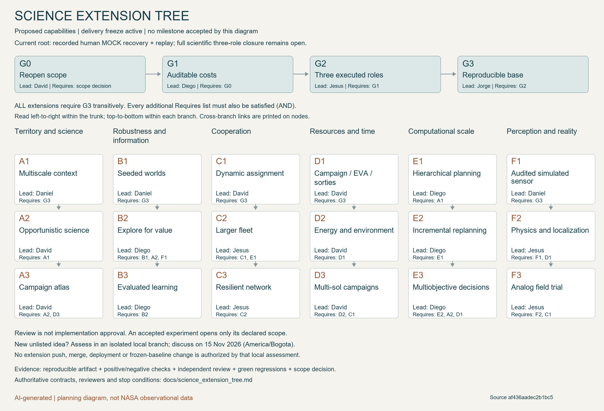
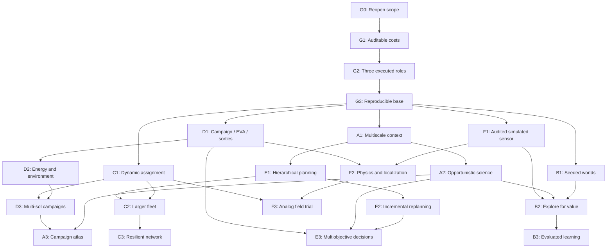

# Science extension tree

<!-- Generated from assets/science-tree/tree.json; source_sha256=af436aadec2b1bc544ad28508e015496f5f9d11a1f58d49222d84c9dd24ef19a -->

Owner-requested research guide, recorded 14 November 2026 (America/Bogota).
Publication input: main `29e9f97b3a4b17e86880afd2b47e4e984f9de4b4`. This is a proposed capability/dependency
tree, not a bibliometric ranking, runtime contract, implementation claim or approved research programme.



[Scalable image](assets/science-tree/science-tree.svg) · [structured source](assets/science-tree/tree.json)

## Freeze and local ideas: owner clarification

[D-DEL-03](decisions/2026-11-14-delivery-freeze.md) remains active. This document does not reopen
integration, change the 15 November 20:00 delivery target or approve maps, profiles, budgets,
extra agents or new models. Scientific and contract gates remain unchanged.

**If a team member thinks of an extension not covered here, they may evaluate it in an isolated
local branch and bring it for discussion tomorrow, 15 November 2026, America/Bogota.**
This explicitly permitted, bounded local assessment is not permission to push an extension,
merge/deploy it, replace the frozen baseline or mark its prerequisites accepted. Preserve
other members' work and label any local MOCK/synthetic inputs. Do not let a local experiment
displace assigned delivery work. Review time/channel are not scheduled by this guide.

Bring a short proposal: question, expected usefulness, required parent milestones, smallest
experiment, source/assumptions, result or blocker, regression risk, owner and decision requested.
Do not force a new idea into an existing node if it needs different evidence. David reviews
scientific value/assumptions and Jesus integration; the owner decides scope. A discussion
tomorrow does not automatically open implementation, even if the idea is attractive.

## Reading the tree and choosing worthwhile work

The evidenced root is narrower human kinematic MOCK recovery and same-run replay, not complete
scientific three-role execution. [Delivery evidence](delivery_closure_plan.md),
[baseline](CONTRACT_BASELINE.md), [ICD](ICD.md) and [D-COST-02](decisions/2026-11-14-shared-scientific-cost-api.md)
retain their actual publication/approval status. No G0-G3 or extension milestone is marked
accepted by adding this document or by generating its image.

All dependencies are **AND**, including cross-branch prerequisites. Every extension depends
transitively on G3; a new operational trial needs accepted prerequisites plus an explicit scope
decision. A local feasibility assessment may identify blockers without accepting any gate.

A prerequisite is an evidenced need/capability, not an obligation to add architecture. If the
unchanged baseline already meets a required target, record that result and review the relevant
dependency before advancing. Do not mark an unimplemented feature complete or implement an
unnecessary optimizer merely to tick a node. Amend this proposed graph through review when a
dependency proves inappropriate; never silently bypass it.

After the base is accepted and scope is reopened, A1 (representative context), B1 (robustness)
and D1 (representative time/resources) are first candidates, not simultaneous commitments.
Choose the one addressing a measured weakness. C1/F1 then test the value of coordination/
acquired information. E1/E2 are conditional on measured computation bottlenecks. The third
levels are long-term horizons; their presence is permission to discuss an idea, not a task order.

### Advancement contract

1. Name one question and a measured baseline weakness; freeze the control revision/inputs.
2. Accept every required parent with linked evidence and reviewers; decide the bounded scope.
3. Before evaluation, declare metrics, N, tolerances, pass/fail and stop conditions.
4. Retain source/config/model/input hashes, seeds, commands, environment, observed results and failures.
5. Pass a positive case, a negative/adversarial case, an independent check and existing regressions.
6. Lead supplies evidence; named reviewers assess it and the owner accepts/rejects scope before expansion.

Evidence states: proposed -> prerequisites reviewed -> bounded trial -> evidence reviewed ->
accepted for its declared scope, or rejected/deferred. A correct negative result closes an experiment
but does not establish a capability it failed to demonstrate. No deadline, green build, appearance
or arbitrary complexity level substitutes for that decision. Increase one experimental axis at a time.

## Complete dependency graph



The image emphasizes branch progression and prints each immediate Requires set.
The graph/structured source preserve every cross-link; no branch bypasses the common gates.

## Milestones and extension contracts

### G0 — Reopen scope

- **Lead:** David. **Reviewers:** Jesus.
- **Requires (AND):** Explicit scope decision under D-DEL-03. **State:** `not_closed_by_this_plan`.
- **Priority/value:** Mandatory scope gate. Protect delivery and preserve a reproducible baseline before investing in extensions.
- **Question:** Has delivery closed, and has the owner explicitly reopened a bounded research scope?
- **Initial scope:** Retain baseline, studies, failures and delivery evidence; select one next experiment. A new explicit owner decision may replace the freeze.
- **Verifiable milestone:** Record the exact scope decision and applicable delivery/endorsement evidence. Local assessment of unlisted ideas is the limited exception below; it grants no integration or milestone acceptance.
- **Stop / limit:** D-DEL-03 remains in force until explicitly changed. No branch merge, deployment or operational activation follows from this tree.

### G1 — Auditable costs

- **Lead:** Diego. **Reviewers:** David, Jesus.
- **Requires (AND):** G0. **State:** `not_closed_by_this_plan`.
- **Priority/value:** Mandatory base gate. A proposed route must fit the mission model and remaining resources.
- **Question:** Do planning, mission audit and accounting agree on the same complete itinerary?
- **Initial scope:** Shared scientific API under D-COST-02, typed activity/wait/model context and reviewed parameters; no expanded scenario.
- **Verifiable milestone:** Independently compare directed motion, connector, service, wait and return within predeclared tolerances. Exercise interrupted work, budget boundaries and duplicate debit; identify exact model/profile/configuration and owner review.
- **Stop / limit:** A projected profile, approval Boolean or one matching case cannot close agreement. Preserve scientific/model rejection gates where required.

### G2 — Three executed roles

- **Lead:** Jesus. **Reviewers:** David, Daniel, Diego.
- **Requires (AND):** G1. **State:** `not_closed_by_this_plan`.
- **Priority/value:** Mandatory base gate: step 4. Turn isolated components into an observable integrated mission.
- **Question:** Do drone, rover and human contribute evidenced work under one mission authority?
- **Initial scope:** Same base case: survey, inspection, human work, contradiction, acknowledged stop, authorized replan and return.
- **Verifiable milestone:** One run links orders, executed footprints, observations, map versions, poses, work intervals and resources. Require HALTED/zero speed/stable pose before replan. Retain no-alternative, unaffordable-return and optional-task accept/reject cases.
- **Stop / limit:** Three markers, assignments or a scripted COMPLETE do not prove execution. Correct blocking is distinct from mission success.

### G3 — Reproducible base

- **Lead:** Jorge. **Reviewers:** Jesus, David.
- **Requires (AND):** G2. **State:** `not_closed_by_this_plan`.
- **Priority/value:** Mandatory base gate: step 5. Attribute later improvements to a controlled change.
- **Question:** Can another member reproduce and audit the exact mission and its failures?
- **Initial scope:** Close scientific and gateway evidence, replay/video that same run and pin the comparison baseline.
- **Verifiable milestone:** Retain source/config/input hashes, seeds, closed work/traversal/resource audit and exact run IDs. Replay offline on two machines with causal seek and same-run video. Repeat with N and tolerances agreed before evaluation; retain failures.
- **Stop / limit:** Green CI or a video of another run does not close the gate. Do not change the control while evaluating an extension.

### A1 — Multiscale context

- **Lead:** Daniel. **Reviewers:** David, Diego, Jorge.
- **Requires (AND):** G3. **State:** `proposed_frozen_for_integration`.
- **Priority/value:** First candidate: scientific representativeness. Add geological context and meaningful station alternatives without confusing extent and detail.
- **Question:** Does 512-1024 m context improve selection of 128/256 m work windows?
- **Initial scope:** One supported candidate sector, same model and grid; regional context may remain outside the operational graph.
- **Verifiable milestone:** Verify coverage, CRS/datum, NoData, native resolution, non-collinear controls and hashes. Declare load/search limits first; compare whether the larger context changes a justified science choice.
- **Stop / limit:** Keep the smaller map if extra area is empty, misses the feature or exceeds limits. Never move A/B or inflate budgets to force success.

### A2 — Opportunistic science

- **Lead:** David. **Reviewers:** Diego, Jesus, Daniel.
- **Requires (AND):** A1. **State:** `proposed_frozen_for_integration`.
- **Priority/value:** After traceable science selection. Gain evidenced scientific value while preserving primary work and return.
- **Question:** Can an observation during travel improve selection of secondary work?
- **Initial scope:** Explicit objectives and utility rubric, public discovery evidence and MissionManager assignment.
- **Verifiable milestone:** Compare against a fixed plan under identical conditions. Record completed science under a reviewed rubric, rejected optional work, return and reserves. No hidden future-task catalogue reaches the runtime.
- **Stop / limit:** Visited-POI count alone is not scientific value. Without defensible utility or a changed decision, do not add an optimizer.

### A3 — Campaign atlas

- **Lead:** David. **Reviewers:** Daniel, Jesus, Diego, Jorge.
- **Requires (AND):** A2, D3. **State:** `proposed_frozen_for_integration`.
- **Priority/value:** Long-term horizon. Connect regional science selection, stations and campaign logistics.
- **Question:** Does the strategy remain useful across regions and campaign lengths?
- **Initial scope:** Multiple supported sectors with declared domain limits; no claim of operational Martian campaigns.
- **Verifiable milestone:** External review of science/product coverage and campaign ledger; evaluate regions not used to tune the strategy and publish unsupported cases.
- **Stop / limit:** Jezero success does not establish planetary generalization. Without comparable coverage/models, keep a catalogue of proposals.

### B1 — Seeded worlds

- **Lead:** Daniel. **Reviewers:** David, Diego, Jesus.
- **Requires (AND):** G3. **State:** `proposed_frozen_for_integration`.
- **Priority/value:** First candidate: adaptation robustness. Distinguish adaptation from a single scripted scene.
- **Question:** Does the planner handle structurally different hypothetical worlds correctly?
- **Initial scope:** H-DAN-01: bounded assumed relief, obstacles and footprints with fixed prior, model and budgets. Controlled families precede random seeds.
- **Verifiable milestone:** Same seed/configuration yields the same array hash. Open/detour/blocked families show structural diversity. Keep evaluator worlds private and terrain/sensor/policy random streams separate; declare N and criteria before running.
- **Stop / limit:** Do not select seeds for a preferred story. Different seeds may correctly yield the same route. Cosmetic noise is not structural diversity or new observed resolution.

### B2 — Explore for value

- **Lead:** Diego. **Reviewers:** David, Daniel, Jesus.
- **Requires (AND):** B1, A2, F1. **State:** `proposed_frozen_for_integration`.
- **Priority/value:** After observation and utility validation. Justify reconnaissance by better decisions and its own costs.
- **Question:** Which observation reduces useful uncertainty before committing resources?
- **Initial scope:** Compare no reconnaissance, corridor survey and informative survey on identical worlds.
- **Verifiable milestone:** Measure success/return, total exploration cost, replans, rejected segments and science work, including failures. Require a predeclared benefit over simple policies with equal initial information/seeds.
- **Stop / limit:** Global uncertainty reduction is insufficient without useful decisions. Keep the simple policy when benefit does not exceed cost.

### B3 — Evaluated learning

- **Lead:** Diego. **Reviewers:** David, Daniel.
- **Requires (AND):** B2. **State:** `proposed_frozen_for_integration`.
- **Priority/value:** Long-term horizon. Address a measured classical-method gap, if one exists.
- **Question:** Does a learned component improve results outside its training/tuning worlds?
- **Initial scope:** One perception or policy component per experiment; retain the classical baseline and separated labels/data.
- **Verifiable milestone:** Split by worlds/sites, use unseen seeds, prevent leakage, retain uncertainty/rejection behavior and run an ablation. Demonstrate a predeclared improvement over the baseline.
- **Stop / limit:** Discard if it fails to generalize or justify cost/robustness. Simulation success does not establish transfer to Mars or certification.

### C1 — Dynamic assignment

- **Lead:** David. **Reviewers:** Jesus, Diego.
- **Requires (AND):** G3. **State:** `proposed_frozen_for_integration`.
- **Priority/value:** After three fixed roles execute. Make cooperation adaptive before adding robots.
- **Question:** Does changing who surveys or inspects improve an event-driven mission?
- **Initial scope:** Same three agents, capabilities/orders/resources per ID and a single mission authority.
- **Verifiable milestone:** Compare to fixed roles: one justified reassignment and one correctly rejected reassignment. Verify precedence, completed work, independent ledgers and nonconflicting orders/reserves.
- **Stop / limit:** Keep fixed roles if no relevant case improves. A larger agent list is not cooperation.

### C2 — Larger fleet

- **Lead:** Jesus. **Reviewers:** David, Diego.
- **Requires (AND):** C1, E1. **State:** `proposed_frozen_for_integration`.
- **Priority/value:** Conditional on marginal benefit. Increase coverage/redundancy only when they justify coordination and consumption.
- **Question:** Does each additional agent deliver net useful work?
- **Initial scope:** Increase N one step at a time; account for space, task and resource conflicts.
- **Verifiable milestone:** Against three agents, measure marginal completed work, total cost/latency, conflicts and recovery from one failure. Predeclare compute limits and preserve identity on every order.
- **Stop / limit:** Stop scaling when gain disappears or limits fail. More published states or drawn coverage do not count as executed work.

### C3 — Resilient network

- **Lead:** Jesus. **Reviewers:** David, Diego.
- **Requires (AND):** C2. **State:** `proposed_frozen_for_integration`.
- **Priority/value:** Long-term horizon. Preserve coherence and return when information is not instantaneous.
- **Question:** How does valid authority survive delayed, lost or unavailable communication?
- **Initial scope:** First degrade communications under central authority; decentralize only if necessary.
- **Verifiable milestone:** Inject losses/reordering/partitions and test command expiry, stale maps, no double assignment and finite-resource wait/return behavior.
- **Stop / limit:** Do not distribute decisions without verified authority/recovery rules. Silence cannot imply safe state or completed work.

### D1 — Campaign / EVA / sorties

- **Lead:** David. **Reviewers:** Diego, Jesus.
- **Requires (AND):** G3. **State:** `proposed_frozen_for_integration`.
- **Priority/value:** First candidate: representative horizons. Avoid imposing the human demonstration horizon on the rover campaign.
- **Question:** Which horizons/resources make cooperation useful on a real patch?
- **Initial scope:** Separate rover campaign, human EVA and drone sorties with a global clock and cumulative ledger. Review CAM proposals without automatic adoption.
- **Verifiable milestone:** Use actual mapped routes and reviewed work/wait/return costs, remaining availability between phases and joint sensitivity. Review allocations/parameters; nominal fit by construction is insufficient.
- **Stop / limit:** Reject/reduce scope when adverse cases fail or a phase balance is missing. Longer time/battery allocations are not demonstrated hardware capacity.

### D2 — Energy and environment

- **Lead:** David. **Reviewers:** Daniel, Diego, Jesus.
- **Requires (AND):** D1. **State:** `proposed_frozen_for_integration`.
- **Priority/value:** After complete phase accounting. Make waiting, recharge or exposure influence planning through a justified model.
- **Question:** When does an environmental condition change a decision, with what uncertainty?
- **Initial scope:** One phenomenon at a time: generation/recharge, thermal state or environmental exposure under reviewed assumptions.
- **Verifiable milestone:** Close cumulative balances with units/intervals and boundary cases. Identify sources/analogs, spatial/temporal transfer, sensitivity and missing-input rejection; compare with the model without this component.
- **Stop / limit:** Do not derive safety thresholds from historical context or reset batteries. A display layer is not a validated predictive model.

### D3 — Multi-sol campaigns

- **Lead:** David. **Reviewers:** Jesus, Diego.
- **Requires (AND):** D2, C1. **State:** `proposed_frozen_for_integration`.
- **Priority/value:** Long-term horizon. Plan prior scouting, rest, maintenance and work windows.
- **Question:** Does a longer campaign improve science/return without hidden inter-day consumption?
- **Initial scope:** Complete agenda, agent availability and contingencies; no assumption of real hardware autonomy.
- **Verifiable milestone:** Close ledgers between sols, include sleep/heating/recharge/activity and interrupt/recover causally. Compare with a shorter campaign on equivalent objectives.
- **Stop / limit:** No full-campaign authorization with NOT_ESTIMATED intervals or unmodeled resources. A sortie budget does not establish campaign capacity.

### E1 — Hierarchical planning

- **Lead:** Diego. **Reviewers:** Daniel, Jesus, David.
- **Requires (AND):** A1. **State:** `proposed_frozen_for_integration`.
- **Priority/value:** Only after a measured scale bottleneck. Keep useful response times once larger area adds scientific value.
- **Question:** Does regional/local decomposition preserve solution quality and constraints?
- **Initial scope:** One hierarchical strategy on the same problem/model; keep the baseline solver as reference.
- **Verifiable milestone:** Compare reference-solvable cases, costs/return, p50/p95 latency, memory and UNKNOWN reasons. Include corridor/locality counterexamples; declare any loss of optimality.
- **Stop / limit:** Do not add hierarchy if the solver already meets limits or the approximation loses important alternatives. Do not hide scaling by raising timeouts.

### E2 — Incremental replanning

- **Lead:** Diego. **Reviewers:** Jesus, David.
- **Requires (AND):** E1. **State:** `proposed_frozen_for_integration`.
- **Priority/value:** Only after correctness and useful reuse. Reduce repeated work while retaining declared guarantees.
- **Question:** Can reuse accelerate changes without preserving obsolete information?
- **Initial scope:** One search/cache mechanism; preserve map, cost and authorization semantics.
- **Verifiable milestone:** Compare full recomputation under map changes, removed obstacles, changed costs and continuous poses. Test invalidation and measure benefit at equal load.
- **Stop / limit:** An incorrect cache hit fails acceptance. Keep simple recomputation without reproducible benefit or with stale answers.

### E3 — Multiobjective decisions

- **Lead:** Diego. **Reviewers:** David, Jorge.
- **Requires (AND):** E2, A2, D1. **State:** `proposed_frozen_for_integration`.
- **Priority/value:** Long-term horizon. Expose science/time/consumption/uncertainty tradeoffs.
- **Question:** Does the team need alternatives that one objective cannot express?
- **Initial scope:** A bounded set of explainable alternatives, measurable objectives and mission/human selection.
- **Verifiable milestone:** Show useful changed decisions, verify dominance and each alternative's budget/return, test sensitivity and keep compute cost bounded.
- **Stop / limit:** SAFE is not certification and science utility cannot be arbitrary. Without justified preferences, present alternatives without automatic authorization.

### F1 — Audited simulated sensor

- **Lead:** Daniel. **Reviewers:** Jesus, David.
- **Requires (AND):** G3. **State:** `proposed_frozen_for_integration`.
- **Priority/value:** After executed observation bindings. Make acquired information depend on executed exploration and sensor limits.
- **Question:** Does partial/noisy observation yield a causal and useful update?
- **Initial scope:** One modality with declared footprint/occlusion/noise; reference or full world isolated from planner.
- **Verifiable milestone:** Derive footprints from executed poses, quantify uncertainty/latency, reject stale/duplicate data and apply updates atomically. Compare error to reference only in evaluation.
- **Stop / limit:** Orbital preview is not observation. Do not expose a full world or infer metric properties from appearance without calibration.

### F2 — Physics and localization

- **Lead:** Jesus. **Reviewers:** David, Daniel, Diego.
- **Requires (AND):** F1, D1. **State:** `proposed_frozen_for_integration`.
- **Priority/value:** Question-driven fidelity. Measure errors absent from kinematic execution.
- **Question:** Do slip, relief or pose error change model limits and decisions?
- **Initial scope:** Gazebo or another reviewed environment for one bounded capability with identified parameters and reference trials.
- **Verifiable milestone:** Contrast trajectories/consumption against an independent trial reference, set error limits beforehand and test stopping on contradictory pose/observation.
- **Stop / limit:** A more detailed simulator does not validate its parameters. Without model identification, report synthetic sensitivity only.

### F3 — Analog field trial

- **Lead:** Jesus. **Reviewers:** David, external domain specialists.
- **Requires (AND):** F2, C1. **State:** `proposed_frozen_for_integration`.
- **Priority/value:** Long-term horizon. Contrast assumptions outside simulation and identify transfer failures.
- **Question:** Does perception-planning-execution retain behavior in a limited physical trial?
- **Initial scope:** Hardware-in-the-loop, then a controlled terrestrial analog with expert supervision and bounded operation.
- **Verifiable milestone:** Review protocol/limits, independent telemetry/reference, stop criteria, failures/recovery and external repetition. Separate calibration and evaluation.
- **Stop / limit:** Do not extrapolate a terrestrial analog to a Mars EVA. Operational autonomy/certification needs additional institutions and validation.

## Provenance, interpretation and reproduction

Use the [NASA lineage register](nasa_traceability.md) for actual product IDs, native resolution,
processing/CRS/datum, uncertainty, hashes and source-to-decision claims. Ground truth/future
discoveries stay isolated; synthetic details never become NASA observations. H-DAN-01 remains
a proposed seeded-world experiment, not proof of learned adaptation or simulation-to-Mars transfer.

No specific new study, algorithm, hardware capability or numeric safety threshold is approved
here. Each node's proposed benefit is a hypothesis for this project. Physical/operational claims
require additional expert and institutional validation. Preserve labels and required AI disclosures.

The image is an AI-assisted, code-rendered planning diagram, not a terrain image. Its visible
AI-generated marking and metadata must survive export. It contains no NASA logos/mission marks.

The Markdown, PNG and SVG are rendered from one JSON source; do not manually change generated
copies. To update a node, edit the source, render, inspect both images and check dependencies:

```sh
# Rendering needs Python with Pillow; --check uses only the standard library.
python docs/assets/science-tree/render.py
python docs/assets/science-tree/render.py --check
```

The check verifies all 22 nodes, an acyclic graph, G3 ancestry, document/source parity, image
dimensions and provenance/watermark declarations. Visual inspection separately checks legibility.
This documentation changes no ROS/replay/runtime schema, receipt or scientific approval.
