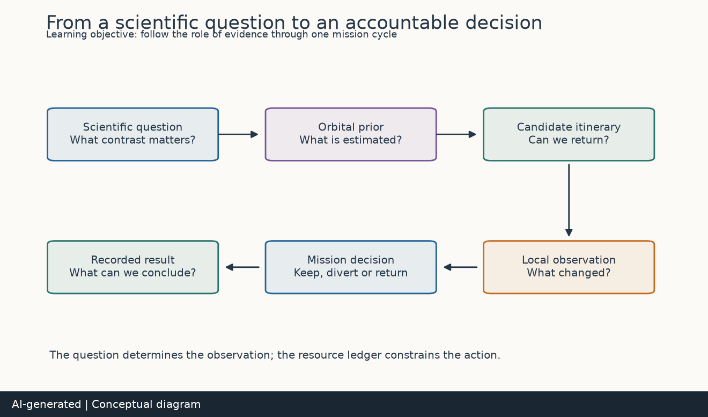

# Research question and scientific approach

[Home](Home.md) · Next: [Jezero as a scientific setting](02-Jezero-Science.md)

Exploration begins with a difference between what is interesting and what is known. An orbital map may suggest a promising outcrop, while the route to that outcrop still contains unresolved terrain. A reconnaissance vehicle can reduce some of that uncertainty. Its observations consume time and energy, however, so obtaining more information is itself a mission decision. Mars God's Eye studies this relationship between scientific objectives, reconnaissance and the resources needed to complete a mission and return.

The central research question is: under a declared terrain and resource model, when does additional reconnaissance improve the decisions available to a heterogeneous exploration team?

The question has two parts. One concerns information: which observations distinguish useful alternatives? The other concerns action: after paying for those observations, which routes and tasks remain feasible? Keeping both parts in the same explanation makes the contribution easier to assess. A highly detailed map has practical value when it changes a justified choice, improves a resource margin or establishes that a proposed action should be abandoned.

Figure 1. Scientific reasoning in the project. This conceptual diagram connects the question that motivates an excursion to the evidence needed to interpret its outcome. The arrows connect the conceptual dependencies used to reason about an excursion.

## From planetary science to a mission objective

The Mars 2020 mission provides a relevant scientific context. Its published objectives connect geological interpretation, past habitability, potential biosignatures and the collection of carefully selected samples (Farley et al., 2020, abstract and mission science objectives). In our project, those themes motivate the selection of scenarios and the questions posed at candidate sites. The computational experiment then asks a narrower question about access, information and allocation of resources.

Consider an outcrop whose exposed layers differ from those seen nearby. A scientific investigation may seek to document the contact, inspect a representative surface and decide whether a sample would contribute to the interpretation. Before any of those activities can occur, the team must reach an appropriate station, preserve a return route and allocate sufficient time for stationary work. This chain explains why scientific interest and mission feasibility appear together throughout the Wiki.

The geological question and the navigation question also require different evidence. An elevation product supports topographic reasoning. An image may show morphology at its own resolution. Mineral identification requires the measurements and instrument interpretation appropriate to that claim. [Chapter 2](02-Jezero-Science.md) develops the geological motivation, while [Chapter 3](03-Terrain-and-Scale.md) explains how the public terrain enters the experiment.

## Why use heterogeneous agents?

The proposed team combines complementary roles. A drone can obtain a local view before a ground agent commits to a corridor. A rover can perform an inspection while a human follows the primary mission sequence. The human's subsequent work depends on both the inspection evidence and the resources still available after the primary objective. These roles give the experiment several opportunities for useful coordination.

Heterogeneity is expressed through capabilities, movement models, activity costs and mission constraints. It is therefore insufficient to compare agents only by speed. A fast reconnaissance flight may be useful if it resolves a decisive obstruction; the same flight can be wasteful if it reveals information that leaves every admissible decision unchanged. Similarly, a rover inspection may be scientifically relevant yet finish too late to support a human sampling opportunity.

An instructive comparison holds the initial situation fixed and changes only the reconnaissance strategy. The project's A/B/C protocol contrasts planning from the public prior, inspecting the candidate corridor, and observing alternatives. These are research strategies defined by the team. Their interpretation depends on the paired worlds, the actual observation costs and the outcomes recorded for each run. [Chapter 7](07-Experimental-Method.md) develops that comparison.

## A simple representation of the decision

Let a candidate itinerary be an ordered set of movement segments and stationary activities. Its predicted resource cost is

$$
\mathbf{c}(\pi)=\sum_{e\in\pi}\mathbf{c}_{\mathrm{move}}(e)
                 +\sum_{a\in\pi}\mathbf{c}_{\mathrm{activity}}(a).
$$

Here, $\pi$ denotes the itinerary and $\mathbf{c}$ contains time, energy and, for a human, oxygen. The movement terms are directed: a descent followed by the reverse ascent need not have equal costs. The activity terms include the duration of work and waiting, each charged once. A decision also requires compatible capabilities, completed precedences and an admissible route under the current map. This notation summarizes the existing mission reasoning; the executable equations and their assumptions are explained in [Chapter 5](05-Resource-Models.md).

For an optional task, the relevant comparison is made from the current state. The team accounts for reaching the task, performing it, returning from the resulting position and preserving the designated reserve. Resources already consumed remain consumed after replanning. The return calculation and the reserve represent different obligations: one pays for a predicted action, while the other remains available as a holdback.

This formulation leads to several scientifically useful outcomes. The mission may retain its plan, select a detour, omit optional work, return early or report that the available information does not support a decision. Each outcome becomes interpretable when its cause is recorded.

## A worked reasoning example

Suppose the initial public prior admits two corridors to the primary station. One is shorter but passes through terrain that a later observation could contradict. A reconnaissance action reveals an obstruction in that corridor. Three quantities now matter: the cost already paid, the cost of the remaining alternative and the return margin after the required work.

If the alternative preserves the constraints, replanning can produce a justified detour. If only optional sampling would exhaust the margin, the appropriate adaptation is to keep the primary excursion and remove that task. If the primary excursion itself no longer fits, an early return can be the supported decision. The same observation therefore has different consequences under different remaining resources. This is why the experiment records state and resource history, rather than counting new route identifiers as evidence of adaptation.

## Reading the project's evidence

The Wiki organizes its claims into four categories: published observations, model formulations, experimental choices and reproducible project results. A source-backed physiological reference belongs to the first category; adapting it to a Mars activity model introduces a formulation. A chosen reserve fraction is an experimental policy. A recorded route and resource trace are a result of that particular configuration.

These categories provide a constructive reading of the work. The approved compact Jezero scenario and the subsequent local scale studies can be examined on their own terms. A software test establishes the property it exercises; an analytical pilot establishes behavior under its declared model; execution evidence establishes the actions actually covered by that record. [Chapter 8](08-Case-Studies.md) follows this progression through concrete examples.

## Sources and further reading

- Farley, K. A., et al. (2020). [Mars 2020 Mission Overview](https://doi.org/10.1007/s11214-020-00762-y). Space Science Reviews, 216, 142. Supports the mission-science objectives and scientific context.
- Project research design: [benchmark protocol](../science_benchmark.md), [scientific decisions](../science_decisions.md) and [mission success criteria](../mission_success_contract.md). These are the authoritative records for project-specific choices.
- Continue with [Jezero as a scientific setting](02-Jezero-Science.md), or consult the [Bibliography](Bibliography.md) for the source catalogue.
