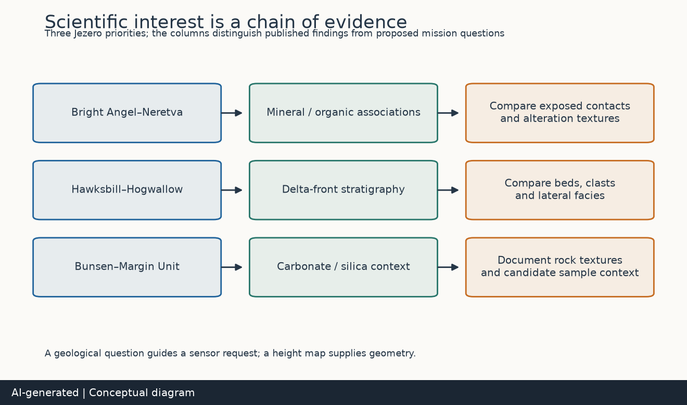

# Jezero as a scientific setting

[Home](Home.md) · Previous: [Research question](01-Research-Question.md) · Next: [Terrain and scale](03-Terrain-and-Scale.md)

A scientifically interesting place is one where observations can help distinguish explanations. For an exploration mission, this usually requires more than an attractive rock or a single unusual measurement. The surrounding layers, contacts, fractures and neighboring materials provide the relationships needed to interpret a target. Jezero offers several settings in which those relationships can be studied, with published orbital and surface observations that help formulate concrete questions.

This chapter explains why three sectors were prioritized in our scenario research: Bright Angel–Neretva Vallis, Hawksbill Gap–Hogwallow Flats and Bunsen Peak–Margin Unit. The selection emphasizes different questions and scales of context. The resulting mission proposals ask what information a reconnaissance or inspection action would need to provide before a subsequent activity becomes useful.

Figure 2. Evidence and interpretation across scales. The diagram is a teaching aid: it shows why a regional map, a local view and a compositional measurement answer different questions. The project uses published scientific results to motivate scenarios and public elevation products to support its terrain model.

## Read the landscape as a set of relationships

The geological map of Jezero and Nili Planum provides regional units and contacts at a published scale of 1:75,000 (Sun and Stack, 2020). A map at that scale helps locate major relationships and select areas for closer study. It does not specify the geometry of every local obstacle. The project therefore treats geological context and navigation terrain as separate, related layers of reasoning.

A useful sequence is to identify the setting, articulate a geological question, choose the observations that would address it and then select a mission window. This order makes map size a consequence of the question. A station can be sufficient for comparing neighboring surfaces, while a stratigraphic traverse may require several exposures distributed across a larger area. The appropriate extent also depends on what the available instruments can resolve.

The [project survey](../science_patch_survey.md) considered 17 sectors, including alternatives beyond Jezero. Its first three priorities provide a manageable range of questions for the present study. The priorities are research choices supported by the cited literature; they are not estimates of a probability of discovery.

## Bright Angel–Neretva Vallis: preserve context across contrasting targets

Hurowitz et al. (2025) report a geological and geochemical investigation of Bright Angel rocks, including organic-carbon-bearing mudstones and iron-, sulfur- and phosphorus-bearing features. Their interpretation uses surface imaging, spectroscopy and elemental measurements. The relationship between textures, chemistry and geological context motivates close comparison of neighboring materials.

For mission design, the paper's spatial context is particularly informative. Figure 1b places the Beaver Falls workspace about 110 m upslope from Walhalla Glades and Grapevine Canyon about 50 m downslope. Figure 2 shows several targets within the Beaver Falls workspace. These examples demonstrate how the scale of an individual inspection differs from that of the surrounding comparison. A regional crop helps choose an approach; a smaller working window can support a particular station.

Our proposed question is how reconnaissance and subsequent inspection could preserve the context needed to select among contrasting surfaces. Candidate observations include the exposure of a contact, continuity of layering and the relationship of fractures to accessible rock faces. The known instrument results motivate those questions. An elevation grid supplies topography for the experiment; the compositional evidence remains associated with the instruments and targets reported in the paper.

## Hawksbill Gap–Hogwallow Flats: compare stratigraphy and alteration

The Shenandoah formation offers a complementary setting. Stack et al. (2024) describe its sedimentology and stratigraphy using Perseverance observations. Their Section 6.2.5 identifies the Hogwallow Flats member and discusses its lateral occurrence, while the broader stratigraphic framework relates exposures across the western fan. Benison et al. (2024) examine sulfate-bearing rocks and depositional and diagenetic interpretations at Hogwallow Flats and Yori Pass.

For our research, the useful contrast is between documenting one rock and following a relationship between exposures. A mission might inspect a laminated surface, compare a nearby vein-bearing surface or examine where an interpreted layer becomes covered. Those observations could support decisions about which station deserves longer work. They also create meaningful optional tasks: a comparison may be valuable but dispensable when the return margin becomes small.

The associated map request combines larger context with nested local windows. The relevant criterion is whether the chosen extent includes the exposures and approaches required by the question. A larger square alone does not guarantee a representative stratigraphic sample. The distribution of exposures and the planned observation sequence must be examined together.

## Bunsen Peak–Margin Unit: connect a local workspace to regional hypotheses

The mission team's account of the Comet Geyser core describes Bunsen Peak as a carbonate- and silica-rich target selected for investigation and sampling (Broz, 2024). This provides a direct operational example of selecting a local rock within a broader unit whose geological history motivates comparison.

The scenario question is how an inspection can distinguish useful surfaces and relationships before committing time to a sample. Fractures, exposed faces, neighboring materials and the approach geometry all matter to that decision. Scientific relevance and access are evaluated together: an interesting surface can require a different station or remain outside the feasible excursion.

Our local analytical run carries the label Bunsen because its map was extracted around the sector's search anchor. That label identifies the scenario family. Exact registration of a particular outcrop requires the georeferenced image, terrain footprint and published target location to be reconciled. The local A/B pair was chosen as an experimental pair of public cell centers. Its role is developed as a planning and resource case in [Chapter 8](08-Case-Studies.md).

## Choosing a sector and choosing a mission are related decisions

The three priorities can be summarized as complementary questions:

| Sector | Question motivating the scenario | Information useful before longer work |
|---|---|---|
| Bright Angel–Neretva | How do contrasting surfaces and their context affect target selection? | Exposure, approach alternatives and relationships within a workspace |
| Hawksbill–Hogwallow | How do stratigraphic and alteration contrasts guide station selection? | Continuity, cover and accessible comparison surfaces |
| Bunsen–Margin Unit | How can a local workspace contribute to a broader rock–water interpretation? | Surface condition, fractures and neighboring contrasts |

These questions connect scientific selection to reconnaissance without prescribing a favorable outcome. The reconnaissance action earns its place when the information obtained can influence an admissible decision. Travel, observation and stationary work remain part of the same resource ledger.

The team's [map request](../science_patch_map_requests.md) provides search centers, desired windows and acceptance checks for Daniel's terrain preparation. Its centers are approximate query anchors associated with historical rover locations. Their numerical precision is not a claim that each center is the exact location of a rock core or a safe base. Registration, coverage and scientific representativeness are evaluated from the delivered products.

## Sources and further reading

- Sun, V. Z., and Stack, K. M. (2020). [Geologic map of Jezero crater and the Nili Planum region, Mars](https://doi.org/10.3133/sim3464). USGS Scientific Investigations Map 3464, scale 1:75,000. Regional geological context.
- Hurowitz, J. A., et al. (2025). [Redox-driven mineral and organic associations in Jezero Crater, Mars](https://doi.org/10.1038/s41586-025-09413-0). Nature, 645, 332–340. See Figures 1–3 and the outcrop-scale observations.
- Stack, K. M., et al. (2024). [Sedimentology and Stratigraphy of the Shenandoah Formation, Western Fan, Jezero Crater, Mars](https://doi.org/10.1029/2023JE008187). Journal of Geophysical Research: Planets, 129, e2023JE008187. See Section 6.2.5 and the stratigraphic figures.
- Benison, K. C., et al. (2024). [Depositional and Diagenetic Sulfates of Hogwallow Flats and Yori Pass, Jezero Crater](https://doi.org/10.1029/2023JE008155). Original study of the sedimentary and alteration context.
- Broz, A. (2024, 16 April). [Comet Geyser: Perseverance's 21st Rock Core](https://science.nasa.gov/blog/comet-geyser-perseverances-21st-rock-core/). NASA mission-team field account; used for the Bunsen workspace context. The page names Adrian Broz as the writer; its later update date is distinct from publication.
- Project records: [sector survey](../science_patch_survey.md), [map requests](../science_patch_map_requests.md) and [Bibliography](Bibliography.md).
