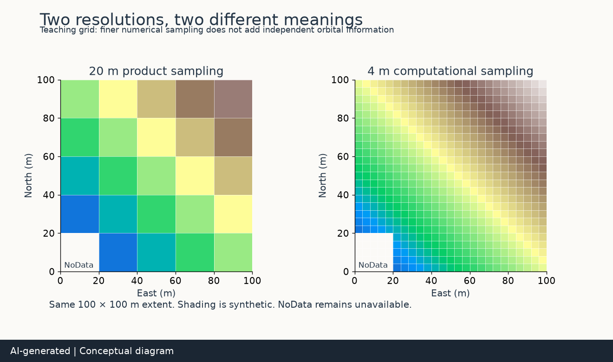
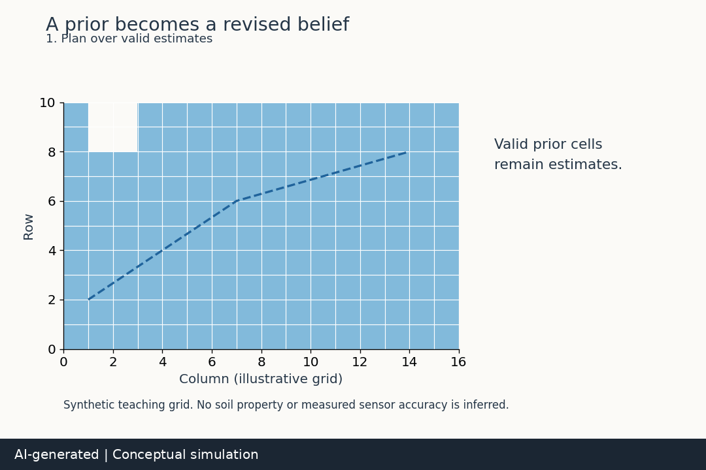
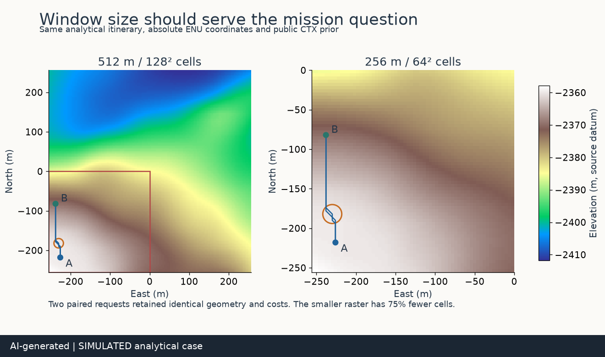

# From orbital data to mission terrain

[Home](Home.md) · Previous: [Jezero science](02-Jezero-Science.md) · Next: [Agents and activities](04-Agents-and-Activities.md)

A terrain model makes a landscape computable. It assigns elevations, coordinates and uncertainty information to a defined grid so that a planner can evaluate possible movement. The scientific meaning of the resulting route depends on how that grid was constructed. Its cell size, source resolution, valid-data mask and coordinate conventions all contribute to the interpretation.

The project's public prior comes from a CTX digital terrain model associated with Mars 2020 terrain-relative navigation. The source product has 20 m posts; the delivered planning grid uses 4 m cells. This distinction is central: computational subdivision provides a convenient representation for algorithms, while the original observations and their processing determine the information available about the surface.

Figure 3. Terrain information across scales. The diagram illustrates the relationship between source sampling and computational representation. Subdividing a source interval produces additional locations at which an interpolated model can be evaluated; it does not create independent observations at those locations.

## Products with different roles

CTX, HiRISE and MOLA enter the project with distinct purposes. The CTX terrain supplies the public topographic prior. MOLA contributes regional context and area selection through its separately identified dataset. HiRISE reference material belongs to the isolated evaluation side of the experiment. Its separation preserves the difference between information available to the decision maker and information used to examine that decision.

The current [source register](../data_sources.md) identifies the actual products and roles. For CTX, the USGS Mars 2020 TRN DTM release is identified by DOI 10.5066/P906QQT8. The USGS technical documentation also explains why DTM post spacing and effective resolving capability should be considered separately. The project records 20 m as the native CTX terrain spacing and 4 m as its computational cell size.

The resampled grid is a model of a continuous surface between source posts. Neighboring values can therefore be strongly related. Counting computational cells is useful for memory and search accounting; it is not a count of independent measurements. Likewise, the elevation model supplies geometry. Rolling resistance, slip and material composition come from separate assumptions or measurements, as discussed in [Chapter 5](05-Resource-Models.md).

## Coordinates make the model reproducible

The local frame is east–north–up, in metres. Columns grow east and rows grow north from a southwest corner. For cell size $r$, row $i$, column $j$, and southwest origin $(x_0,y_0)$, the cell center is

$$
x=x_0+(j+\tfrac12)r,\qquad y=y_0+(i+\tfrac12)r.
$$

This convention allows a reviewer to connect an array index with a physical location. It also makes a crop checkable: removing rows and columns should retain the absolute coordinates and elevations of the cells that remain.

Planetary coordinates require a planetary reference system. The current configuration records a Mars sphere radius of 3,396,190 m and its MOLA/DeltaGeoid vertical convention. These configuration values fix the planetary reference system used by the recorded coordinates. The browser uses a separate display-axis mapping, while the recorded mission retains the ENU coordinates. The [dataset contract](../DATASET_CONTRACT.md) and [ICD](../ICD.md) define the implementation conventions.

## Valid, estimated, observed and blocked are different properties

A valid prior cell has a supplied topographic estimate. A NoData cell lacks a supported value for that product and remains excluded according to the terrain rules. An observed cell carries evidence from a declared observation process. An obstacle state expresses a movement-relevant conclusion associated with its provenance and update rules.

These distinctions allow exploration to begin with orbital estimates. Under the accepted D-EST-01 scope, local observation is not a blanket prerequisite for proposing routes over valid estimated terrain. The route remains conditional on the declared model, uncertainty policy and later evidence. When an observation contradicts that estimate, the map version and route decision must be reconsidered.

Figure 4. Conceptual information update. The animation shows a simulated observation entering a finite footprint and changing the decision-relevant map. Its purpose is to explain the causal sequence; it is not an instrument record or a reconstruction of unobserved Martian terrain.

An uncertainty field must also be interpreted from its provenance. The compact scenario's initial sigma of 2.5 m is a declared modeling parameter. A configured 1 m acceptance threshold is a policy choice. Comparing them explains a particular model rejection, but neither number alone establishes the physical accuracy of the local terrain or pose.

## Map extent should follow the question

At 4 m per cell, the relationship between map side and grid dimensions is straightforward:

| Physical side | Grid dimensions | Number of cells |
|---:|---:|---:|
| 128 m | 32 × 32 | 1,024 |
| 256 m | 64 × 64 | 4,096 |
| 512 m | 128 × 128 | 16,384 |
| 1,024 m | 256 × 256 | 65,536 |
| 2,048 m | 512 × 512 | 262,144 |

Thus, a 128 × 128-cell grid covers 512 × 512 m. Stating both dimensions prevents a fourfold ambiguity in side length and a sixteenfold ambiguity in area.

Larger windows can contain more exposures and route alternatives. They also increase storage and the potential search domain. Their value is tested by holding the mission fixed and comparing the decisions obtained, or by defining a new mission whose question actually requires the additional area. The total size of a raster is not itself evidence of useful explored coverage.

## Worked example: a 512 m window and its 256 m crop

The approved compact scenario uses a 128 m map with its own A/B pair. A later local analytical case, `local-cost-eva-bunsen-20261115-02`, used a different public crop and experimental endpoints. Its A lies at $(-226,-218)$ m and B at $(-238,-82)$ m. Their northing span is 136 m, so a 128 m square aligned with the current grid cannot contain both.

The [recorded footprint analysis](../../evidence/mission-3d-video-20261115-local/map-analysis/README.md) found a 24 × 136 m enclosing box when the observation circle was included. That box occupies approximately 1.245% of the original 512 m square. The percentage describes an envelope, rather than observed area or the search frontier.

Figure 5. A smaller active window for the recorded case. Coordinates and heights stay fixed. The inset explains the relationship between the displayed mission geometry and the broader source domain; it does not imply that unseen alternatives are absent outside the crop.

The initial and post-observation requests were repeated on both domains. All four queries returned FEASIBLE, and each paired comparison produced identical outbound and directed-return geometry and identical time, energy and oxygen totals. The 256 m crop contained 4,096 cells instead of 16,384, a 75% reduction. These checks establish sufficiency for the two fixed requests. Other goals, perturbations or route alternatives require their own boundary checks.

## Sources and further reading

- USGS. [Mars 2020 Terrain Relative Navigation CTX DTM Mosaic](https://doi.org/10.5066/P906QQT8). Source identity and product metadata for the public prior.
- USGS. [Mars ASP Generated CTX DTMs and Orthoimages](https://stac.astrogeology.usgs.gov/docs/data/mars/ctxdtms/). Technical discussion of DTM production, post spacing and resolving capability; accessed 15 November 2026.
- NASA PDS. [MGS MOLA derived-topography bundle](https://pds.nasa.gov/ds-view/pds/viewBundle.jsp?identifier=urn%3Anasa%3Apds%3Amgs_mola_topography_derived&version=1.0). Regional data provenance.
- Project definitions and results: [terrain configuration](../../config/terrain.yml), [source traceability](../nasa_traceability.md), [accepted estimated-terrain scope](../decisions/2026-11-14-estimated-terrain-planning.md), [crop comparison record](../../evidence/mission-3d-video-20261115-local/map-analysis/crop-comparison.json), and [Bibliography](Bibliography.md).
