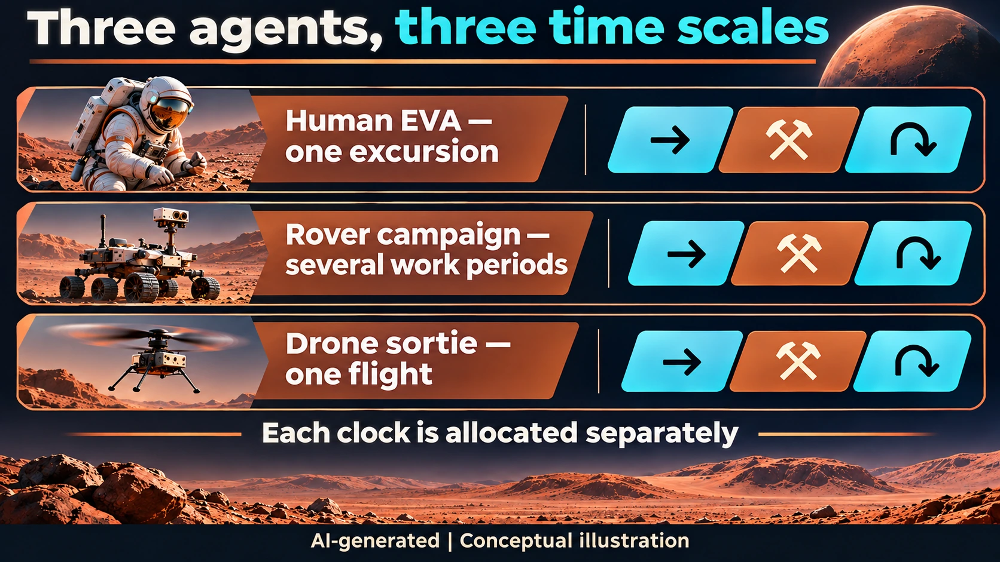
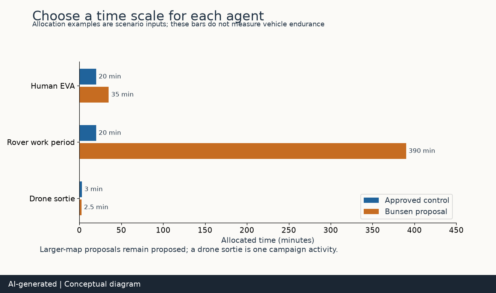
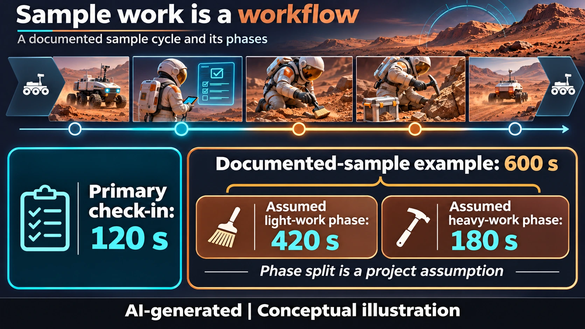

# Agents, activities and mission timescales

[Home](Home.md) · [Previous: Terrain and scale](03-Terrain-and-Scale.md) · [Next: Resource models](05-Resource-Models.md)

An exploration team is heterogeneous when its members differ in how they move, what they can observe, what work they can perform and which resources constrain them. These differences are the reason to coordinate an astronaut, a rover and a drone. Aerial reconnaissance can inform a route, a rover can inspect a workspace before an EVA, and a human can perform a documented sampling procedure after the required inspection. The scientific value comes from the sequence and quality of the resulting observations.

This chapter develops that sequence before assigning durations. A duration becomes meaningful only after the activity, its output and the episode being timed have been defined.

Figure 4.A. Three accounting episodes in a conceptual campaign. Each clock is allocated separately. The quantitative control and proposed allocations remain in Figure 4.1, with their original scenario status. [Full-size PNG](assets/imagegen-20261115/05-agent-timescales-reviewed.png).

## Three agents, three accounting episodes

The project uses three complementary reference roles. The human profile contains the `reach` and `sample` capabilities; the rover contains `inspect`; and the drone contains `observe`. These are task-allocation categories in the [profile registry](../../config/science_profiles.proposed.json). The same registry includes costing activities such as human `inspect`, which can price a visual check-in without creating an optional inspection capability or proving that an inspection occurred.

The human episode is an EVA: departure, directed travel, field activities, pauses and return. Rover reconnaissance can begin earlier, so the rover's campaign clock may include preparation, inspection and waiting before and during the human episode. A drone sortie is a third episode, with ascent, translation, observation, return and descent. The global simulated clock relates these episodes. Starting the EVA does not replenish a rover that has already worked for several hours, and landing does not reset a drone's battery.

Figure 4.1. Different clocks answer different questions. The short control and the longer proposed programs are experimental allocations. Drone values describe individual sorties; a complete drone campaign also requires the intervals between sorties.

The [approved experimental control](../../config/mission_jezero.experimental.yaml) assigns 1,200 s to the human, 1,200 s to the rover and 180 s to the drone. Its human primary activity at B lasts 120 s. These values make a compact, reproducible experiment; the 20-minute horizon is a scenario choice.

The subsequent [campaign proposal](../agent_campaign_proposal.md) sizes episodes from workload. Its proposed Bunsen case assigns 35 minutes to the EVA and 6.5 hours to the rover campaign; one desired drone sortie receives 150 s. Bright Angel and Hawksbill/Hogwallow have larger proposed workloads. These proposals remain separate from the approved control and from the local analytical replay described in [the case studies](08-Case-Studies.md).

## Why a slow rover can still travel far

Speed determines travel time for a given distance, whereas range also depends on the duration and energy allocated to driving. NASA reports a Perseverance mass of 1,025 kg and a maximum speed of 152 m/h on flat, hard ground. These references motivate the project's mass scale and centimetres-per-second commanded speed. The daily driving schedule is specified by each experimental scenario. [NASA, Rover Components, “Body” and “Rover Speed”](https://science.nasa.gov/mission/mars-2020-perseverance/rover-components/).

At the proposed command speed of 0.04 m/s and slip coefficient of 0.10, a flat 100 m segment takes approximately 46.3 minutes under the implemented model. Consequently, a 20-minute allocation offers little driving time once return, inspection and reserves are included. A multi-hour campaign addresses a different workload.

An energy allocation also differs from an energy supply. Perseverance's reference architecture combines an MMRTG with batteries; the landing press kit reports approximately 110 W of initial generation and batteries that support larger temporary loads. The project uses a Perseverance-inspired mass reference without adding solar generation or charging credit to its consumption ledger. A future supply model would need storage, state of charge, power limits, thermal conditions and charging losses. [JPL, undated, “Power”](https://www.jpl.nasa.gov/news/press_kits/mars_2020/landing/mission/spacecraft/power/).

## A sample is a workflow

The time required to pick up material is one part of a geological sample cycle. Context images, descriptions, acquisition, identifiers, bagging and tool recovery all contribute to the scientific record. The D-RATS 2010 geologist report describes approximately ten minutes per documented sample in its terrestrial analogue operations and emphasizes the contribution of field context to sample quality. This is the main empirical analogue used to motivate a 600 s workflow. [Hurtado et al., 2011, pp. 1–2](https://ntrs.nasa.gov/api/citations/20120011761/downloads/20120011761.pdf).

Figure 4.2. A documented-sample example with separate accounting for the primary check-in. The 600 s workflow uses the proposed 420 s light-work and 180 s heavy-work decomposition. The phase split is a project assumption; the duration sources are discussed below. [Full-size PNG](assets/imagegen-20261115/06-activity-cycle-reviewed.png).

Several other references answer narrower questions. Chappell et al. list a 30 s manual pickup, 60 s hammering and 180 s trenching among lunar operations modeling assumptions. These are different task primitives. Bekdash et al. prescribe ten-minute sampling blocks in an ARGOS test protocol after contextual work. A prescribed block and a measured complete cycle should therefore enter the source catalogue under different evidence categories. [Chappell et al., 2010, §3.1, Table 3, printed p. 12](https://ntrs.nasa.gov/api/citations/20110001417/downloads/20110001417.pdf#page=20); [Bekdash et al., 2020, §II.C.1, pp. 6–7](https://ntrs.nasa.gov/api/citations/20205003610/downloads/ARGOS%20ICES%202020%20-Final%20for%20Export%20Control.pdf#page=6).

For the proposed mixed cycle, the light-work phase represents documentation and related handling, and the heavy phase represents demanding acquisition. At the current human power anchors, the total is 64.8345 metabolic Wh and 13.2394 equivalent litres of oxygen. These are model outputs for an assumed schedule. Task performance, suit configuration and tools would be needed to evaluate transfer to a particular EVA.

The approved 120 s activity in B has a smaller purpose: stationary visual observation and check-in. A rover's proposed 300/600/900 s inspection alternatives are engineering windows for sensitivity studies. They are not a measured distribution of Mars rover spectroscopy, drilling or imaging times. The [duration review](../activity_duration_research.md) records the source, task definition and transfer scope for each candidate.

## Observations as products

An activity should have an identifiable output. Reconnaissance may produce a footprint-bound terrain observation. Inspection may provide a task-specific public result. Sampling should connect the material acquired to its preceding context and identifiers. In the experimental system, these outputs must retain their run, agent, map, time and source context.

The role labels alone do not establish an instrument. A drone observation footprint in an analytical study has a declared geometry and uncertainty. Its ability to identify a mineral or biological process would require an appropriate sensor and measurement model. Similarly, the rover inspection category describes a stage in task allocation; its scientific interpretation depends on the recorded evidence supplied for that stage.

## Building a schedule from work

Begin with directed travel to the stations, add each explicit activity and wait, and calculate return separately. Then compare the sum with the allocation while retaining a separate reserve. A useful schedule states what each pause achieves and which agent pays for it.

For example, completing rover reconnaissance before the EVA can avoid spending suit consumables while the rover prepares the route. The rover still consumes resources throughout its own campaign. If the human waits during the EVA, the wait is recorded and priced once. For interrupted work, a progress-aware accounting protocol should retain the evidenced completed prefix and plan only the remaining service from current resources. The current manager conservatively includes the full service until explicit completion; binding partial progress to the planning context remains part of the execution handoff.

This workload-first interpretation connects scientific priorities to feasible operations. Reducing the number of samples can release service time, but it saves travel only when the itinerary itself changes. Preserving well-documented observations and return margins gives the team a meaningful basis for comparing alternative programs.

## Sources and further reading

- Hurtado, J. M., Jr., et al. (2011). [Lessons Learned for Geologic Data Collection and Sampling: Insights from the Desert RATS 2010 Geologist Crewmembers](https://ntrs.nasa.gov/api/citations/20120011761/downloads/20120011761.pdf), LPSC abstract 1334, pp. 1–2.
- Chappell, S. P., et al. (2010). [Life Sciences Implications of Lunar Surface Operations](https://ntrs.nasa.gov/api/citations/20110001417/downloads/20110001417.pdf), NASA/TM-2010-216138, Tables 3–4.
- Bekdash, O. S., et al. (2020). [Development and Evaluation of the Active Response Gravity Offload System as a Lunar and Martian EVA Simulation Environment](https://ntrs.nasa.gov/api/citations/20205003610/downloads/ARGOS%20ICES%202020%20-Final%20for%20Export%20Control.pdf), ICES-2020-175, §II.C.1.
- NASA. [Perseverance Rover Components](https://science.nasa.gov/mission/mars-2020-perseverance/rover-components/), consulted 15 November 2026.
- JPL (undated). [Mars 2020 Landing Press Kit: Power](https://www.jpl.nasa.gov/news/press_kits/mars_2020/landing/mission/spacecraft/power/).
- Project records: [duration research](../activity_duration_research.md), [campaign proposal](../agent_campaign_proposal.md), [approved experimental scenario](../jezero_mission_proposal.md), [bibliography](Bibliography.md).

[Next: Resource models](05-Resource-Models.md)
