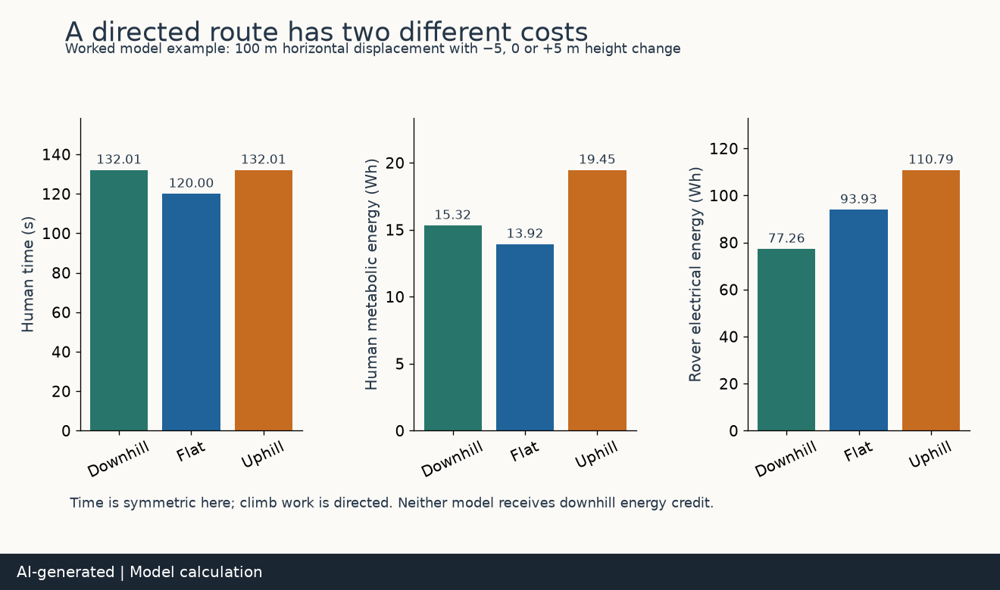
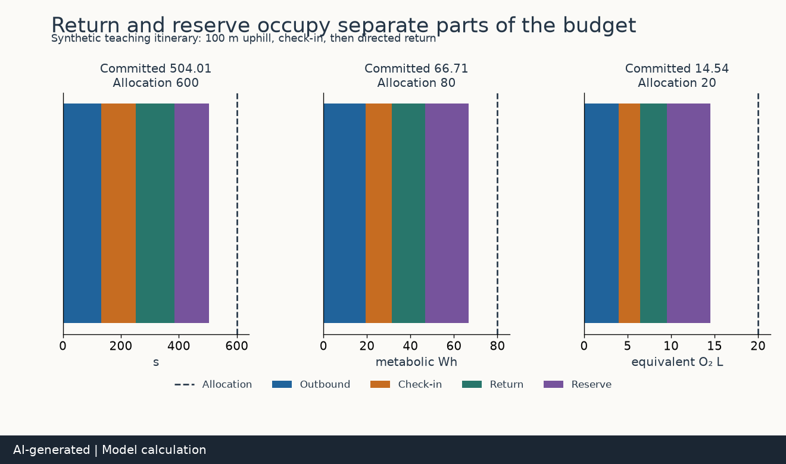

# Resource models: from activity to directed itinerary

[Home](Home.md) · [Previous: Agents and activities](04-Agents-and-Activities.md) · [Next: Mission decisions](06-Mission-Decisions.md)

A route consumes resources because an agent moves for a finite time, performs work against gravity and operates its supporting systems. A stationary activity consumes resources for its duration. Separating these contributions makes a mission estimate inspectable: the reader can see which term changed when the route became steeper, an inspection lasted longer or a detour was introduced.

The implemented estimators are `estimate_segment(profile, start_enu, end_enu)` and `estimate_activity(profile, activity, duration_s)` in [the scientific model](../../src/mge_mission/mge_mission/models.py). They operate independently of ROS and accept explicit inputs. The registered model is `mge-science-1.0.0`; its [coefficients and provenance](../../config/science_profiles.proposed.json) retain their proposed status. This chapter explains their mathematical behavior.

## Quantities and units

For endpoints $p_0=(x_0,y_0,z_0)$ and $p_1=(x_1,y_1,z_1)$ in local east–north–up metres, define

$$
h=\sqrt{(x_1-x_0)^2+(y_1-y_0)^2},\qquad
\Delta z=z_1-z_0,\qquad
L=\sqrt{h^2+\Delta z^2}.
$$

Here $h$ is horizontal distance and $L$ is three-dimensional segment length. For a ground segment with $h>0$, signed inclination is $\theta=\operatorname{atan2}(\Delta z,h)$ and absolute grade is $q=|\Delta z|/h$. Grade is dimensionless; an angle in degrees is a different quantity.

Power is expressed in W and time in s. Dividing joules by 3,600 gives Wh. Human energy is estimated metabolic expenditure; robot energy is estimated electrical consumption. Their common unit supports ledger arithmetic, but it does not make the two energy stores interchangeable. All models use the reference Mars gravity $g_M=3.71$ m/s² from [JPL's physical-parameter table, Mars row](https://ssd.jpl.nasa.gov/planets/phys_par.html).

## Human: walking and positive climb work

The human model first estimates the time needed to cover the horizontal distance, with a symmetric slowdown for absolute grade:

$$
t_h=\frac{h(1+kq)}{v_h},\qquad
E_h=\frac{P_wt_h+(m_b+m_s)g_M\max(\Delta z,0)/\eta_h}{3600}.
$$

$v_h$ is reference horizontal speed, $k$ the grade slowdown coefficient, $P_w$ walking metabolic power, $m_b$ body mass, $m_s$ suit mass and $\eta_h$ the proposed metabolic climb efficiency. The current values are 0.8333 m/s, 2, 417.70 W, 80.7 kg, 120 kg and 0.25 respectively.

The activity anchors are rounded conversions of the lunar-analogue rates in Chappell et al.: walking, stationary light work and stationary heavy work. The latter two become 358.08 and 461.17 W. Transferring those anchors to this Mars model, assigning light work to waiting/check-in and selecting the slowdown and efficiency are explicit project choices. [Chappell et al., 2010, Table 4, printed p. 13/PDF p. 21](https://ntrs.nasa.gov/api/citations/20110001417/downloads/20110001417.pdf#page=21).

The model adds climb expenditure only for positive height change. Downhill still takes time and consumes walking energy. A zero-length segment has zero cost, while a vertical-only ground segment is rejected. Profile slope bounds are checked by the estimator; obstacles, footprint clearance, step rules and uncertainty require the map and planner.

Figure 5.1. A 100 m horizontal segment with a 5 m height difference has direction-dependent cost. These values are calculations from the proposed profile, rather than terrain measurements. Each agent has its own energy meaning and axis.

For the human, ascent takes 132.0053 s and 19.4529 metabolic Wh; the reversed descent takes the same modeled time and 15.3163 Wh. Their sum is 34.7692 Wh. Computing one direction and doubling it would give the wrong round-trip energy.

## Oxygen: an explicitly defined equivalent volume

The human oxygen model extends the BVAD reference of 0.086 kg per crewmember-hour and 1.062 MJ per crewmember-hour, equivalent to 295 W. The project assumes proportionality between modeled metabolic energy and oxygen consumption. [Ewert, Chen and Powell, eds., 2022, BVAD Rev2, Table 4-70, printed p. 135/PDF p. 149](https://ntrs.nasa.gov/api/citations/20210024855/downloads/BVAD_2.15.22-final.pdf#page=149).

The proposed volume convention is dry ideal oxygen at 273.15 K and 101.325 kPa. With molar mass $M_{O_2}=0.0319988$ kg/mol and molar volume $V_m=22.41396954$ L/mol,

$$
\alpha=\frac{0.086}{M_{O_2}}\frac{V_m}{295}
=0.2042027191\ \mathrm{L/Wh},\qquad
O_h=s_O\alpha E_h.
$$

$s_O$ is the human oxygen sensitivity multiplier, nominally one. Molar mass comes from [NIST Chemistry WebBook, oxygen entry](https://webbook.nist.gov/cgi/cbook.cgi?Name=O2); the ideal-gas volume follows the stated temperature and pressure in [NIST's 2022 CODATA table](https://physics.nist.gov/cuu/pdf/all.pdf). The implementation retains its declared constant precision and rounds only the displayed results.

Equivalent gas litres describe oxygen amount under a common reference condition. A tank's geometrical litres require pressure, temperature and storage information. The chosen conversion covers modeled metabolic demand; a complete suit model would additionally account for losses and other life-support functions. Consumer confirmation of the precise gas-volume convention remains a separate contract decision. Robot oxygen is inapplicable and is represented as an absent value internally and JSON `null` at the public boundary.

## Rover: auxiliary power, rolling resistance and slope

The rover formulation separates systems that operate throughout the drive from traction work:

$$
t_r=\frac{L}{v_r(1-s)},\qquad
F=m_rg_M(c_r\cos\theta+\sin\theta),
$$

$$
E_r=\frac{P_at_r+\max(F,0)L/[\eta_r(1-s)]}{3600}.
$$

$v_r$ is command speed, $s$ slip coefficient, $c_r$ rolling-resistance coefficient, $P_a$ auxiliary power and $\eta_r$ drive efficiency. The proposed values are 0.04 m/s, 0.10, 0.05, 100 W and 0.35, with reference mass 1,025 kg. Slip affects both travel time and modeled traction expenditure.

Howard et al. describe an LSOS/ROAMS power structure combining onboard loads, rolling resistance and slope work, with vehicle-specific calibration. That structure informs our decomposition; our coefficients are registered assumptions. [Howard et al., 2011, “Power Modeling,” p. 4](https://dartslab.jpl.nasa.gov/References/pdf/2011-howard_ieeeaero_2011.pdf#page=4).

For 100 horizontal metres and 5 m ascent, the result is 2,781.2478 s and 110.7908 electrical Wh. Reversed descent costs 77.2569 Wh. At this particular negative grade the computed traction force reaches zero; the positive auxiliary load remains. The clipping operation provides no regenerative credit. Soil properties and slip are supplied parameters, rather than deductions from the elevation raster.

## Drone: motion and activity phases

Drone segment duration follows concurrent horizontal and vertical limits:

$$
t_d=\max\left(\frac{h}{v_{xy}},\frac{|\Delta z|}{v_z}\right),\qquad
E_d=\frac{P_dt_d+m_dg_M\max(\Delta z,0)/\eta_d}{3600}.
$$

The reference mass $m_d$ is 1.8 kg; the proposed speeds are 2 m/s horizontally and 1 m/s vertically. A segment with horizontal displacement uses 350 W translation power. Vertical-only ascent uses 350 W and descent uses 230 W; the climb efficiency $\eta_d$ is 0.5. The extra positive-work term is part of this simplified engineering formulation. These declared values are recorded in the [profile registry](../../config/science_profiles.proposed.json).

Observation and hover use 230 W, combining a reported approximately 210 W rotor hover reference with 20 W of assumed auxiliaries. Ground waiting uses 5 W. These explicit phases make the duration and expenditure visible. [NASA, 2021, flight-control report, hover discussion](https://science.nasa.gov/blog/what-were-learning-about-ingenuitys-flight-control-and-aerodynamic-performance/).

A horizontal 100 m segment takes 50 s and 4.8611 Wh. Adding 5 m of concurrent ascent gives 4.8797 Wh. A full sortie also needs its separately declared observation, takeoff/landing transitions and ground intervals. Flight clearance, aerodynamic response, thermal state and charging require additional inputs beyond the ground-grid projection.

## Activities, return and reserve

Every stationary phase uses

$$
E_a=P_a\tau/3600,
$$

with an explicit activity identity and duration $\tau$. Human oxygen follows the same energy conversion. A 120 s human check-in at 358.08 W costs 11.936 metabolic Wh and 2.4374 equivalent litres. Replanning retains already consumed intervals and prices the remaining schedule.

Figure 5.2. Return belongs to the candidate's remaining cost; reserve is retained after that cost. Completed work appears once in the consumed prefix. The ledger follows the same rule independently for time, energy and applicable oxygen.

The legacy planner projection replaces some activity and direction terms with simpler coefficients. D-COST-02 selects reuse of the scientific API as the implementation direction. A local exact-cost composition and the production transport have separately recorded evidence and review states. [Mission decisions](06-Mission-Decisions.md) explains how model identity and the current resource ledger enter route acceptance.

## Sources and further reading

- Chappell et al. (2010), [NASA/TM-2010-216138](https://ntrs.nasa.gov/api/citations/20110001417/downloads/20110001417.pdf), Table 4.
- Ewert, Chen and Powell, eds. (2022), [BVAD Rev2](https://ntrs.nasa.gov/api/citations/20210024855/downloads/BVAD_2.15.22-final.pdf), Table 4-70.
- Howard et al. (2011), [An KML Interface for Dynamics Simulation of Robotic Planetary Exploration](https://dartslab.jpl.nasa.gov/References/pdf/2011-howard_ieeeaero_2011.pdf), p. 4.
- NIST, [oxygen molar mass](https://webbook.nist.gov/cgi/cbook.cgi?Name=O2) and [2022 CODATA constants](https://physics.nist.gov/cuu/pdf/all.pdf).
- Project records: [scientific models](../science_models.md), [parameter registry](../../config/science_profiles.proposed.json), [shared-cost decision](../decisions/2026-11-14-shared-scientific-cost-api.md), [bibliography](Bibliography.md).

[Next: Mission decisions](06-Mission-Decisions.md)
