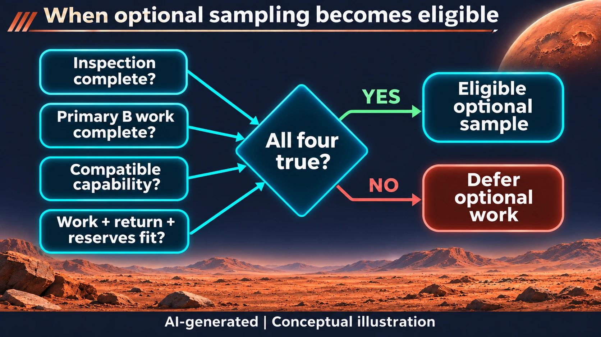
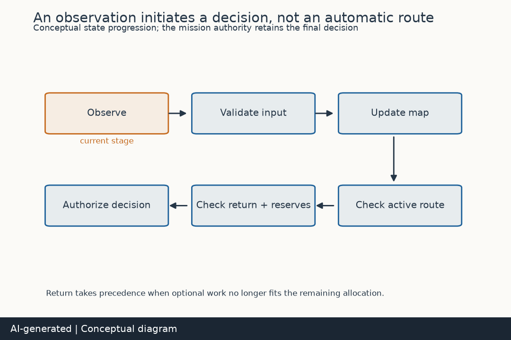

# Mission decisions: information, work and return

[Home](Home.md) · [Previous: Resource models](05-Resource-Models.md) · [Next: Experimental method](07-Experimental-Method.md)

A useful exploration decision combines an expected scientific benefit with a feasible sequence of actions. Reaching an interesting location requires travel; understanding it may require reconnaissance and inspection; acquiring a useful sample requires context and service time. Each additional action changes the resources available for return. Mission planning therefore links information, task order and the resource ledger.

The project gives mission authority to a single core. The planner proposes candidates, mapping supplies a versioned public terrain state, and the mission core accepts or rejects the candidate in its current context. The Web viewer displays the resulting record. This separation provides a clear answer to the question of which component may authorize continued work.

## The decision state

At a decision instant, the relevant state includes the observed agent pose, current resources, map version, task history, active route and pending request. An answer computed for an earlier state may arrive after the map changes or the agent moves. Its numerical costs can be internally consistent while its starting assumptions are no longer current.

The [mission manager](../../src/mge_mission/mge_mission/manager.py) checks run, request, agent, mode and map identity. It also checks the agent-state revision, route endpoints, return geometry and the agreed cost model. A repeated request with identical content can reuse its recorded response; a conflicting reuse of the same identity is rejected. This makes delivery order and causality part of the decision record.

Valid public prior cells can support hypothetical route proposals before local observation under [D-EST-01](../decisions/2026-11-14-estimated-terrain-planning.md). Such a proposal is based on an estimate with a source and uncertainty. Unknown or invalid data, obstacles and explicit profile limits retain their own meanings. The terrain representation in [Chapter 3](03-Terrain-and-Scale.md) supplies the distinction between a usable estimate and a local measurement.

## How route candidates are compared

The published planner searches a grid using directed costs and resource labels. A label records a partial itinerary's time, energy and applicable oxygen consumption. Keeping resource alternatives matters: the fastest prefix may leave too little energy for the complete excursion. An optimistic remaining-time estimate orders the search, following the heuristic-search principle introduced by [Hart, Nilsson and Raphael (1968)](https://doi.org/10.1109/TSSC.1968.300136). The resource constraints and mode semantics are specified by [the project's planner](../../src/mge_planning/mge_planning/core.py).

FAST seeks minimum complete-mission time while respecting the supplied constraints. SAFE first seeks the largest minimum conservative footprint clearance along the complete route, then uses FAST to break ties. Clearance is the geometric quantity defined by the grid and agent footprint; it is not a probability of avoiding an accident. Both modes include the requested service and directed return. A bounded search that cannot establish feasibility or the requested optimality returns UNKNOWN, so an unfinished search retains its uncertainty in the result.

## Discovery, inspection and sampling

A discovered task first enters the public mission record with an identity and supporting source context. Registration does not perform the work. Eligibility then depends on the agent's capabilities, precedences and resources. The current optional-task interface accepts explicitly labeled simulated discoveries from an observing agent; the origin remains part of their interpretation.

Figure 6.1. Optional sampling eligibility requires all four conditions together: completed inspection, completed primary B work, compatible capability and sufficient resources for work, directed return and reserves. A failed gate defers the optional activity while the primary mission retains its own state. [Full-size PNG](assets/imagegen-20261115/07-task-precedence-reviewed.png).

The rover may receive an inspection before the human completes B. Human sampling requires completed B work and a completed predecessor inspection at the same location within the declared model tolerance. A cost activity called `inspect` can price B's light work without completing that optional predecessor. The distinction prevents an accounting label from being interpreted as scientific evidence.

Assignment follows explicit capability and state checks and uses the corresponding feasibility request. Once return is requested, optional requests are cleared and pending optional work is blocked. This priority makes the task program deterministic under the supplied state and inputs. It does not assign a probability of discovery or an uncalibrated geological reward.

## A feasible candidate must preserve return

For resource component $j$, let $R_j$ denote the current available allocation, $C_j$ the remaining candidate cost including directed return, and $S_j$ the required reserve. Acceptance requires

$$
C_j+S_j\leq R_j
$$

for time, energy and human oxygen separately. Geometry and model agreement must also pass their checks. A low energy cost cannot compensate for insufficient oxygen, and an unused time margin cannot be converted into battery energy.

This rule uses current resources. A route planned before an unexpected wait may fail the same comparison afterward. Replanning starts from the last justified pose and remaining allocation, retaining already consumed travel and work in the existing ledger. [The cost agreement](../cost_agreement_handoff.md) defines the context needed to carry activities and unfinished service across that boundary.

### Worked decision example

Consider a teaching itinerary with 100 horizontal metres and 5 m ascent to B, the reversed return and a 120 s light-work check-in. Using the proposed human profile from [Chapter 5](05-Resource-Models.md), travel plus service costs 384.0106 s, 46.7052 metabolic Wh and 9.5373 equivalent litres of oxygen.

Give this synthetic example 600 s, 80 Wh and 20 L, with reserves of 120 s, 20 Wh and 5 L. The required totals including reserve are 504.0106 s, 66.7052 Wh and 14.5373 L, so the resource comparison passes. These endpoints and allocations are teaching inputs, separate from the approved Jezero configuration.

Now consider adding 180 s of heavy sampling, assuming its task precedences have independently been met. The additional cost is 23.0585 Wh and 4.7086 L. The new totals including reserve become 684.0106 s, 89.7637 Wh and 19.2459 L. Oxygen still fits; time and energy do not. The optional task is rejected even though the location is reachable and one resource has remaining margin.

The informative result is the changed decision and the binding constraints. Increasing every budget until the sample fits would remove precisely the comparison the experiment was meant to study.

## Adapting to an observation

An observation can confirm the previous expectation, reveal a local obstruction, change an estimated height or expose a more expensive continuation. The system must compare the new information with the route currently in force.

Figure 6.2. Conceptual adaptation sequence. Observation changes the information state; authorization and resource checks determine the next action. A meaningful adaptation is assessed through changes in geometry, task eligibility or resource margins.

When a route is invalidated, its identity and active path must be cleared. The execution handoff then needs observed stop or hold acknowledgement before movement is considered halted. Replanning uses the reached XYZ pose; silently shifting it to a convenient cell centre would change the experiment's state. The analytical studies preserve that state explicitly, while each production consumer requires its own recorded acceptance evidence.

The posterior decision can be to maintain the route, take a detour, abandon optional work, return, block or retain an unknown outcome. `UNKNOWN` indicates that available information or bounded computation does not establish an answer. `NO_PATH` and insufficient resources describe different reasons for declining the request. Keeping these outcomes distinct helps explain whether additional reconnaissance, a different program or additional computation could address the limitation.

## What constitutes mission success

The [success specification](../mission_success_contract.md) combines four affirmative predicates for the same run:

1. Primary B work is completed, supported by public work evidence and disjoint stationary service intervals covering the approved duration.
2. The primary human is observed after B within the declared three-dimensional model tolerance of A.
3. The execution record closes every executed ground step against the declared public map and model, with positive executed distance and complete coverage.
4. A per-agent ledger accounts for movement, service and waiting once and preserves the required resources and reserves throughout the episode.

The approved control uses 120 s of primary service and a 1 m 3D model tolerance. Those are experimental choices; the tolerance does not describe the physical accuracy of the CTX surface. The four-condition Boolean function exists in the core, while the [machine-readable acceptance record](../../config/mission_success.experimental.json) separately identifies the service-progress and execution bindings needed to establish those predicates from runtime evidence.

A simulation can measure the decisions made by a declared model and compare them with an analytical ledger. A recorded replay can show those states in a consistent visual sequence. Evidence of completed work and traversal answers the additional question of what actually occurred in the corresponding execution. [The case studies](08-Case-Studies.md) state which of these questions each retained artifact addresses.

## Reading the resulting record

A useful explanation of a decision contains its prior state, the new observation or event, current resources, applicable constraints and the selected action. The same structure supports scientific interpretation and engineering review: it reveals whether reconnaissance changed geometry, task eligibility or the margin for return. The next chapter turns these quantities into experimental controls and indicators.

## Sources and further reading

- Project decision [D-EST-01: Planning on estimated terrain](../decisions/2026-11-14-estimated-terrain-planning.md).
- Project decision [D-COST-02: Reuse the scientific cost API](../decisions/2026-11-14-shared-scientific-cost-api.md).
- [Mission manager implementation](../../src/mge_mission/mge_mission/manager.py) and [four-predicate success function](../../src/mge_mission/mge_mission/core.py).
- [Approved Jezero experimental configuration](../../config/mission_jezero.experimental.yaml), [success evidence specification](../../config/mission_success.experimental.json) and [cost agreement](../cost_agreement_handoff.md).
- [Resource models and primary references](05-Resource-Models.md), [experimental method](07-Experimental-Method.md), [bibliography](Bibliography.md).

[Next: Experimental method](07-Experimental-Method.md)
