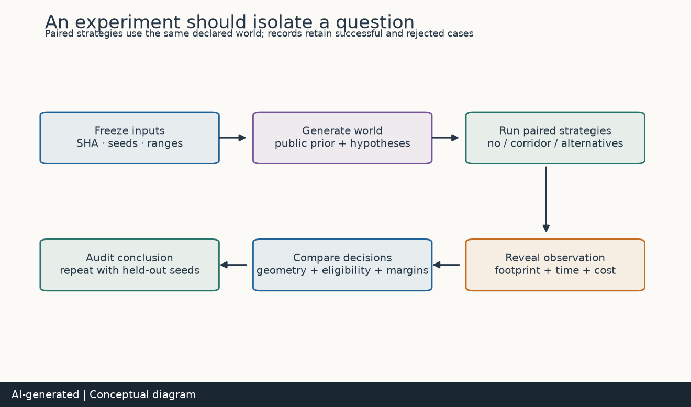
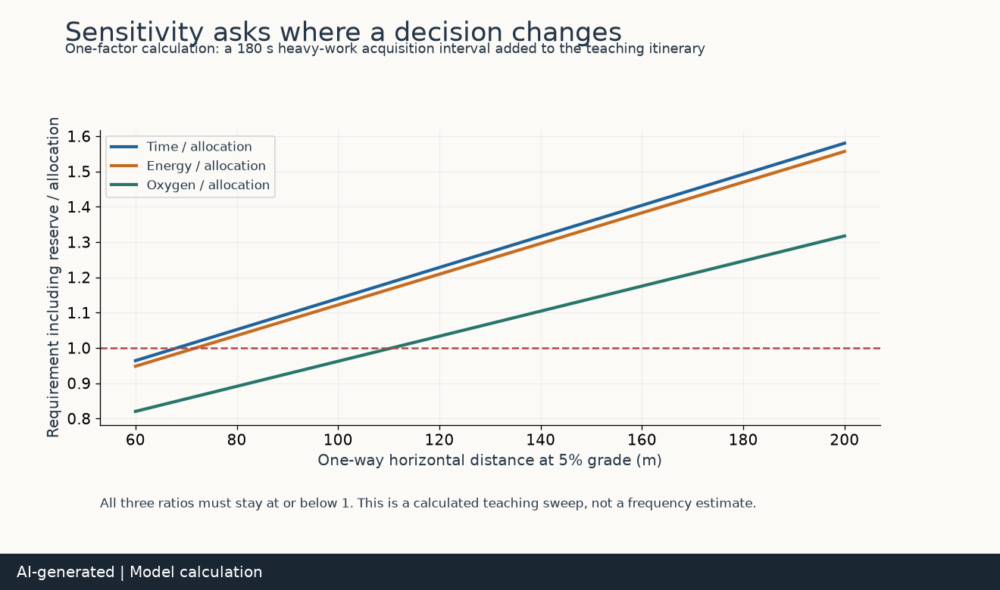

# Experimental method

An interesting route provides an example. An experiment explains why that example occurred and tests whether the explanation survives a change of conditions. For this project, the central distinction is between finding a route, estimating its complete itinerary, and observing enough of its execution to evaluate mission completion. Each question requires a different record.

This chapter develops the experimental logic used to study scale, uncertainty and reconnaissance. The [case studies](08-Case-Studies.md) then show what the existing local records support. The original integrated comparison is specified in the [A/B/C benchmark protocol](../science_benchmark.md); the larger-map research has its own [frozen protocol](../../evidence/overnight-mission-research-20261115-v3/protocol.json).

Figure 7.1. Conceptual design of a paired planning experiment. The world, resources and initial knowledge are shared inputs. The observation policy is the intervention whose consequences are evaluated.

## Start with a question that can change a decision

Consider a corridor that is short on the orbital prior but may contain an obstacle. Reconnaissance is useful if its information changes a later action enough to justify its own cost. It may support keeping the original route, selecting a detour, abandoning an optional task, returning, or holding for more information. An observation that confirms the original choice is also informative: it describes a case in which the intervention did not alter the decision.

We therefore evaluate actions and geometry rather than the mere production of a new route identifier. We also separate the effects of information from the effects of elapsed time. A vehicle can change its recommendation after a survey because the survey revealed an obstacle, because waiting consumed its margin, or because both occurred. Those are different mechanisms.

The broad audit uses five declared families: unchanged conditions, an obstruction with an alternative, an obstruction without an admissible alternative, altered relief, and additional delay or consumption. These names describe intended conditions to check. A seed remains in the catalogue even when its intended family condition does not materialize.

## Freeze the inputs before observing outcomes

A reproducible experiment identifies the public terrain product, crop geometry, coordinate and vertical conventions, NoData mask, initial uncertainty, A and B, profile values, activities, budgets, reserves, observation model, algorithm revision, search limits and seeds. File hashes identify the exact inputs; human-readable descriptions explain their meaning.

The approved small experimental scenario and the later research copies are separate configurations. The former uses a 128 m window and its recorded approval; the latter examines multiple regions, larger windows and explicitly proposed regional allocations. Each research result retains the configuration and approval status of its own scenario. The [parameter and decision catalogue](Parameters-and-Decisions.md) provides the distinction in one place.

For the nocturnal study, the frozen source was main `7ad605039a524d5b5cbe2c983f2da9113f8b1ce9`, with root seed `20261115`. The ordinary limits were 2 s and 200,000 labels per query. A later exact-cost diagnostic separately tested 20 s and 1,000,000 labels. The increased-limit result belongs to that later diagnostic, rather than silently replacing the original study's limits.

## Pair strategies on the same hypothetical world

The planned integrated A/B/C comparison changes the reconnaissance policy: A starts from the public prior, B concentrates reconnaissance on the candidate corridor, and C seeks information that distinguishes alternatives. Its P0 seed is 7; 19 and 42 are planned follow-up seeds. These are protocol choices, not results from three completed integrated missions.

The local research compares analogous `none`, `corridor` and `alternatives` strategies at the planner level. Each strategy sees the same underlying hypothetical world and initial allocations. A private process owns that world. The planner receives public belief, accepted observations and reached-pose telemetry; its observation footprint determines which new information becomes available. An analytical reference guard limits ground movement before a segment that is inadmissible in the private world. This guard is a simulation mechanism, while onboard hazard detection and physical braking would require their own models and measurements.

At a checkpoint, an information comparison holds pose, remaining resources and parameters fixed. One query receives the contextual observation; its counterpart retains only the same current-cell telemetry. A delay comparison then changes the available resources while controlling information. This construction makes the counterfactual precise. If one branch had a different pose or a gratuitous resource reset, its difference could not be attributed to the observation alone.

## Sample ranges without choosing only convenient cases

Latin hypercube sampling distributes each input's samples across equal-probability strata. For a uniformly sampled parameter between declared bounds $a$ and $b$, a unit sample $u$ is transformed as

$$
x=a+u(b-a).
$$

The parameter's range expresses the study design. It is not automatically a measured probability distribution for Mars. The method originates in [McKay, Beckman and Conover (1979)](https://doi.org/10.2307/1268522); the implemented sampling interface is documented by [SciPy](https://docs.scipy.org/doc/scipy/reference/generated/scipy.stats.qmc.LatinHypercube.html). The protocol records the generator and seed rather than relying on a sampler's default initialization.

The audit separates mission, world and sensor random streams. Consequently, requesting an extra observation does not regenerate the terrain. This follows the explicit stream-management approach described in [NumPy's random-number documentation](https://numpy.org/doc/stable/reference/random/parallel.html). Derivation also includes identifiers such as region, size, family and index so execution order does not define the scenario.

The declared broad design requests 16 seeds per family and sector on the 512 and 1,024 m windows. Indices 0–11 support exploration; 12–15 provide a preassigned check set. These groups organize evaluation. The classical planner is not trained on the exploratory group.

## Separate sensitivity from a frequency estimate

Figure 7.2. A calculated teaching sensitivity sweep using the existing scientific estimator. One-way distance changes at fixed 5% grade, with a 120 s check-in, a 180 s heavy-work acquisition interval and fixed reserves. All resource ratios must remain at or below one. The curve describes this constructed itinerary rather than a distribution inferred from the audit.

A one-parameter sensitivity test changes one coefficient while retaining the scenario. A joint stratified sweep varies several declared inputs to examine interactions. Both help locate fragile decisions. Neither design supplies the natural incidence of obstacles, scientific targets or hazards in the real region.

The broad worlds are generated before the initial query. Directed cases instead place a perturbation in relation to a known corridor or margin. Directed cases efficiently explain a threshold, but their selection is conditional. Their change rate is therefore reported separately from the broad sweep.

Search limits introduce another distinction. `UNKNOWN/SEARCH_LIMIT` means the bounded computation did not decide the request. A paired comparison containing that result is censored for causal interpretation. It is not transformed into `NO_PATH`, and it does not establish a benefit for the strategy whose search happened to finish.

## Define measurements at the level of the claim

Useful planner measurements include returned status, expanded labels, query latency, route geometry, directed return cost and resource margin. Analytical workflow measurements add reached steps, disjoint movement/service/wait intervals, accepted observations and remaining allocations. Integrated mission measurements additionally require context-bound execution evidence.

The existing success rule combines four requirements: evidenced primary work at B, observed post-B return to A, complete justified executed ground traversal, and resource-ledger closure. The [success contract](../mission_success_contract.md) and [machine-readable criteria](../../config/mission_success.experimental.json) state their bindings. A route candidate and a replay image answer different questions from those four execution records.

Finally, report the denominator. The definitive nocturnal catalogue contains 6,108 analytical episodes, including dependent policy and mode arms, rather than 6,108 independent worlds. The [study report](../../evidence/overnight-mission-research-20261115-v3/README.md) retains completed, unavailable and pending blocks. Preserving this accounting lets another reader reconstruct both the conclusions and the unanswered part of the design.

## Sources and further reading

- McKay, M. D., Beckman, R. J. and Conover, W. J. (1979). [A comparison of three methods for selecting values of input variables in the analysis of output from a computer code](https://doi.org/10.2307/1268522). Methodological origin of Latin hypercube sampling.
- SciPy developers. [LatinHypercube reference](https://docs.scipy.org/doc/scipy/reference/generated/scipy.stats.qmc.LatinHypercube.html). Implementation semantics; the run's recorded environment determines its actual version.
- NumPy developers. [Parallel random number generation](https://numpy.org/doc/stable/reference/random/parallel.html). Explicit random-stream derivation.
- Project records: [integrated benchmark](../science_benchmark.md), [frozen research protocol](../../evidence/overnight-mission-research-20261115-v3/protocol.json), and [definitive research report](../../evidence/overnight-mission-research-20261115-v3/README.md).

Continue with [Case studies](08-Case-Studies.md), or return to [Home](Home.md) and the [Bibliography](Bibliography.md).
