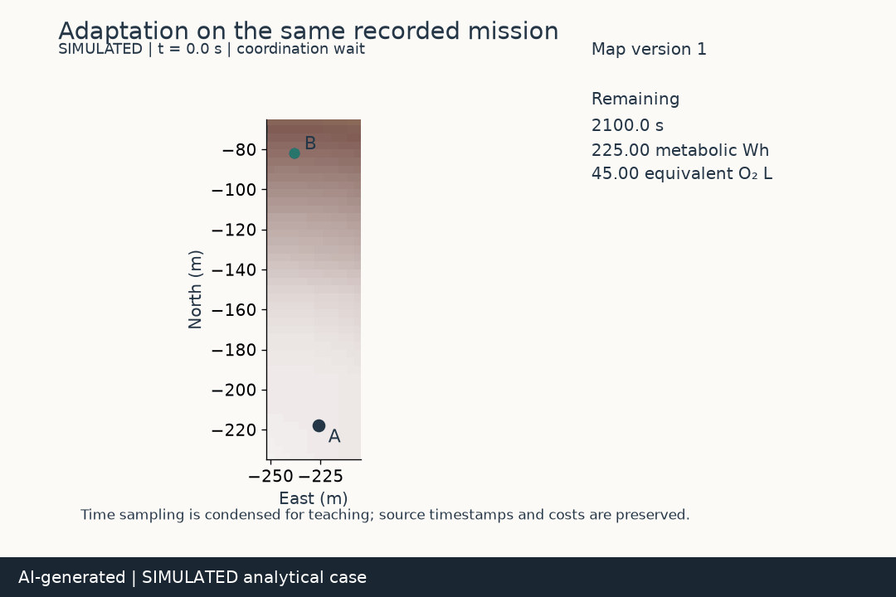
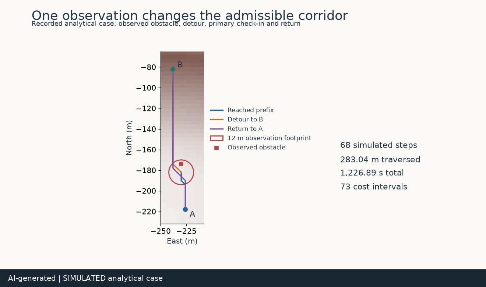
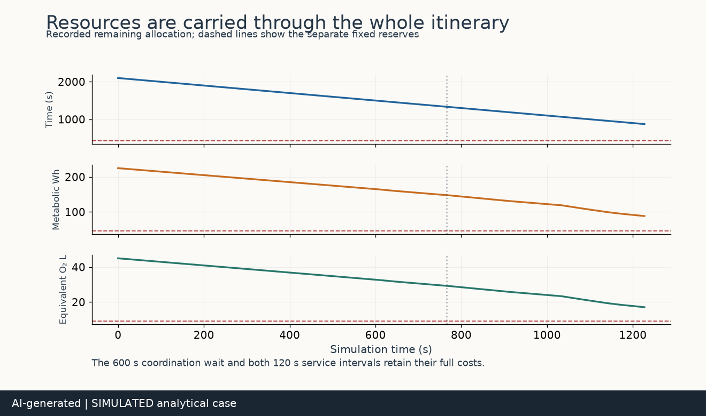

# Case studies and recorded results

The most useful example is one whose explanation can be followed from an initial assumption to a later decision. This chapter presents three complementary views: selected changes from the broad planning audit, a complete local analytical EVA, and a controlled comparison of map sizes. Their records answer different questions, so each case carries its own identity and scope.

The baseline experimental scenario uses the approved 128 m window and its own A/B coordinates. The Bunsen example below is a later, single-human research experiment with different endpoints and resources. Its 256 m presentation window does not replace that baseline.

## What changed in the broader audit?

The definitive nocturnal study evaluated three regional query anchors: Bright Angel–Neretva, Hawksbill–Hogwallow and Bunsen Peak. It retained 6,108 episodes in its final tables. A completed block combines two ground agents, two planner modes and three observation policies; these arms share inputs and are statistically dependent. The broad regime completed 408 of 480 planned blocks. Its private arrays had 252 distinct hashes, emphasizing why the episode count is not an independent-world count. The [definitive report](../../evidence/overnight-mission-research-20261115-v3/README.md) gives the complete denominators and pending cases.

Three examples make the distinction between information and consumption concrete:

| Recorded case | Comparison | Scientific reading |
|---|---|---|
| `bright-512-relief-3`, rover FAST | KEEP → DETOUR with contextual observation | The newly available context changed the selected geometry at the same pose and resource state. |
| `bunsen-128-blocked-13`, rover FAST, check set | KEEP → RETURN with contextual observation | The revised knowledge supported returning rather than continuing the pending agenda. |
| `bright-256-resource-14`, human FAST, check set | KEEP → DROP_OPTIONAL after additional delay | Lost resource margin, rather than information alone, changed the recommendation. |

The [curated-case record](../../evidence/overnight-mission-research-20261115-v3/curated-cases.json) preserves the observations, checkpoints and alternatives. The first case received a 29-cell footprint with 33,866.77 s and 1,157.11 electrical Wh remaining. The second retained 16,551.98 s and 564.50 Wh after a 29-cell observation. The human delay case used a 13-cell footprint and retained 2,672.63 s, 307.83 metabolic Wh and 62.87 equivalent litres of oxygen at its compared checkpoint. These allocations are research assumptions and are not comparable vehicle performance ratings.

An unchanged case is equally valuable. `bunsen-512-unchanged-12` retained KEEP with and without contextual information. A separate Hawksbill comparison was censored by a search limit and contributes no causal change claim. Together, these examples show why a new map version, observation or route identifier is insufficient to demonstrate adaptation.

Figure 8.1. The recorded Bunsen analytical EVA developed in the next section, animated from its timestamped timeline. The labels distinguish its simulated local observation from the public terrain prior. This animation illustrates that particular EVA; the curated comparisons above retain their separate records and conditions.

## A complete local analytical EVA

The run `local-cost-eva-bunsen-20261115-02` uses published planner source main `64985e7b4b69ac9683661db4842885d5a8293695` with a mission-owned exact scientific-cost composition. Its [raw experiment](../../evidence/mission-cost-experiment-20261115-local-v2/experiment.json) and [independent analytical audit](../../evidence/mission-cost-experiment-20261115-local-v2/analytical-audit.json) provide the numerical account.

The human begins at A = (−226, −218) m and has B = (−238, −82) m in local east/north coordinates. Heights retain the source datum. The programmed sequence is a 600 s coordination wait, an initial plan, an outbound prefix, a 120 s inspection, a restricted simulated observation, invalidation and replanning, primary 120 s stationary service at B, and directed return to A. Planning wall latency is charged as analytical waiting under the declared 1:1 assumption.

Figure 8.2. Recorded geometry from the local analytical EVA. The observation is a synthetic intervention associated with the initial corridor; the plotted coordinates are not an independently registered geological workspace.

The hypothetical obstacle was deliberately placed ahead of the programmed inspection point. A separate process supplied the private synthetic world. The accepted observation exposed only a 12 m-radius footprint containing 29 computational grid centres. Its noiseless-height assumption and declared 0.25 m observation sigma belong to this analytical sensor model. The public prior originated from CTX terrain; a 4 m computational grid did not make those 29 samples independent 4 m orbital measurements.

After the observation, the active candidate was invalidated and a new request used the reached XYZ and current remaining resources. In total the workflow completed 68 simulated ground steps covering 283.0374 m, with 73 disjoint cost intervals and an elapsed analytical duration of 1,226.8855 s.

| Resource | Initial allocation | Consumed | Remaining | Separate reserve |
|---|---:|---:|---:|---:|
| Active time, s | 2,100 | 1,226.8855 | 873.1145 | 420 |
| Human metabolic energy, Wh | 225 | 136.7195 | 88.2805 | 45 |
| Dry equivalent oxygen, L | 45 | 27.9185 | 17.0815 | 9 |

Figure 8.3. Resource closure for the recorded analytical run. Horizontal reserve lines represent retained allocations, not extra consumable resources. The initial wait remains charged even where video presentation abbreviates it.

The independent audit matched 38 cost contexts, checked both public map versions, found zero duplicate journal debits, and recovered the journal under the same run identifier. Margins above the separate reserves at return were 453.1145 s, 43.2805 Wh and 8.0815 L. The 600 s sampling alternative was not assigned: prior rover-inspection evidence was absent, and the candidate's work plus return failed all three applicable resource checks.

This result establishes closure of the recorded analytical workflow under its declared assumptions. The harness did not run MissionManager or produce ROS work/traversal telemetry. Its physical-or-ROS mission verification field is false, and owner review of the proposed analytical-verification label remains pending. This description gives the numerical result its proper experimental unit: one bounded single-human trace.

## Does this mission need a 512 m map?

The original query window measured 512 × 512 m. A and B are only 136.5284 m apart horizontally, and the northing span is 136 m. The enclosing rectangle of all reached and candidate routes measures 12 × 136 m; including the entire observation circle expands it to 24 × 136 m. Its 1.2451% share of the original map is a bounding-box fraction, rather than an observed-coverage or search-frontier metric.

The [crop comparison](../../evidence/mission-3d-video-20261115-local/map-analysis/crop-comparison.json) reran the initial request and the post-observation request on the original 512 m window and an aligned 256 m southwest crop. The four searches were FEASIBLE within the original 2 s/200,000-label limits. Each pair returned exactly equal outbound and return geometry and time, energy and oxygen costs. Expanded-label counts were identical: 3,033 initially and 1,804 after observation.

The smaller raster contains 4,096 rather than 16,384 cells, a 75% reduction. It preserves the ENU origin, A/B, heights, masks, uncertainty, resources and observation world centres. A 128 m square aligned with this grid cannot contain the 136 m northing separation. A 160 m square can enclose the geometry, but its planning was not tested. Thus 256 m is a checked active window for these two requests; the 512 m source provides regional context. Other goals or alternatives can require a different domain.

## Reading the 3D replay

The [82.2 s Web-viewer video](../../evidence/mission-3d-video-20261115-local/capture-final/mission-web-3d-final.mp4) displays the same analytical run in the unchanged viewer from main `9013bebf2400d605f5a3d68e79dadbd5d1c57d03`. It preserves source coordinates and resource totals. Presentation interpolation and playback edits make the route legible without producing new mission evidence. The permanent AI-generated / SIMULATED / NOT LIVE watermark identifies that provenance throughout the recording.

## Sources and further reading

- Project [definitive nocturnal report](../../evidence/overnight-mission-research-20261115-v3/README.md) and [curated cases](../../evidence/overnight-mission-research-20261115-v3/curated-cases.json).
- Project [exact-cost analytical packet](../../evidence/mission-cost-experiment-20261115-local-v2/README.md), [raw run](../../evidence/mission-cost-experiment-20261115-local-v2/experiment.json), and [independent audit](../../evidence/mission-cost-experiment-20261115-local-v2/analytical-audit.json).
- Project [map-window analysis](../../evidence/mission-3d-video-20261115-local/map-analysis/README.md) and [video provenance](../../evidence/mission-3d-video-20261115-local/README.md).

Continue with [Discussion](09-Discussion.md), or return to [Home](Home.md) and the [Bibliography](Bibliography.md).
