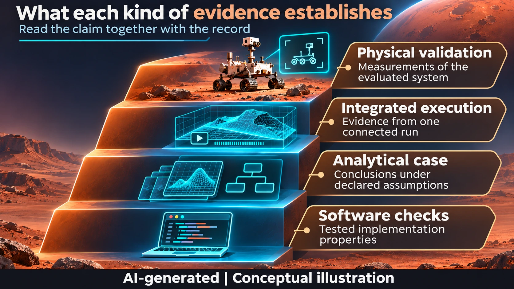

# Discussion and research perspectives

The project brings two kinds of reasoning together. Planetary science motivates where an expedition might look and which observations could distinguish geological interpretations. Mission modelling asks whether an agent can reach a place, perform a specified activity and retain a justified return under limited resources and incomplete terrain knowledge. A useful conclusion connects these two questions at the spatial and temporal scale actually represented by the data.

The present evidence supports several conditional conclusions. It also identifies the next observations and experiments that would make those conclusions more informative. This chapter organizes both around questions that a reader can test.

## Scientific interest and model accessibility describe different properties

A region's documented geological interest does not increase because a planner finds a short route through its crop. Conversely, an unsuccessful search does not diminish the scientific questions associated with the region. The [Jezero chapter](02-Jezero-Science.md) evaluates published geological evidence; the [terrain chapter](03-Terrain-and-Scale.md) establishes which aspects of that setting the numerical map represents.

Bright Angel–Neretva, Hawksbill–Hogwallow and Bunsen Peak remain complementary candidates because their published contexts motivate different questions. A mission proposal should name the observation required to pursue each question, the instrument capable of making it and the relevant spatial scale. A visual terrain inspection can support a mobility decision. A claim about mineralogy or organic associations requires the appropriate instrumental evidence and interpretation.

The connection is therefore an evidence chain: scientific question → observable property → instrument and sampling scale → activity → route and resources → recorded result. Making that chain explicit allows the team to revise a workload or map request when a required observation lies beyond its current representation.

## Choose the map around the decision

The Bunsen case illustrates a simple but consequential point: a large raster is useful when the mission needs its additional destinations, alternatives or context. It is not inherently more representative because it contains more cells.

The checked 256 m crop retained exactly the routes and costs of its 512 m source for the initial and post-observation requests. This supports a local working window for that example. It does not determine the correct size for all three regions, for a rover campaign or for a different set of scientific stops. Cropping changes boundaries and may remove a valuable alternative.

A practical map request can therefore contain nested products: a registered regional context, a planning domain large enough to hold meaningful alternatives, and a detailed worksite product for the activity itself. The request should identify its centre, footprint, native spacing, datum, uncertainty information, public mask and georeferenced image. These quantities answer different questions from the display camera's field of view.

The 4 m computational grid remains an interpolated representation of the 20 m CTX DTM spacing. Smaller cells provide a convenient numerical mesh; they do not supply observed small rocks or a measured soil field. A scientifically useful increase in detail requires a corresponding source or an explicitly modelled hypothetical perturbation.

## Reconnaissance is an allocation problem

The audit produced examples of maintaining a decision, detouring, returning and dropping optional work. This diversity is more informative than a catalogue containing only successful detours. It shows that the value of an observation depends on what decision is still open and how much margin remains.

In the paired comparisons, information is valuable when it changes geometry or eligibility at the same reached pose and resource state. Waiting has a different effect: it can make an originally affordable agenda inadmissible even when the map is unchanged. The [method chapter](07-Experimental-Method.md) explains how these two contributions are separated.

This suggests a focused reconnaissance question: which footprint is most likely, under the declared hypothetical ensemble, to distinguish actions that remain affordable? The current results provide cases for studying that question, rather than a calibrated probability model for Mars. A costly survey can be rational when it resolves a consequential alternative, while a shorter confirmation survey can be rational near an already adequate corridor. The comparison must charge both movement and observation to the appropriate agent.

## Time scales determine what a resource budget means

Human EVA time, a rover campaign and a drone sortie describe different operational intervals. The local analytical EVA's 2,100 s allocation is an experimental active window. It is not an astronaut's full life-support capacity. Likewise, a rover campaign allocation is not its lifetime driving range, and a single-flight drone cap does not establish complete campaign autonomy.

The [agent chapter](04-Agents-and-Activities.md) and [resource chapter](05-Resource-Models.md) connect activities to those intervals. Their distinction also explains why a solar-recharged campaign cannot be obtained by repeatedly resetting a single-route battery budget. Generation, storage, standby, thermal conditioning, scheduling and charging opportunities would need their own explicit model.

The existing single-human trace gives a particularly clear teaching example: 600 s of charged waiting consumes a substantial part of a short EVA allocation before any displacement. Its eventual return demonstrates accounting for that chosen workload. Changing the workload, reserve fraction or biological coefficients changes the question being evaluated and requires a separately identified configuration.

## Build evidence at the level of the conclusion

Figure 9.1. Evidence categories and their claim scope. Software checks examine tested properties; an analytical case supports conclusions under declared assumptions; connected execution supplies a same-run record; physical validation requires measurements of the evaluated system. The picture illustrates these categories. [Full-size PNG](assets/imagegen-20261115/10-evidence-ladder-reviewed.png).

Software checks establish properties such as duplicate rejection, journal recovery, coordinate conversion or numerical agreement for tested contexts. An audited analytical workflow adds a complete trace under declared terrain, sensing and cost assumptions. The Bunsen packet belongs to that latter category and records its pending owner review.

The integrated simulated-mission question requires four same-run evidence streams: primary work at B, observed return, complete justified traversal, and a resource ledger. Production cost/context agreement, service and stop feedback, and recorder identity make those streams comparable. A replay is then a way to inspect their record. Its animation provides an explanatory view; the underlying evidence supports the acceptance decision.

Physical validation is another experimental step. Measured localization, perception, locomotion and consumption would be needed to assess transfer to a real robot or EVA system. Transfer is therefore a research question with its own measurements, distinct from checking the internal consistency of an analytical model.

## A sequence of useful next studies

The first priority is a registered site package, linking the intended scientific workspace to a public terrain/image footprint and independent control information. The second is a reviewed resource configuration with fixed activity identities and durations, so planning and execution describe the same itinerary. The third is an integrated same-run experiment that records service, reached-pose stop/replan behaviour, return and disjoint consumption.

After those records exist, the A/B/C comparison can investigate reconnaissance under identical initial conditions. Prespecified seeds, complete outcome tables and explicit search-limit handling will make that comparison interpretable. Sensitivity studies can then identify whether its conclusions depend on a narrow coefficient choice or persist across the declared ranges.

Larger domains should answer a new question: additional sites, alternative corridors, worksite diversity or a longer robot campaign. Their benefit should be measured against their computational and operational cost. The goal is a traceable relation between scientific purpose and the information required to support a mission decision.

## Sources and further reading

- Project [science-site survey](../science_patch_survey.md), [map requests](../science_patch_map_requests.md), and [agent campaign proposal](../agent_campaign_proposal.md).
- Project [four-predicate success contract](../mission_success_contract.md) and [proposed analytical/integrated verification criteria](../mission_simulated_verification.md).
- Project [definitive research report](../../evidence/overnight-mission-research-20261115-v3/README.md), [analytical EVA audit](../../evidence/mission-cost-experiment-20261115-local-v2/analytical-audit.json), and [actual crop comparison](../../evidence/mission-3d-video-20261115-local/map-analysis/crop-comparison.json).
- The primary scientific literature and data-product descriptions are collected in the [Bibliography](Bibliography.md). Statements about specific sites and model coefficients should be read with their source and derivation in the corresponding chapter.

Return to [Home](Home.md), consult the [Glossary](Glossary.md), or follow the [reproduction guide](Reproducibility.md).
