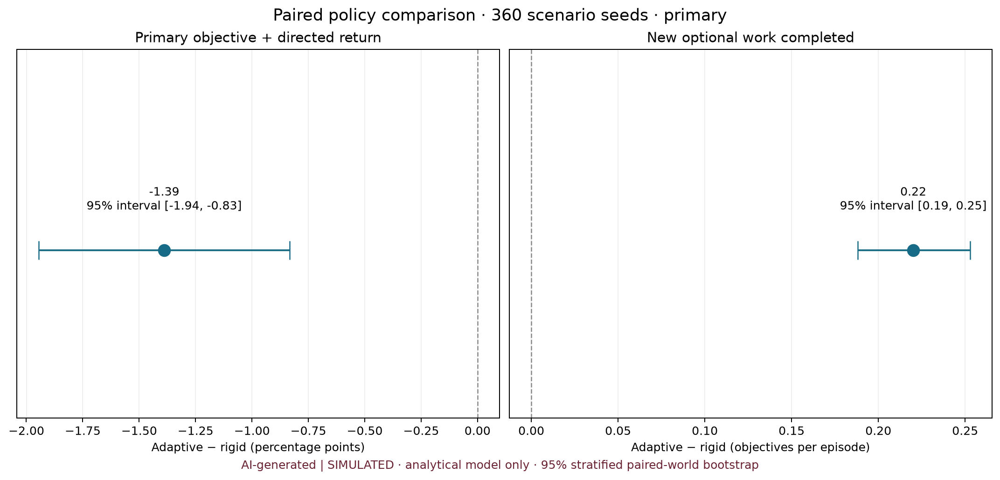
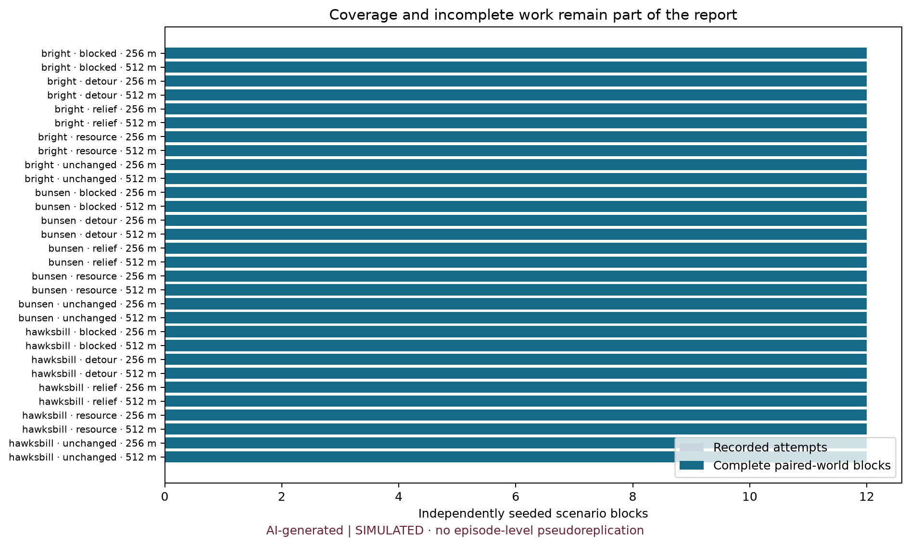
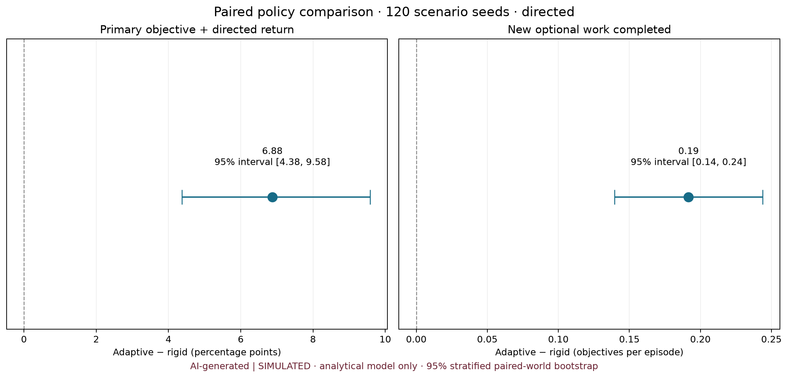

# When a mission changes its mind

This experiment asks when a plan prepared at departure remains useful and when a new observation justifies changing the route or the scientific work. It compares two policies on the same analytical mission, with the same initial terrain, agent, resources and later world. The fixed policy keeps its initial itinerary. The adaptive policy can replan after receiving new terrain information or a newly announced additional inspection at B. Both policies remain subject to the same resource, directed-return and reserve accounting.

The broad comparison finds more additional work with adaptation, alongside a small reduction in primary-and-return completion caused by constrained replanning. Corridor-conditioned cases show the complementary benefit: a detour can preserve the mission when a newly observed obstruction affects the initial route. Reading the two designs together explains when flexibility helps and where this implementation still spends its computational budget.

The experiment is classified as SIMULATED. Its outcomes describe the frozen planning and resource models under declared synthetic observations. The recorded completion criterion is completion within that analytical model; operational mission acceptance retains its own execution and evidence requirements. The comparison has one reached checkpoint and one posterior decision, which makes the response to that decision visible without claiming continuous autonomous exploration.

## A matched comparison

The study uses the Bright Angel–Neretva, Hawksbill–Hogwallow and Bunsen Peak public terrain windows. The regional names identify areas of scientific interest and map queries. They do not establish that a particular computational cell is an observed outcrop or that an onboard sensor can identify a composition at that location. CTX has a native resolution of 20 m in this dataset. The 4 m planning grid is a resampling of that source, rather than an independent 4 m geological observation.

Each independently seeded scenario/mission block contains matched fixed and adaptive episodes for a human and a rover, each using FAST and SAFE planning. The repeated conditions share a world; they are four views of one mission draw conditional on the selected public terrain. Observations, intermediate checkpoints, route alternatives and the two policy outcomes also remain part of that same block. This distinction determines the statistical denominator.

The planned main grid contains 360 independently seeded scenario blocks: three sectors, five perturbation families, two window sizes of 256 and 512 m, and 12 seeded draws in each combination. Cases are interleaved across combinations so that the execution deadline does not concentrate all coverage in a single sector. A separate strict-uncertainty control retains the 1 m threshold. The broad research comparison uses the explicitly experimental 3 m threshold against the assigned 2.5 m uncertainty of the orbital prior. These thresholds represent different admissibility questions and are reported separately.

The five families ask about an observation that preserves the decision, an obstruction with a possible alternative, an obstruction without an admissible alternative, local relief that changes access or cost, and additional time or consumption. A family is a condition to test. Its name does not guarantee that the generated world causes a detour, an infeasible mission or a changed decision. Newly available optional work is an additional INSPECT activity at the same B, announced through an exogenous public mission notice in half the indexed cases. It tests flexibility in the work schedule rather than discovery of a new spatial target. Its eligibility and completion are recorded explicitly.

Budgets, reserves, rover inspection duration and perturbation amplitude/scale follow three coupled design tiers indexed by the seed. Their effects cannot be isolated as independent parameter sensitivities in this run; the scientific profile coefficients remain nominal. This is a paired mission-and-world comparison rather than a Latin-hypercube coefficient sensitivity sweep.

The main research variant also uses a local grade-consistent projection for the planning step limit. The published 0.20 m parameter measures elevation difference between adjacent cell centres; at 4 m spacing it can restrict an ordinary continuous slope as though it were a discrete step. The research projection bounds that difference using the agent's declared slope limit and link length. It does not estimate unresolved rock height from CTX. A separate published-step control retains the original parameter, and neither experimental projection constitutes scientific approval or a shared-contract change.

The broad sweep defines its random world independently of the initial planner result, with a separate random stream. Unchanged cases can share an identical terrain array while their mission geometry differs. Distinct array hashes are therefore counted separately from scenario seeds. Directed cases may instead place a perturbation in relation to an initial corridor to identify a mechanism or a threshold. These are different sampling designs. The broad results and the directed examples therefore have separate denominators.

## What counts as an improvement

The primary endpoint gives one unit of analytical completion credit only when the primary objective and directed return are complete, the result is resolved, and the ledger explicitly reports no resource or reserve violation. A timed-out or UNKNOWN search receives no analytical completion credit and remains separately identified as unresolved. It does not establish that a physical path is absent. A block not executed before the deadline is retained as pending coverage rather than entered as an observed failure.

Within a world, the comparison is the adaptive completion credit minus the fixed-policy credit, averaged equally over the four agent and planning conditions. The overall estimate then gives equal weight to each sector, family and size combination. This expresses the planned experimental comparison rather than the accidental mix of faster cases completed before a deadline. An uncovered combination makes the full planned-target estimate unavailable; a covered-combinations estimate can still be reported with its actual scope.

Optional objectives are a separate endpoint. Adaptation can accept a target that was unavailable when the fixed itinerary was prepared. Its benefit in this endpoint partly follows from the policy definition. The resulting count describes useful responsiveness to newly introduced scientific work; the primary completion and safety endpoints show whether that responsiveness also preserves the original mission and return.

A new route identifier or a no-op refusal of optional work is insufficient to count as adaptation. The comparison reconstructs meaningful change from geometry, extra optional work or a difference in resolved primary/return outcomes and retains the before-observation decision, received information, remaining allocations and after-observation response. A different geometry in an unchanged-world control describes replanning behavior; it does not establish that new terrain information caused the difference. Resource costs for movement, observation, service and waiting remain recorded once. Replanning does not restore spent allocations, and the return is evaluated in its actual direction.

Both policies pay for and receive the same observation at the checkpoint. Synthetic measurements use the hypothetical world values without added measurement noise; the 0.25 m sigma supplied to fusion and the 12 m footprint are experimental inputs, rather than calibrated instrument performance. The private-world traversal guard is an analytical admissibility check, not an onboard detection capability. This isolates how they respond to available information; it does not estimate the net value of buying reconnaissance instead of foregoing it. A private-world analytical guard stops traversal before an inadmissible segment. The fixed policy can reverse a known reached prefix, while an adaptive UNKNOWN response requests a fresh return search, which can itself reach the computation limit. This difference belongs to the tested implementation and helps explain the completion comparison.

Main-batch queries retain an 8 s and 1,000,000-label search limit. The 1,024 m supplementary batch has its own declared 20 s and 1,000,000-label limit. The query limits are distinct experimental conditions. Processor wall time is recorded for computational diagnosis and is not charged as physical mission time or energy. Concurrent-worker latencies describe this run's execution conditions rather than a controlled serial speed benchmark.

## Results of the broad comparison

The main catalogue closed with all 360 planned scenarios and 1,440 matched agent/mode pairs. Every sector, family and size combination contains its 12 planned draws. The 360 mission seeds produce 222 distinct private-world array hashes, which reflects the repeated prior arrays in unchanged and resource-only conditions.

The fixed policy receives primary-and-return completion credit in 875 of 1,440 episodes, or 60.764%. The adaptive policy receives credit in 855, or 59.375%. The paired difference is −1.389 percentage points, with a 95% paired-scenario interval from −1.944 to −0.833 percentage points. The predeclared comparison therefore does not show a primary-completion benefit from this adaptive implementation in the broad ensemble.

The condition table shows where that difference occurs. Each row contains the same 360 independently seeded scenarios; adding rows does not create additional independent terrain samples.

| Condition | Fixed primary + return | Adaptive primary + return | Adaptive-only completion | Fixed-only completion | Additional inspections completed |
|---|---:|---:|---:|---:|---:|
| Human, FAST | 164/360 | 164/360 | 0 | 0 | 47 |
| Human, SAFE | 146/360 | 135/360 | 0 | 11 | 40 |
| Rover, FAST | 286/360 | 286/360 | 0 | 0 | 119 |
| Rover, SAFE | 279/360 | 270/360 | 0 | 9 | 111 |

All 20 fixed-only completions occur in SAFE conditions. Their interpretation depends on the search and return policies: the adaptive arm must complete an additional planning query, while the fixed arm can retain a usable itinerary. The broad comparison includes this computational availability cost. Its result does not establish that adaptation is intrinsically less useful in a physically obstructed corridor.

Adaptive episodes complete 317 additional inspections at B; fixed episodes complete none because their task set is fixed at departure. The average difference is +0.220 inspections per agent/mode episode, with a 95% paired-scenario interval from +0.188 to +0.253. This endpoint demonstrates useful work that fits the declared allocations. It does not measure discovery yield or visits to new spatial targets.

The recorded analytical ledgers contain no resource or reserve violation in either policy. Since every observed violation indicator is zero, its bootstrap interval is degenerate. That observation describes the guards and outcomes of these recorded runs; it does not estimate the frequency of unmodelled hazards.

Initial planning yields 890 FEASIBLE, 484 NO_PATH, 63 UNKNOWN and three insufficient-budget conditions. A further two shared-prefix traversals halt before the policies diverge. All remain in the primary denominator. The per-episode unresolved flag also covers unavailable execution evidence after some common guards; actual planner UNKNOWN outcomes are counted independently from that flag using the recorded query statuses.

The query audit identifies another useful boundary: all 76 INVALID_START_Z errors occur in optional queries in the relief family, after the primary objective and return still complete. At B, the reached XYZ contains the hypothetical terrain height while that cell may still retain its unobserved prior height in the planning map. The published centred-start contract requires agreement within 1 µm, so the consumer preserves the actual pose and declines the optional query. This is a concrete requirement for a later implementation: reconcile new reached-pose information and map provenance before requesting additional work; do not silently change the pose.

## What changes when an obstruction is deliberately placed on a corridor

The directed batch contains 120 separately reported scenario blocks and 480 paired conditions. It reuses the first four main-batch seed indices and their mission geometry. Unchanged and resource-family controls reuse the corresponding main seeded inputs; conditioned obstacle and relief placement changes the applicable worlds. These blocks are not additional independent replications of the main batch. It places the perturbation relative to an initial route, rather than asking whether a broadly placed perturbation happens to affect that route. The fixed policy receives completion credit in 181 conditions and the adaptive policy in 214. There are 36 adaptive-only and three fixed-only completions. The descriptive paired difference is +6.875 percentage points, with a 95% conditional-scenario bootstrap interval from +4.375 to +9.583 percentage points. The adaptive policy completes 92 extra inspections, or +0.192 per episode.

This directed result demonstrates a mechanism: rerouting can preserve the original mission when new information identifies an obstruction that matters to the chosen corridor. Its magnitude cannot replace the predeclared broad result. The batch deliberately concentrates relevant perturbations and uses its own four-index design; the two batches are not a randomized estimate of the effect of changing the prevalence of Martian obstacles. Their reused inputs also make the cross-batch panels dependent; no independent-samples test compares their effect estimates.

| Separate experiment | Scenario blocks | Matched conditions | Fixed primary + return | Adaptive primary + return | Adaptive − fixed | Extra inspections |
|---|---:|---:|---:|---:|---:|---:|
| Broad, 256/512 m, predeclared comparison | 360 | 1,440 | 875 | 855 | −1.389 pp | 317 |
| Corridor-conditioned, 256/512 m | 120 | 480 | 181 | 214 | +6.875 pp | 92 |
| Supplementary broad, 1,024 m, 20 s query limit | 180 | 720 | 233 | 211 | −3.056 pp | 82 |

The [broad analysis](../../evidence/rigid-adaptive-study-20261115/main/analysis/summary.json) and the [directed analysis](../../evidence/rigid-adaptive-study-20261115/directed/analysis/summary.json) retain their separate denominators, initial planning states, query outcomes and per-stratum counts.

## A separate 1,024 m extension

The supplementary extension completed all 180 planned scenarios and 720 matched conditions before the computation cutoff, with 12 indices in every one of its 15 sector/family combinations. There are no pending or replaced seeds in this batch. It contains 111 distinct private-world array hashes. Its query limit is 20 s with the same 1,000,000-label cap, so its results remain separate from the predeclared 8 s main comparison.

The fixed policy completes the primary objective and return in 233 conditions, compared with 211 for adaptation. The paired difference is −3.056 percentage points, with a 95% paired-scenario interval from −4.306 to −1.944 percentage points. Adaptation completes 82 extra inspections, a mean difference of +0.114 per episode, with a 95% interval from +0.082 to +0.149. The recorded resource and reserve guards report no violation in either policy.

Initial planning obtains 239 FEASIBLE, 291 UNKNOWN, 184 NO_PATH and six insufficient-budget results. All 239 FEASIBLE conditions reach the posterior decision: 211 obtain a FEASIBLE posterior route and 28 return UNKNOWN. Of the resolved routes, 149 retain their horizontal geometry and 62 change it. Extra inspections occur in 63 of the retained-route episodes and 19 changed-route episodes. The [supplementary analysis](../../evidence/rigid-adaptive-study-20261115/extended-1024/analysis/summary.json) retains the full catalogue and these separate denominators.

These windows test a larger mission problem as well as a larger grid. Endpoint separation is sampled between one eighth and one half of the map side, while allocations remain tied to sector and agent through the declared tiers. Larger windows can therefore demand longer physical itineraries with different resource margins. The changed task spans, terrain and 20 s computation limit prevent treating this comparison as an isolated measurement of map-size latency or as evidence that a larger map is inherently preferable.

The figures display the paired effects and coverage. Their nominal 95% intervals resample whole scenarios within sector, perturbation family and map size, preserving the paired policies and all repeated agent/mode conditions. The fixed bootstrap seed and 10,000 resamples make the analysis reproducible for the recorded catalogue. Scenario generation and input hashes are also reproducible, while wall-clock search limits depend on the host and concurrent load; a rerun can therefore reach different computational limits without changing its seeded world. Shared-worker scheduling can also correlate computational-limit outcomes across scenarios. The intervals express empirical scenario-resampling sensitivity in this catalogue, rather than guaranteed coverage across hosts or schedulers. A small or constant group is explicitly flagged; an interval that collapses to one value describes the recorded group and does not establish universal behavior.

Figure 1. Paired effects for the predeclared broad comparison. The left endpoint includes directed return and explicit resource/reserve evidence. The right endpoint counts additional inspections at B. The intervals retain all dependent agent/mode conditions within each resampled scenario.

Figure 2. All 30 predeclared combinations contain 12 scenario seeds. These are mission draws conditional on the selected terrains, not 360 independently sampled geological sites.

Figure 3. Corridor-conditioned cases show the value of a detour when the hypothetical obstruction is deliberately relevant to the initial route. Their conditional effect is distinct from the broad sampling result.

The initially FEASIBLE panel answers a narrower question: what happened after a usable initial itinerary existed? The unconditional comparison also retains initial failures and UNKNOWN searches. Reading the two panels together separates the ability to begin the mission from the ability to respond after departure. Differences in query count and fixed per-query search limits are part of this implementation and can affect computational availability.

## An observation need not change the route

The direct geometry comparison answers this question more clearly than route identifiers. Here geometry compares the outbound and return horizontal XY sequences; height updates and their costs remain in the terrain and resource records. Of the 888 broad conditions that reach the common posterior decision, 858 obtain a FEASIBLE posterior route and 30 return UNKNOWN. Among the 858 resolved routes, 612 retain the initial remaining geometry and 246 change it. An UNKNOWN query is left unresolved rather than counted as a decision to keep the route.

| Separate group | Posterior decisions reached | FEASIBLE posterior routes | UNKNOWN | Other resolved rejection | Geometry retained among FEASIBLE | Geometry changed among FEASIBLE |
|---|---:|---:|---:|---:|---:|---:|
| Broad, all five families | 888 | 858 | 30 | 0 | 612 | 246 |
| Broad, unchanged family only | 175 | 171 | 4 | 0 | 131 | 40 |
| Directed, all five families | 285 | 274 | 10 | 1 budget rejection | 152 | 122 |
| Directed, unchanged family only | 50 | 50 | 0 | 0 | 40 | 10 |
| Supplementary 1,024 m, all five families | 239 | 211 | 28 | 0 | 149 | 62 |
| Supplementary 1,024 m, unchanged family only | 42 | 36 | 6 | 0 | 24 | 12 |

These rows count repeated agent/mode conditions and have overlapping groups; they are descriptive counts rather than independent sample sizes. In the broad batch, 259 extra inspections occur with retained geometry and 58 with changed geometry. The corresponding directed counts are 52 and 40. A mission can therefore keep its path while changing useful work, or change its path without adding any work.

Geometry also changes in some unchanged-world controls: 40 of 171 resolved broad routes and ten of 50 resolved directed routes. These cases describe replanning from a reached pose and the planner's alternatives; they do not demonstrate a response to a newly revealed hazard. The meaningful-change classification also considers extra completed work or different resolved primary/return outcomes and excludes a route identifier or an unused optional-work refusal alone.

At the scenario level, at least one meaningful change is recorded in 192 of the 360 broad scenarios. All four conditions are classified without a change in 19 scenarios; the remaining 149 do not support a complete yes/no classification, often because some conditions never obtain an initial route or a resolved posterior result. The machine summary's conditional any-change metric uses the 211 classified scenarios. It is not the change frequency of all 360 planned scenarios, and the descriptive table above exposes the more useful decision-specific denominators.

The two small controls preserve the distinction between uncertainty, geometry and resources. With the strict 1 m uncertainty threshold, all 12 conditions across three scenario seeds return UNKNOWN with UNVERIFIED_CORRIDOR against the 2.5 m prior. With the published 0.20 m step parameter, eight conditions return NO_PATH and four insufficient budget. These controls show how the declared criteria constrain this dataset; they do not establish physical impassability of those Martian regions.

## Four explanatory cases

Human energy values below express modelled metabolic Wh; rover values express electrical Wh. Oxygen litres follow the proposed dry-gas equivalent at 273.15 K and 101.325 kPa, rather than tank volume.

### A detour preserves the objective and return

In `bright-256-detour-0-directed`, human FAST, the shared observation covers 29 cells and reports one hypothetical obstacle. At the decision point both policies have 1,837.56 s, 215.94 Wh of modelled metabolic energy and 42.75 L of equivalent oxygen remaining. The fixed itinerary reaches the analytical safety guard and returns along its known prefix. The adaptive policy changes geometry, completes B and an extra inspection, and returns with margins above the separate reserves of 677.95 s, 92.50 Wh and 17.68 L. The extra work consumes resources; its completion is not obtained by resetting the allocation. The [directed case record](../../evidence/rigid-adaptive-study-20261115/directed/analysis/case-studies.json) contains the observation, decisions and remaining-resource values.

### A small observation misses the later barrier

In `bright-256-blocked-0-directed`, human FAST, the 29 observed cells contain no reported obstacle. Both policies keep the route at that checkpoint and later stop at an inadmissible segment outside that local information. Both return, and neither receives primary completion credit. This case explains why the observation footprint matters: a valid local update does not reveal the full private world or guarantee that replanning will change the decision.

### Keeping the geometry can still change the work

In `bright-256-blocked-0-broad`, human FAST, both policies complete the primary route with unchanged geometry. Adaptation accepts an additional 600 s inspection at B. The final remaining time is 960.35 s, compared with 1,560.35 s in the fixed episode, while the adaptive reserve margin remains 672.35 s. The useful change is the work schedule. The family label does not itself imply that an obstacle affects this broadly generated mission. The [broad case record](../../evidence/rigid-adaptive-study-20261115/main/analysis/case-studies.json) preserves both ledgers' outcomes.

### Replanning can consume its computation budget

In `bright-512-blocked-0-broad`, human SAFE, the fixed policy completes B and returns. The adaptive posterior query reaches SEARCH_LIMIT, obtains no primary completion credit, and returns with its reserves intact. The common decision-point allocation was still 1,817.26 s, 213.58 Wh and 42.27 L. The unresolved result is computational, rather than evidence that a physically feasible primary route does not exist: the fixed episode provides a model-level counterexample in that same paired world. The later requirement is to review fallback and return behavior while preserving the distinction between UNKNOWN and NO_PATH. Reusing an incumbent would require fresh authorization against the current map, observed pose, remaining resources and return constraints; an old route decision alone would not suffice.

After the parallel queues closed, a separate lower-load serial diagnostic repeated all 20 posterior queries responsible for the broad batch's fixed-only completions, once each with the same 8 s and 1,000,000-label limits. Twelve queries returned FEASIBLE and eight remained UNKNOWN. This supports a role for execution load in part of the original unavailability while showing that the declared search limit also remains consequential at lower load. The [serial diagnostic record](../../evidence/rigid-adaptive-study-20261115/quiet-serial/summary.json) is a query-level check: it reruns no mission execution and replaces none of the predeclared outcomes or their 875-versus-855 completion counts.

## Reproducing the comparison

The experiment records the exact published main SHA, separately hashes its local analytical wrapper, and preserves map arrays, profile inputs, perturbation seeds, planned inventory, raw outcomes and resource ledgers. Published main supplies scientific model functions, mapping and planning APIs. The study consumes archived public CTX crops with their own manifests and hashes. The local wrapper is identified as an experimental consumer; its execution is distinct from production integration.

The allocation helper and campaign-analysis JSON were identified and copied after the first cases had started. Their hashes and capture times are retained in the [input-closure record](../../evidence/rigid-adaptive-study-20261115/input-closure.json); no modification was observed. This post-start dependency closure is distinct from the producer and statistical-plan locks recorded before the main batch.

The analysis exports the hash of every input catalogue, the frozen statistical plan, its own script and the inventory. [World-block rows](../../evidence/rigid-adaptive-study-20261115/main/analysis/world-blocks.csv) contain one row per scenario. [Paired condition rows](../../evidence/rigid-adaptive-study-20261115/main/analysis/paired-conditions.csv) expose repeated agent/mode conditions, and [stratum rows](../../evidence/rigid-adaptive-study-20261115/main/analysis/strata.csv) record coverage and signed differences. The JSON summary preserves incomplete blocks and pending inventory entries so that an independent reader can reconstruct each denominator.

The [analysis validation record](../../evidence/rigid-adaptive-study-20261115/main/analysis/analysis-validation.json) covers known signed paired differences, a small exact discordance calculation, an all-zero binomial boundary, UNKNOWN and missing safety fields, incomplete scenarios, duplicate conditions and repeated bootstrap reproduction. It also records rejection of truncated input, conflicting identities, sequence gaps and incorrect payload hashes without modifying the source file. These checks validate the arithmetic and bookkeeping of this analysis; the mission models retain their documented scientific sensitivity and approval state.

## What this teaches about exploration

The result can support a bounded conclusion about how the selected policies use information under the declared models. A detour that preserves the primary service and return is different from dropping optional work to retain a safe return. Keeping the original plan after an unimportant observation is also an informative result. Cases where neither policy obtains a resolved route show a limit of the terrain, allocations or computational search rather than a reason to replace unsuccessful seeds.

The synthetic perturbations are controlled experimental questions. Their frequencies are not probabilities of hazards, viable paths or discoveries on Mars. The public terrain contributes topographic context; the experiment adds hypothetical changes with explicit provenance. Scientific site interest, accessibility under the model and the value of reconnaissance remain separate parts of the interpretation.

## Sources and analysis record

The paired-resampling implementation follows the [SciPy bootstrap documentation](https://docs.scipy.org/doc/scipy/reference/generated/scipy.stats.bootstrap.html). Descriptive independent-world indicators use the [Wilson interval documented by NIST/SEMATECH](https://www.itl.nist.gov/div898/handbook/prc/section2/prc241.htm). Condition-specific discordant pairs also receive the [exact binomial McNemar calculation documented by statsmodels](https://www.statsmodels.org/stable/generated/statsmodels.stats.contingency_tables.mcnemar.html). These auxiliary comparisons are exploratory; the paired completion difference is the primary estimand.

The site's scientific rationale and the original topographic provenance are documented in the regional catalogue and the public map manifests. The [frozen statistical plan](../../evidence/rigid-adaptive-study-20261115/statistical-plan.json) and the [later implementation clarifications](../../evidence/rigid-adaptive-study-20261115/statistical-clarifications.json) distinguish methodological choices made before outcome inspection from additional descriptive diagnostics. The [broad geometry table](../../evidence/rigid-adaptive-study-20261115/main/analysis/geometry-summary.json) and [directed geometry table](../../evidence/rigid-adaptive-study-20261115/directed/analysis/geometry-summary.json) expose the counts used to distinguish retained paths, changed paths and unresolved queries.

AI use: OpenAI Codex assisted the experiment tooling, statistical protocol, analysis and explanatory figures. Generated simulation records are labelled SIMULATED, and the charts retain the visible AI-generated label. They are not observational NASA data.
