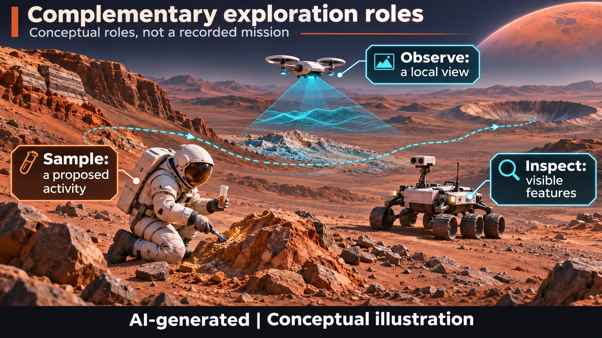

# Mars God's Eye: scientific foundations

Exploring a scientifically promising place requires a sequence of decisions. The team first interprets regional observations, chooses a question and identifies a suitable worksite. It then considers how to reach that site, what to observe, which agent should perform the work and how to preserve the resources required to return. New information can change any of those choices.

Mars God's Eye studies that sequence using public Martian terrain, heterogeneous agents and explicit mission constraints. Its central question is: under a declared terrain and resource model, when does additional reconnaissance improve the decisions available to an exploration team?

Figure H.1. Complementary roles in a conceptual exploration program. The generic landscape and work areas illustrate how a local view, inspection and proposed sampling activity can contribute to a mission question. [Full-size PNG](assets/imagegen-20261115/01-cooperative-exploration-reviewed.png).

## A first reading

Start with [the research question](01-Research-Question.md), follow [how orbital data become a mission map](03-Terrain-and-Scale.md), then examine [the recorded cases](08-Case-Studies.md). The [discussion](09-Discussion.md) connects the findings to the next scientific questions. This route provides a short overview; the intervening chapters develop the models and experimental reasoning.

The most useful distinction is between a scientific objective and the evidence needed to support a decision about that objective. A published outcrop study can motivate a station. A terrain model can help estimate access. A local observation can change a corridor's admissibility. A mission record can establish which actions occurred and what resources they consumed. Each contribution has a place in the explanation.

## The chapters

| Chapter | Question addressed |
|---|---|
| [1. Research question and scientific approach](01-Research-Question.md) | Why study reconnaissance together with mission resources? |
| [2. Jezero as a scientific setting](02-Jezero-Science.md) | Which geological questions justify the candidate sites? |
| [3. Terrain, information and scale](03-Terrain-and-Scale.md) | What does the map represent, and how large should the active window be? |
| [4. Agents and activities](04-Agents-and-Activities.md) | How do an EVA, a rover campaign and a drone sortie differ? |
| [5. Resource models](05-Resource-Models.md) | How are directed motion, stationary work, waiting and oxygen estimated? |
| [6. Mission decisions](06-Mission-Decisions.md) | How do observations, task precedence, return and reserves determine an action? |
| [7. Experimental method](07-Experimental-Method.md) | How can an experiment distinguish an information effect from a resource effect? |
| [8. Case studies](08-Case-Studies.md) | What do the retained local runs and the map-window comparison show? |
| [9. Discussion](09-Discussion.md) | Which conclusions follow, and which measurements would extend them? |

Each chapter begins with the intuition, introduces the quantities needed for the explanation and develops an example. Equations, figures and sources appear where they help the reader follow the argument. Animated figures also have [static alternatives](Reproducibility.md#reading-the-visual-material).

## Three findings to carry through the reading

Reconnaissance has a cost and a purpose. Its benefit is assessed through a decision that it informs: retaining a route, selecting an alternative, changing optional work or returning. An unchanged decision can also be an informative outcome.

Map scale should follow the scientific question and the itinerary. In the recorded Bunsen analytical example, two fixed planning requests produced identical geometry and costs on 512 m and 256 m windows. The smaller raster contains 75% fewer cells. That observation supports the smaller active window for those requests and leaves regional context useful for selecting other questions or sites.

Agent resources refer to different physical and operational quantities. Human energy is modeled metabolic expenditure, robot energy is modeled electrical consumption, and human oxygen uses a stated equivalent-gas convention. A rover work period and a human EVA therefore require separate activity schedules and budgets, even when they contribute to the same campaign.

## How to read the sources and results

The Wiki uses four complementary forms of support:

| Basis | Role in the argument |
|---|---|
| Published observation | Establishes a reported measurement and its scientific context. |
| Model formulation | Defines the calculation connecting declared inputs to estimates. |
| Experimental decision | Specifies the selected activities, coefficients, allocations and comparison. |
| Project result | Records the outcome for identified inputs, software and run. |

The [parameter and decision catalogue](Parameters-and-Decisions.md) places the approved compact scenario alongside later proposals and local analytical cases. The [bibliography](Bibliography.md) identifies primary papers, technical reports, data products and methodological references. The [reproduction guide](Reproducibility.md) links the explanatory graphics to their inputs and records.

This is the complete English documentation draft prepared for scientific audit on 15 November 2026. It describes the inspected project state and preserves the acceptance status of each underlying record. This publication edition makes the complete articles, marked media and supporting records available for owner review. The scientific audit and the team's final submission review retain their separate records.

## Supporting material

- [Glossary and notation](Glossary.md).
- [Parameters, scenarios and decisions](Parameters-and-Decisions.md).
- [Bibliography and source policy](Bibliography.md).
- [Reproduction and figure provenance](Reproducibility.md).
- [Publication integrity audit](audit/publication-report.json) and [original local editorial/asset audit](audit/report.json).

The [required AI-use declaration](../AI_USAGE.md) describes assistance used for the documentation and media. Generated illustrations, plots and every GIF frame carry a visible `AI-generated` mark. Existing scientific references retain their authorship and licences.

[Visual edition: selection and review](Editorial-Review.md).
